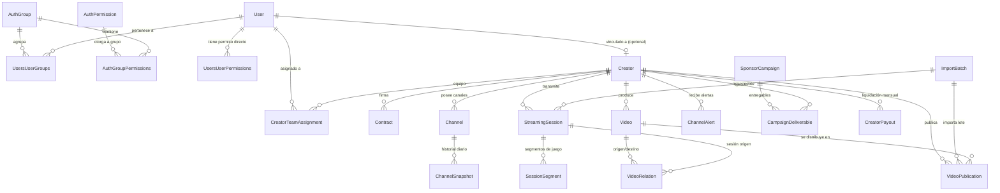

# Documentación Técnica del Sistema (DOCS)

Este documento describe en detalle la arquitectura, el modelo de dominio, la transición desde las migraciones antiguas ([`old-migrations/`](file:///home/diego/Proyectos/rrss-creators-analyzer/old-migrations)) y las decisiones de infraestructura de **RRSS Creators Analyzer**.

> [!NOTE]
> El esquema físico completo en SQLite 3 (DDL con tablas, restricciones `CHECK`, columnas generadas e índices) se encuentra en [`docs/schema.sql`](file:///home/diego/Proyectos/rrss-creators-analyzer/docs/schema.sql).

---

## 1. Visión General y Contexto del Negocio

**RRSS Creators Analyzer** es el sistema centralizado de inteligencia de negocios, auditoría y seguimiento de talento para una compañía o agencia de creadores de contenido y streamers. Permite a los directivos, managers, analistas, equipo financiero y a los propios creadores consultar el rendimiento operativo y financiero de canales en **Twitch**, **YouTube**, **Kick**, **TikTok**, **Instagram** y **X**.

### Decisiones Arquitectónicas Clave
1. **Sistema Single-Tenant (Única Compañía)**:
   - A diferencia del diseño original multi-tenant basado en PostgreSQL/Supabase con Row-Level Security (RLS) y `organization_id` en cada tabla, esta versión en Django opera para **una sola compañía**.
   - Se elimina toda la sobrecarga de tablas `organizations`, `organization_members` y el filtrado obligatorio por `organization_id` / `tenant_id`.
2. **Autorización mediante el Sistema Nativo de Permisos y Grupos de Django (`django.contrib.auth`)**:
   - No se acopla una columna `role` en el modelo `User`. Toda la gestión de roles y capacidades se delega a **`Group`** (`auth_group`), **`Permission`** (`auth_permission`), `users_user_groups` y `users_user_user_permissions` junto con permisos personalizados en `Meta.permissions`.
3. **Persistencia con SQLite en Modo WAL**:
   - Por restricciones en el entorno de despliegue, la base de datos de producción y desarrollo es **SQLite 3**.
   - Se configura con `journal_mode=WAL` (Write-Ahead Logging) para permitir lecturas concurrentes sin bloqueo durante las escrituras.
4. **Caché con DiskCache y Memoria**:
   - En lugar de requerir servidores externos de caché o vistas materializadas de PostgreSQL, el sistema emplea **`diskcache.DjangoCache`** (persistente en disco y seguro entre procesos) junto con caché en memoria para almacenar métricas precalculadas, rankings y resúmenes financieros.
5. **Maximización del Ecosistema Django**:
   - Uso intensivo del ORM de Django (`annotate`, `aggregate`, `Window`, `F`, `Q`, `Case/When`, `GeneratedField`), Class-Based Views (CBVs), `PermissionRequiredMixin`, `django-tables2`, `django-filter`, `django-crispy-forms`, `django-widget-tweaks` y **`django-formtools`** (para flujos asistidos y formularios en múltiples pasos / wizards).

---

## 2. Transición desde el Sistema Antiguo (`old-migrations/`)

Las migraciones del sistema anterior se conservan como referencia histórica en [`/old-migrations/`](file:///home/diego/Proyectos/rrss-creators-analyzer/old-migrations). A continuación se detalla cómo se mapea cada archivo SQL antiguo hacia la nueva arquitectura en Django:

| Archivo en `old-migrations/` | Propósito en el Sistema Antiguo | Adaptación en Django (Single-Tenant + SQLite) |
|---|---|---|
| [`20260904000001_initial_multi_tenant_schema.sql`](file:///home/diego/Proyectos/rrss-creators-analyzer/old-migrations/20260904000001_initial_multi_tenant_schema.sql) | Enums (`member_role`, `creator_status`, `platform_type`, etc.), tablas `organizations`, `profiles`, `organization_members`. | Los Enums de dominio pasan a ser subclases de `models.TextChoices`. Se descartan `organizations` y `organization_members`. `member_role` se migra íntegramente al sistema nativo de **Grupos y Permisos de Django** (`auth_group`, `auth_permission`). |
| [`20260904000002_creators_and_streaming_sessions.sql`](file:///home/diego/Proyectos/rrss-creators-analyzer/old-migrations/20260904000002_creators_and_streaming_sessions.sql) | Tablas `creators`, `channels`, `import_batches` y `streaming_sessions` (con columna generada `hours_streamed`). | Modelos `Creator`, `Channel` (app `creators`), `ImportBatch` (app `imports`) y `StreamingSession` (app `streams`). Se usa `models.GeneratedField` para `hours_streamed`, `total_earnings` y `earnings_per_hour`. Sin `organization_id`. |
| [`20260904000003_channel_alerts_and_strikes.sql`](file:///home/diego/Proyectos/rrss-creators-analyzer/old-migrations/20260904000003_channel_alerts_and_strikes.sql) | Tabla `channel_alerts` para strikes de DMCA, TOS, caídas de tráfico y anomalías. | Modelo `ChannelAlert` (app `alerts`) con historial de cambios (`HistoricalRecords` de `django-simple-history`). |
| [`20260904000004_rls_security_policies.sql`](file:///home/diego/Proyectos/rrss-creators-analyzer/old-migrations/20260904000004_rls_security_policies.sql) y [`0006`](file:///home/diego/Proyectos/rrss-creators-analyzer/old-migrations/20260904000006_fix_organization_creation_rls.sql) | Políticas RLS en PostgreSQL (`is_org_admin`, `get_user_creator_ids`). | Reemplazado por el sistema de permisos de Django (`user.has_perm(...)`, `PermissionRequiredMixin`) y filtrado en la capa `Selector` (si el usuario tiene el permiso `creators.view_all_creators` o `streams.view_all_sessions` ve todo el catálogo; de lo contrario, solo ve los registros vinculados a su `creator_profile`). |
| [`20260904000005_published_videos...`](file:///home/diego/Proyectos/rrss-creators-analyzer/old-migrations/20260904000005_published_videos_and_materialized_views.sql) y [`0007_refactor_video_schema_three_entities.sql`](file:///home/diego/Proyectos/rrss-creators-analyzer/old-migrations/20260904000007_refactor_video_schema_three_entities.sql) | Refactorización de videos en 3 entidades: `videos`, `video_publications` y `video_relations`. | Modelos `Video`, `VideoPublication` y `VideoRelation` (app `videos`), usando `TaggableManager` (`django-taggit`) para `tags` en lugar de `TEXT[]` de PostgreSQL, y `CheckConstraint` en `VideoRelation`. |
| [`20260904000008_materialized_and_sql_views...`](file:///home/diego/Proyectos/rrss-creators-analyzer/old-migrations/20260904000008_materialized_and_sql_views_with_triggers.sql), [`0009`](file:///home/diego/Proyectos/rrss-creators-analyzer/old-migrations/20260904000009_secure_views_revoke_mv_and_pg_cron.sql) y [`0010`](file:///home/diego/Proyectos/rrss-creators-analyzer/old-migrations/20260904000010_enforce_strict_multitenant_view_isolation.sql) | Vistas materializadas (`mv_*`), vistas SQL (`v_*`) y triggers de refresco concurrente en PostgreSQL. | Como SQLite no soporta `MATERIALIZED VIEW`, se definen vistas SQL estándar (`CREATE VIEW`) en [`docs/schema.sql`](file:///home/diego/Proyectos/rrss-creators-analyzer/docs/schema.sql) y consultas en **`AnalyticsSelector`** mediante el ORM de Django (`annotate`, `Window(expression=DenseRank())`, `TruncDay`, `TruncMonth`) cuyos resultados se almacenan en **`DiskCache`** con invalidación explícita desde la capa `Service`. |

---

## 3. Sistema de Grupos y Permisos Nativos de Django

En lugar de almacenar roles rígidos en una columna de la tabla de usuarios, se utilizan las tablas estándar de `django.contrib.auth`:
- `django_content_type`
- `auth_permission`
- `auth_group`
- `auth_group_permissions`
- `users_user_groups`
- `users_user_user_permissions`

### 3.1 Grupos Predefinidos (`auth_group`)
1. **`Company Admin`**: Administración integral de la agencia, configuración global, contratos y usuarios.
2. **`Manager`**: Gestión operativa del roster de creadores, canales, sesiones de streaming, videos, publicaciones y resolución de alertas.
3. **`Analyst`**: Acceso de lectura global a todas las métricas, importación de lotes CSV/XLSX y exportación de reportes.
4. **`Finance`**: Gestión de contratos (`Contract`), campañas de patrocinio (`SponsorCampaign`) y liquidaciones mensuales (`CreatorPayout`).
5. **`Creator`**: Permisos de lectura sobre el módulo pero sin los permisos globales `view_all_*`, por lo que los `Selectors` restringen automáticamente su vista a los registros donde `creator__user=user`.

### 3.2 Permisos Personalizados del Dominio (`Meta.permissions`)
Además de los permisos CRUD automáticos de Django (`add_<model>`, `change_<model>`, `delete_<model>`, `view_<model>`), los modelos declaran permisos de alcance y negocio:
- `creators.view_all_creators`: Ver todos los creadores de la compañía (si no lo posee, solo ve su propio perfil de creador).
- `creators.manage_contracts`: Gestionar contratos, cuotas y porcentajes de *revenue split*.
- `streams.view_all_sessions`: Ver las sesiones de streaming de todos los creadores.
- `streams.export_sessions`: Exportar tablas de sesiones a CSV/XLSX.
- `videos.view_all_videos`: Ver los videos y publicaciones de todos los creadores.
- `videos.view_production_costs`: Visualizar costos de producción, beneficio neto y ROI.
- `alerts.view_all_alerts`: Ver las alertas y strikes de todos los canales.
- `alerts.resolve_channel_alert`: Marcar alertas/strikes como resueltos o apelados.
- `analytics.view_company_dashboard`: Ver el dashboard consolidado y el ranking global de la compañía.
- `analytics.refresh_analytics_cache`: Invalidar y recalcular manualmente el caché analítico en `DiskCache`.

---

## 4. Modelo de Dominio Detallado

### 4.1 Diagrama Entidad-Relación (ER)

### 4.2 Especificación de Módulos (Ver [`docs/schema.sql`](file:///home/diego/Proyectos/rrss-creators-analyzer/docs/schema.sql))

1. **App `users` y `core`**:
   - `User` (`users_user`): Identidad, credenciales, `name`, `avatar_url`, `phone`, `timezone` y relación M2M con `Group` y `Permission`.
   - `CompanySettings` (`core_company_settings`): Configuración singleton de la compañía (nombre legal, moneda base, splits por defecto).
2. **App `creators`**:
   - `Creator` (`creators_creator`): Datos del talento, `handle`, `tier` (`rookie`, `standard`, `partner`, `elite`, `ambassador`), `primary_platform` y `status`.
   - `CreatorTeamAssignment` (`creators_team_assignment`): Asignación de managers, editores, diseñadores de miniaturas y analistas a cada creador.
   - `Contract` (`creators_contract`): Vigencia, *retainer* mensual, porcentajes de reparto (*revenue split*) para streams, videos y patrocinios, y metas mensuales de horas/videos/shorts.
   - `Channel` (`creators_channel`) y `ChannelSnapshot` (`creators_channel_snapshot`): Canales por plataforma y serie histórica diaria de seguidores/suscriptores/vistas.
3. **App `streams`**:
   - `StreamingSession` (`streams_streaming_session`) y `SessionSegment` (`streams_session_segment`): Registro de transmisiones con columnas generadas (`hours_streamed`, `total_earnings`, `earnings_per_hour`) y segmentos por categoría.
4. **App `videos`**:
   - `Video` (`videos_video`): Activo maestro con flujo editorial (`idea` -> `published`) y costos de producción/edición/miniatura (`total_production_cost`).
   - `VideoPublication` (`videos_video_publication`): Métricas por plataforma (`views_count`, `impressions_count`, `click_through_rate`, `retention_rate_pct`, `estimated_revenue`, `rpm_estimated`).
   - `VideoRelation` (`videos_video_relation`): Trazabilidad entre videos y sesiones en vivo.
5. **App `alerts`**:
   - `ChannelAlert` (`alerts_channel_alert`): Strikes DMCA, violaciones TOS, desmonetizaciones, caídas de CCV y cumplimiento de cuotas.
6. **App `imports`**:
   - `ImportBatch` (`imports_import_batch`): Auditoría de importaciones masivas con `django-import-export`.
7. **Apps de Finanzas y Campañas (`campaigns` y `payouts`)**:
   - `SponsorCampaign` y `CampaignDeliverable`: Campañas con marcas y entregables vinculados a streams o publicaciones.
   - `CreatorPayout`: Liquidaciones financieras mensuales por creador.

---

## 5. Estrategia de Formularios en Múltiples Pasos (`django-formtools`)

Para operaciones complejas que requieren capturar información relacionada en etapas secuenciales, la plataforma utiliza **`django-formtools`** (`SessionWizardView`). Esto evita formularios monolíticos difíciles de mantener y garantiza la integridad de los datos en la sesión antes de persistir:

1. **Alta Guiada e Incorporación de Creadores (`creators` / `contracts`)**:
   - *Paso 1 (Perfil de Talento)*: Datos personales, nombre público, handle, tier y plataforma primaria.
   - *Paso 2 (Canales y Conectores)*: Configuración de canales en Twitch, YouTube, Kick y TikTok.
   - *Paso 3 (Contrato Inicial y Split de Ingresos)*: Definición de retainers fijos, porcentajes de reparto por publicidad, suscripciones y patrocinio, junto con metas mensuales de horas de streaming y publicaciones.
2. **Creación y Asignación de Campañas de Patrocinio (`campaigns`)**:
   - *Paso 1 (Datos de Marca y Campaña)*: Nombre del patrocinador, presupuesto total, fechas de vigencia y directrices de marca.
   - *Paso 2 (Selección del Roster)*: Convocatoria de creadores participantes según nicho y audiencia.
   - *Paso 3 (Asignación de Entregables)*: Distribución de sesiones patrocinadas, menciones en vivo, videos dedicados y publicaciones en redes con plazos de entrega.
3. **Cierre de Liquidaciones Financieras Mensuales (`payouts`)**:
   - *Paso 1 (Selección de Periodo y Filtros)*: Mes fiscal y alcance de creadores a liquidar.
   - *Paso 2 (Auditoría de Ingresos y Costos)*: Consolidación de ingresos por streaming, vistas de video y marcas, descontando retenciones, costos de edición y comisiones de agencia.
   - *Paso 3 (Aprobación y Cierre)*: Aprobación por la dirección financiera, generación de extractos y marcado de transacciones como liquidadas.
4. **Asistente de Ingesta Masiva Asistida (`imports`)**:
   - *Paso 1 (Carga de Archivo)*: Subida del archivo CSV/XLSX y selección de la entidad de destino (`StreamingSession` o `VideoPublication`).
   - *Paso 2 (Mapeo de Columnas)*: Asociación asistida de encabezados externos a los campos del modelo.
   - *Paso 3 (Validación y Commit)*: Simulación previa (dry-run) reportando filas con errores de validación antes de confirmar la inserción definitiva en la base de datos.
