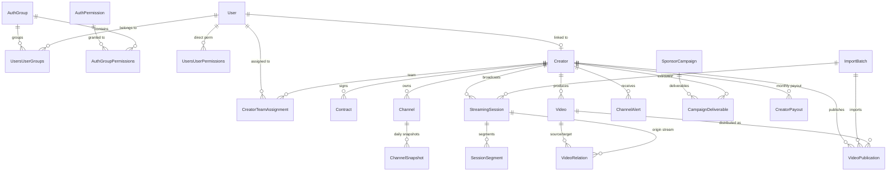

# System Technical Documentation (DOCS)

This document details the architecture, domain model, legacy SQL migration mapping ([`old-migrations/`](file:///home/diego/Proyectos/rrss-creators-analyzer/old-migrations)), RBAC authorization, and multi-step workflows for **RRSS Creators Analyzer**.

> [!NOTE]
> The reference physical SQL DDL (tables, `CHECK` constraints, generated columns, and indexes) is located in [`docs/schema.sql`](file:///home/diego/Proyectos/rrss-creators-analyzer/docs/schema.sql).

---

## 1. Overview & Business Context

**RRSS Creators Analyzer** is a centralized business intelligence, operational auditing, and talent management platform for a content creator agency. It enables company administrators, talent managers, analysts, finance teams, editors, and creators to track operational and financial metrics across **Twitch**, **YouTube**, **Kick**, **TikTok**, **Instagram**, and **X**.

### Key Architectural Decisions
1. **Single-Tenant System (Single Agency)**:
   - Replaces the legacy multi-tenant PostgreSQL/Supabase Row-Level Security (RLS) model (`organizations`, `organization_members`, `organization_id`) with a single-company Django deployment.
2. **Native Django Groups & Permissions (`django.contrib.auth`)**:
   - No hardcoded `role` column on `User`. Access control uses `Group` (`RoleGroupProfile`), `Permission` (`Meta.permissions`), and permission checks (`user.has_perm(...)`, `PermissionRequiredMixin`).
3. **Database & Cache Portability**:
   - **Production**: **PostgreSQL 16+** via `psycopg` 3 (`ATOMIC_REQUESTS = True`) and **Redis 7+** via `django-redis` + Celery / Celery Beat.
   - **Local Development & Tests**: **SQLite 3** (WAL mode) and **`diskcache.DjangoCache`** / `LocMemCache` with `CELERY_TASK_ALWAYS_EAGER = True`.
4. **Django Ecosystem Leverage**:
   - Uses Django ORM (`annotate`, `aggregate`, `Window`, `F`, `Q`, `Case/When`, `GeneratedField`), CBVs, `django-tables2`, `django-filter`, `django-crispy-forms`, `django-widget-tweaks`, and **`django-formtools`** (`SessionWizardView`).

---

## 2. Mapping from Legacy SQL Migrations (`old-migrations/`)

| Legacy SQL File | Legacy Purpose | Django Single-Tenant Adaptation |
|---|---|---|
| [`20260904000001_initial_multi_tenant_schema.sql`](file:///home/diego/Proyectos/rrss-creators-analyzer/old-migrations/20260904000001_initial_multi_tenant_schema.sql) | Enums (`member_role`, `creator_status`, `platform_type`), `organizations`, `profiles`, `organization_members` | Enums converted to `models.TextChoices`. `organizations` and `organization_members` removed. `member_role` mapped to Django `Group` and `Permission`. |
| [`20260904000002_creators_and_streaming_sessions.sql`](file:///home/diego/Proyectos/rrss-creators-analyzer/old-migrations/20260904000002_creators_and_streaming_sessions.sql) | `creators`, `channels`, `import_batches`, `streaming_sessions` | `Creator`, `Channel` (`creators`), `ImportBatch` (`imports`), `StreamingSession` (`streams`) with `models.GeneratedField` (`hours_streamed`, `total_earnings`, `earnings_per_hour`). |
| [`20260904000003_channel_alerts_and_strikes.sql`](file:///home/diego/Proyectos/rrss-creators-analyzer/old-migrations/20260904000003_channel_alerts_and_strikes.sql) | `channel_alerts` for DMCA strikes, ToS violations, and anomalies | `ChannelAlert` (`alerts`) with `HistoricalRecords` (`django-simple-history`). |
| [`20260904000004_rls_security_policies.sql`](file:///home/diego/Proyectos/rrss-creators-analyzer/old-migrations/20260904000004_rls_security_policies.sql) & [`0006`](file:///home/diego/Proyectos/rrss-creators-analyzer/old-migrations/20260904000006_fix_organization_creation_rls.sql) | PostgreSQL RLS policies (`is_org_admin`, `get_user_creator_ids`) | Replaced by Django permissions (`view_all_*`) and role-scoped `Selectors` (`creator__user=user`). |
| [`20260904000005_published_videos...`](file:///home/diego/Proyectos/rrss-creators-analyzer/old-migrations/20260904000005_published_videos_and_materialized_views.sql) & [`0007`](file:///home/diego/Proyectos/rrss-creators-analyzer/old-migrations/20260904000007_refactor_video_schema_three_entities.sql) | 3-entity video model (`videos`, `video_publications`, `video_relations`) | `Video`, `VideoPublication`, `VideoRelation` (`videos`) using `TaggableManager` (`django-taggit`) and DB `CheckConstraint`. |
| [`20260904000008`](file:///home/diego/Proyectos/rrss-creators-analyzer/old-migrations/20260904000008_materialized_and_sql_views_with_triggers.sql), [`0009`](file:///home/diego/Proyectos/rrss-creators-analyzer/old-migrations/20260904000009_secure_views_revoke_mv_and_pg_cron.sql), [`0010`](file:///home/diego/Proyectos/rrss-creators-analyzer/old-migrations/20260904000010_enforce_strict_multitenant_view_isolation.sql) | Materialized views (`mv_*`), SQL views (`v_*`), refresh triggers | Replaced by `AnalyticsSelector` ORM aggregations (`annotate`, `Window(DenseRank())`, `TruncDay`, `TruncMonth`) cached in Redis/DiskCache with explicit invalidation in `Services`. |

---

## 3. Native Django RBAC (`auth_group` & `auth_permission`)

### 3.1 Default Groups
1. **`Company Admin`**: Full agency administration, global settings, contracts, users, and audit access.
2. **`Manager`**: Operational management of creators, channels, streams, videos, schedules, and alert resolution.
3. **`Analyst`**: Global read access to metrics, bulk imports, and report exports.
4. **`Finance`**: Contract management, sponsor campaigns, and monthly creator payouts.
5. **`Creator`**: Read access scoped to records where `creator__user = user` (no `view_all_*` permissions).

### 3.2 Custom Domain Permissions (`Meta.permissions`)
- `creators.view_all_creators` / `creators.manage_contracts`
- `streams.view_all_sessions` / `streams.export_sessions`
- `videos.view_all_videos` / `videos.view_production_costs`
- `alerts.view_all_alerts` / `alerts.resolve_channel_alert`
- `analytics.view_company_dashboard` / `analytics.refresh_analytics_cache`

---

## 4. Domain Model

### 4.1 Entity-Relationship Diagram

### 4.2 Module Summary
1. **`users`, `permissions`, `members`, `core`**: `User`, `RoleGroupProfile`, `MemberInvitation`, `CreatorTeamAssignment`, `CompanySettings`, and demo tracking (`DemoBaselineRecord`).
2. **`creators`, `contracts`, `schedules`**: `Creator`, `CreatorPersonalInfo`, `Channel`, `ChannelSnapshot`, `Contract`, `CreatorSchedulePattern`, `CreatorScheduleSlot`, `ScheduleException`, `CreatorScheduleComplianceSummary`.
3. **`streams`**: `StreamingSession` and `SessionSegment` with generated duration/earnings fields.
4. **`videos`, `editors`**: `Video`, `VideoPublication`, `VideoRelation`, `Editor`, `EditorAssignment`, `EditingTask`, `TaskRevision`.
5. **`campaigns`, `payouts`, `alerts`**: `SponsorCampaign`, `CampaignDeliverable`, `CreatorPayout`, `ChannelAlert`.
6. **`imports`, `exports`, `analytics`, `audit`, `logs`, `monitor`, `backups`**: `ImportBatch`, `ExportJob`, `AnalyticsSnapshot`, audit logs, application logs, health checks, and backups.

---

## 5. Multi-Step Wizards (`django-formtools`)

Complex sequential workflows use `SessionWizardView` to isolate step validation and keep intermediate state server-side until atomic persistence in `done()`:

1. **Creator Onboarding (`creators` / `contracts`)**: Profile info -> Platform channels -> Initial contract, quotas, and revenue splits.
2. **Campaign Setup (`campaigns`)**: Brand & budget -> Creator roster selection -> Deliverable schedule.
3. **Monthly Payout Closing (`payouts`)**: Period & creator scope -> Revenue/cost audit -> Financial approval & settlement.
4. **Assisted Bulk Import (`imports`)**: File upload (CSV/XLSX) -> Interactive column mapping -> Dry-run validation & commit.
