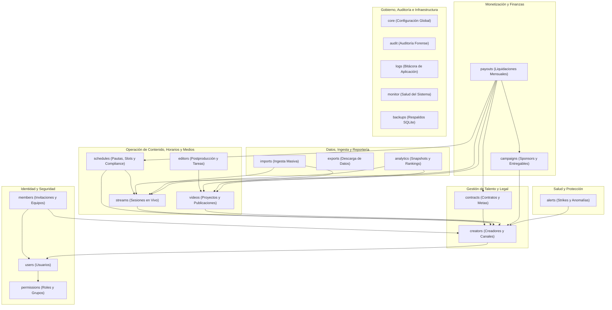

# Sistema RRSS Creators Analyzer — Catálogo de Requerimientos del Sistema

## 1. Introducción y Propósito

El sistema **RRSS Creators Analyzer** es una plataforma integral de gestión de talento digital, análisis multicanal, postproducción audiovisual y liquidación financiera diseñada específicamente para agencias de representación, productoras de contenido y redes de creadores (*streamers*, *youtubers*, *tiktokers* e *influencers*).

La plataforma resuelve la complejidad operativa que enfrentan las agencias al gestionar simultáneamente múltiples plataformas (Twitch, YouTube, Kick, TikTok, Instagram, X), contratos con diferentes esquemas de participación en ingresos (*revenue splits* y *retainers*), equipos de postproducción distribuidos (editores, miniaturistas, coloristas), campañas publicitarias de marcas comerciales y alertas críticas de canal (strikes de DMCA, TOS y caídas inusuales de métricas).

---

## 2. Mapa Integral de Módulos y Arquitectura del Dominio

El sistema se compone de 20 aplicaciones modulares estructuradas en la arquitectura de Django, coordinadas a nivel de base de datos relacional (con soporte óptimo de SQLite en modo WAL y vistas analíticas) y tareas asíncronas con Celery:

---

## 3. Matriz de Actores del Sistema

| Actor | Código | Descripción del Rol y Atribuciones |
|---|---|---|
| **Company Administrator** | `ACT-ADM` | Director o administrador general de la agencia. Acceso irrestricto a configuraciones corporativas, contratos, auditoría forense, asignaciones y backups. |
| **Talent Manager** | `ACT-MGR` | Responsable operativo de un portafolio de creadores. Supervisa canales, metas, transmisiones, proyectos de video y coordina al equipo asignado. |
| **Financial Director** | `ACT-FIN` | Gestor del área contable. Valida contratos, gestiona campañas con sponsors, audita costes de edición y aprueba las liquidaciones mensuales (*payouts*). |
| **Business Analyst** | `ACT-ANA` | Especialista en métricas. Realiza importaciones masivas de datos de plataformas, construye informes de rendimiento y analiza rankings y RPMs. |
| **Creator / Talent** | `ACT-TAL` | Creador representado. Accede exclusivamente a su propio panel de control, estado de metas, métricas de sus canales y resúmenes de liquidación. |
| **Video Editor / Studio** | `ACT-EDT` | Editor de video o diseñador de miniaturas (in-house o freelance). Gestiona sus tareas asignadas, sube avances de corte y atiende revisiones. |
| **System Auditor** | `ACT-AUD` | Perfil de cumplimiento y seguridad. Audita trazas de auditoría (`auditlog`), eventos de seguridad, cambios de permisos y descargas de datos. |

---

## 4. Estructura y Taxonomía de la Documentación

La suite de requerimientos se encuentra organizada en los siguientes documentos especializados:

1. **[`01_MODULO_USUARIOS_ROLES_Y_PERMISOS.md`](file:///home/diego/Proyectos/rrss-creators-analyzer/docs/requeriments/01_MODULO_USUARIOS_ROLES_Y_PERMISOS.md)**:
   - Apps: `users`, `permissions`, `members`
   - Modelos: `User`, `RoleGroupProfile`, `MemberInvitation`, `CreatorTeamAssignment`
2. **[`02_MODULO_CREADORES_CANALES_Y_CONTRATOS.md`](file:///home/diego/Proyectos/rrss-creators-analyzer/docs/requeriments/02_MODULO_CREADORES_CANALES_Y_CONTRATOS.md)**:
   - Apps: `creators`, `contracts`
   - Modelos: `Creator`, `CreatorPersonalInfo`, `Channel`, `ChannelSnapshot`, `Contract`
3. **[`03_MODULO_STREAMS_Y_TRANSMISIONES.md`](file:///home/diego/Proyectos/rrss-creators-analyzer/docs/requeriments/03_MODULO_STREAMS_Y_TRANSMISIONES.md)**:
   - App: `streams`
   - Modelos: `StreamingSession`, `SessionSegment`
4. **[`04_MODULO_VIDEOS_PUBLICACIONES_Y_RELACIONES.md`](file:///home/diego/Proyectos/rrss-creators-analyzer/docs/requeriments/04_MODULO_VIDEOS_PUBLICACIONES_Y_RELACIONES.md)**:
   - App: `videos`
   - Modelos: `Video`, `VideoPublication`, `VideoRelation`
5. **[`05_MODULO_EDITORES_Y_GESTION_DE_TAREAS.md`](file:///home/diego/Proyectos/rrss-creators-analyzer/docs/requeriments/05_MODULO_EDITORES_Y_GESTION_DE_TAREAS.md)**:
   - App: `editors`
   - Modelos: `Editor`, `EditorAssignment`, `EditingTask`, `TaskRevision`
6. **[`06_MODULO_CAMPANAS_Y_PATROCINIOS.md`](file:///home/diego/Proyectos/rrss-creators-analyzer/docs/requeriments/06_MODULO_CAMPANAS_Y_PATROCINIOS.md)**:
   - App: `campaigns`
   - Modelos: `SponsorCampaign`, `CampaignDeliverable`
7. **[`07_MODULO_ALERTAS_Y_SALUD_DEL_CANAL.md`](file:///home/diego/Proyectos/rrss-creators-analyzer/docs/requeriments/07_MODULO_ALERTAS_Y_SALUD_DEL_CANAL.md)**:
   - App: `alerts`
   - Modelos: `ChannelAlert`
8. **[`08_MODULO_LIQUIDACIONES_FINANCIERAS_PAYOUTS.md`](file:///home/diego/Proyectos/rrss-creators-analyzer/docs/requeriments/08_MODULO_LIQUIDACIONES_FINANCIERAS_PAYOUTS.md)**:
   - App: `payouts`
   - Modelos: `CreatorPayout`
9. **[`09_MODULO_IMPORTACIONES_EXPORTACIONES_Y_ANALYTICS.md`](file:///home/diego/Proyectos/rrss-creators-analyzer/docs/requeriments/09_MODULO_IMPORTACIONES_EXPORTACIONES_Y_ANALYTICS.md)**:
   - Apps: `imports`, `exports`, `analytics`
   - Modelos: `ImportBatch`, `ExportJob`, `AnalyticsSnapshot`, Vistas SQL
10. **[`10_MODULO_SISTEMA_AUDITORIA_LOGS_MONITOR_Y_BACKUPS.md`](file:///home/diego/Proyectos/rrss-creators-analyzer/docs/requeriments/10_MODULO_SISTEMA_AUDITORIA_LOGS_MONITOR_Y_BACKUPS.md)**:
    - Apps: `core`, `audit`, `logs`, `monitor`, `backups`
    - Modelos: `CompanySettings`, `AuditEvent`, `ApplicationLogEntry`, `InstanceHealthCheck`, `DatabaseBackup`
11. **[`11_MATRIZ_TRAZABILIDAD_Y_REGLAS_DE_NEGOCIO_GLOBALES.md`](file:///home/diego/Proyectos/rrss-creators-analyzer/docs/requeriments/11_MATRIZ_TRAZABILIDAD_Y_REGLAS_DE_NEGOCIO_GLOBALES.md)**:
    - Matriz de Trazabilidad Total Cruzada (Casos de Uso vs Modelos vs Roles vs Reglas).
    - Compendio Unificado de Reglas de Negocio Globales.
    - Directrices Técnicas de Concurrencia e Integridad.
12. **[`12_MODULO_SCHEDULES_Y_CUMPLIMIENTO_DE_TRANSMISIONES.md`](file:///home/diego/Proyectos/rrss-creators-analyzer/docs/requeriments/12_MODULO_SCHEDULES_Y_CUMPLIMIENTO_DE_TRANSMISIONES.md)**:
    - App: `schedules`
    - Modelos: `CreatorWeeklySchedule`, `CreatorScheduleSlot`, `ScheduleException`, `CreatorScheduleComplianceSummary`

---

## 5. Convención de Nomenclatura Estándar

- **Casos de Uso**: `CU-<MÓDULO>-<NÚMERO>` (ej. `CU-CRE-01`, `CU-PAY-03`, `CU-SCH-01`).
- **Reglas de Negocio**: `RN-<DOMINIO>-<NÚMERO>` (ej. `RN-SEC-002`, `RN-PAY-003`, `RN-SCH-001`).
- **Modelos de Base de Datos**: Notación CamelCase del modelo de Django (`StreamingSession`, `CreatorScheduleSlot`).
- **Estados y Enumeradores**: Valores literales definidos en `TextChoices` (`active`, `scheduled`, `completed`, `late`, `missed`).
