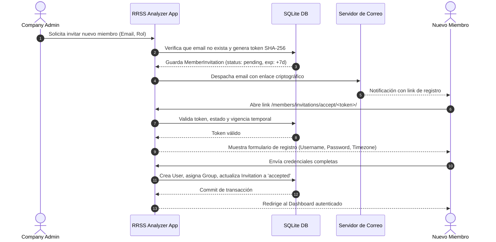
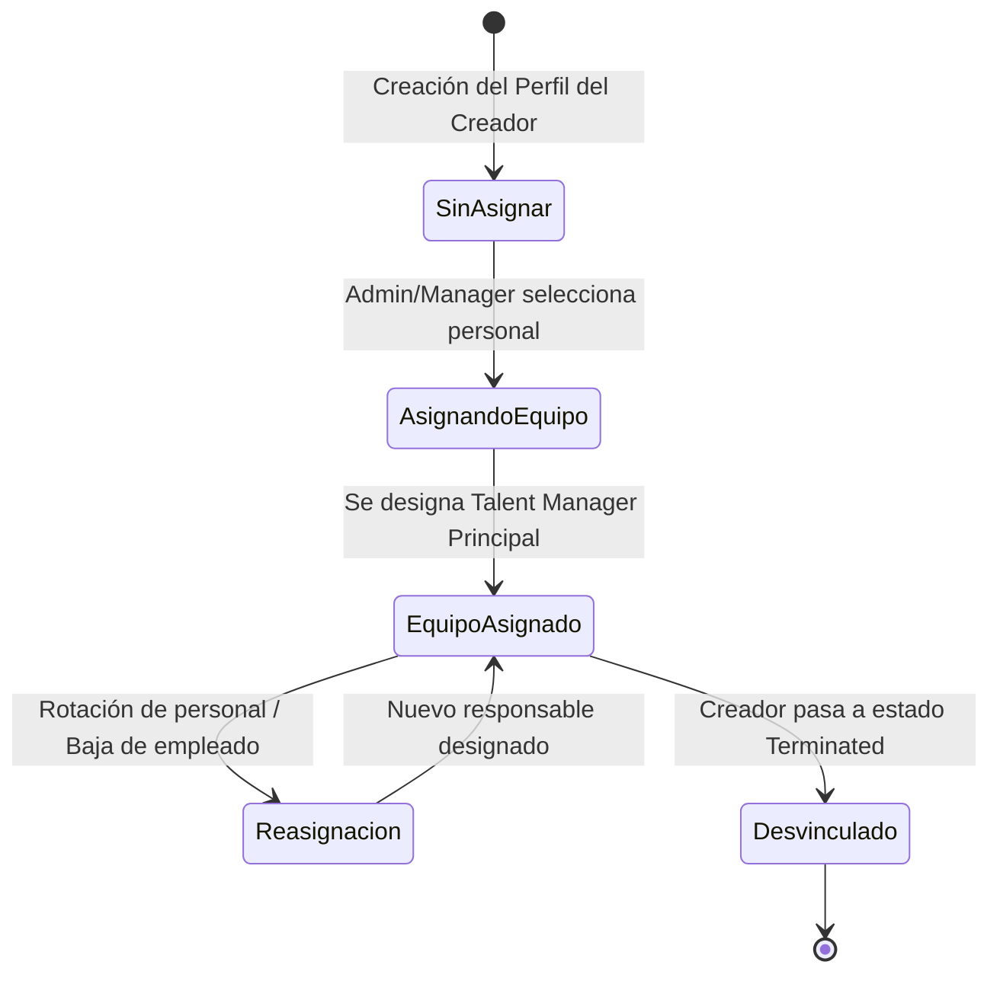

# Módulo 01 — Usuarios, Roles, Permisos y Equipos

## 1. Alcance y Modelos de Datos

Este módulo gestiona la identidad, el control de acceso basado en roles (RBAC), el aislamiento de información mediante selectores (RLS a nivel de aplicación), las invitaciones corporativas y la conformación de equipos de trabajo asignados a cada creador.

### Modelos de Base de Datos Involucrados:
- [`User`](file:///home/diego/Proyectos/rrss-creators-analyzer/rrss_creatos_analyzer/apps/users/models.py) (`users_user`): Identidad, correo corporativo, teléfono, avatar, zona horaria y banderas de estado.
- [`RoleGroupProfile`](file:///home/diego/Proyectos/rrss-creators-analyzer/rrss_creatos_analyzer/apps/permissions/models.py) (`permissions_rolegroupprofile`): Extensión del grupo nativo de Django (`auth_group`) con color de insignia UI, descripción y bandera de rol del sistema.
- [`MemberInvitation`](file:///home/diego/Proyectos/rrss-creators-analyzer/rrss_creatos_analyzer/apps/members/models.py) (`members_memberinvitation`): Tokens criptográficos seguros de invitación por correo electrónico, caducidad y grupo destino.
- [`CreatorTeamAssignment`](file:///home/diego/Proyectos/rrss-creators-analyzer/rrss_creatos_analyzer/apps/members/models.py) (`members_creatorteamassignment`): Vínculo de responsabilidad operativa entre un usuario interno y un creador del roster.

---

## 2. Reglas de Negocio del Módulo (RN-SEC)

### RN-SEC-001: Unicidad y Validación de Correo Electrónico
- Todo usuario del sistema debe poseer un correo electrónico único y válido.
- El correo electrónico se utiliza como identificador de login principal o secundario junto con el `username`.
- No se permiten cuentas duplicadas activas con la misma dirección.

### RN-SEC-002: Ciclo de Vida y Expiración de Invitaciones
- Las invitaciones a nuevos miembros (`MemberInvitation`) se generan con un token pseudoaleatorio de 64 caracteres criptográficamente seguro (`secrets.token_urlsafe(48)`).
- Cada invitación tiene una vigencia predeterminada de 7 días naturales (`expires_at = now + 7 days`).
- Si una invitación no es aceptada antes de `expires_at`, pasa automáticamente a estado `expired` y el enlace queda invalidado.
- Una invitación solo puede ser utilizada una única vez (`status = accepted`).

### RN-SEC-003: Principio de Mínimo Privilegio y Matriz de Roles
- El acceso se rige estrictamente por los grupos del sistema:
  1. **Company Admin**: Control total de la instancia, gestión de contratos, backups y roles.
  2. **Manager**: Gestión de perfiles de creador, canales, videos, sesiones y alertas asignadas.
  3. **Finance**: Aprobación de contratos, presupuestos de campañas y autorización de payouts.
  4. **Analyst**: Carga masiva de datos, exportaciones y tableros analíticos (solo lectura en contratos).
  5. **Creator**: Acceso confinado única y exclusivamente a los datos donde `creator__user = request.user`.
  6. **Video Editor**: Acceso confinado a tareas de edición asignadas y entregas.

### RN-SEC-004: Aislamiento Multitenant Lógico (Row-Level Security por Selectors)
- Ninguna vista o selector debe permitir a un usuario con rol `Creator` o `Editor` listar registros ajenos.
- Si el usuario carece del permiso `creators.view_all_creators` o `streams.view_all_sessions`, los QuerySets deben ser forzadamente filtrados por `user = request.user` o `creator__user = request.user`.

### RN-SEC-005: Asignación Obligatoria de Talent Manager
- Todo creador activo en el sistema debe tener asignado al menos un usuario con rol de `Talent Manager` en `CreatorTeamAssignment`.
- Solo puede existir un único miembro marcado como `is_primary = True` para cada tipo de responsabilidad (`TeamResponsibility`) en un creador específico.

### RN-SEC-006: Protección del Superadministrador
- El sistema no permitirá que el último usuario activo perteneciente al grupo `Company Admin` sea eliminado, desactivado o despojado de dicho grupo, evitando el bloqueo administrativo de la plataforma.

### RN-SEC-007: Trazabilidad y Auditoría de Privilegios
- Toda asignación de grupos, concesión o revocación de permisos debe quedar registrada de forma indeleble en `AuditEvent` con ID del usuario emisor, fecha, IP y user-agent.

---

## 3. Casos de Uso del Módulo

### CU-USR-01: Invitar Nuevo Miembro a la Plataforma
- **Actor Primario**: Company Admin (`ACT-ADM`).
- **Precondiciones**: El administrador ha iniciado sesión y posee el permiso `members.add_memberinvitation`.
- **Disparador**: Necesidad de incorporar un nuevo empleado, manager, analista o talento a la agencia.
- **Flujo Principal**:
  1. El administrador navega a la sección de **Gestión de Miembros > Enviar Invitación**.
  2. El sistema despliega el formulario solicitando: Correo electrónico, Nombre completo del invitado, Rol/Grupo destino (`auth_group`) y notas opcionales.
  3. El administrador completa los datos y confirma el envío.
  4. El sistema valida que el correo no pertenezca a un usuario ya registrado activo y que no exista una invitación pendiente vigente para ese correo.
  5. El sistema genera el registro `MemberInvitation` con un token único y fecha de expiración calculada (`now + 7 días`).
  6. El sistema envía un correo electrónico al destinatario con el enlace único de registro.
  7. El sistema registra el evento en la bitácora de auditoría.
- **Flujos Alternativos**:
  - *4a. El correo ya está registrado en el sistema*: El sistema detiene el proceso y muestra el mensaje "Ya existe un usuario con este correo electrónico".
  - *4b. Ya existe una invitación pendiente para ese correo*: El sistema ofrece la opción de "Reenviar invitación existente" recalculando la fecha de expiración.
- **Postcondiciones**: La invitación queda almacenada en estado `pending` y el enlace está habilitado para su consumo.

---

### CU-USR-02: Aceptar Invitación y Completar Registro
- **Actor Primario**: Usuario Invitado (`ACT-MGR`, `ACT-ANA`, `ACT-FIN`, `ACT-TAL`, `ACT-EDT`).
- **Precondiciones**: El usuario dispone de un enlace de invitación válido recibido por correo electrónico.
- **Disparador**: El usuario hace clic en el enlace de invitación.
- **Flujo Principal**:
  1. El usuario accede a la URL `/members/invitations/accept/<token>/`.
  2. El sistema valida el token: comprueba que exista, que su estado sea `pending` y que `expires_at > now()`.
  3. El sistema muestra la pantalla de registro con el correo precargado y bloqueado para edición.
  4. El usuario ingresa: Nombre de usuario (`username`), Nombre completo, Contraseña segura (confirmada), Número de teléfono y Zona horaria preferida.
  5. El usuario envía el formulario.
  6. El sistema crea la entidad `User`, aplica el hash a la contraseña (`PBKDF2/Argon2`) y lo añade al `auth_group` definido en la invitación.
  7. El sistema actualiza `MemberInvitation`: `status = accepted`, `accepted_at = now()`.
  8. Si el rol destino es `Creator` o `Editor`, el sistema crea el perfil base correspondiente vinculado al `User`.
  9. El sistema inicia la sesión del usuario y lo redirige a su panel principal de bienvenida.
- **Flujos Alternativos**:
  - *2a. El token ha expirado*: El sistema muestra una alerta informando que el enlace ha caducado y ofrece solicitar un nuevo envío al administrador.
  - *2b. El token ya fue consumido*: El sistema muestra un mensaje indicando que la invitación ya fue aceptada e invita a iniciar sesión.
- **Postcondiciones**: El usuario queda registrado, autenticado y con los privilegios asignados listos para operar.

---

### CU-USR-03: Asignar y Revocar Roles a Usuarios
- **Actor Primario**: Company Admin (`ACT-ADM`).
- **Precondiciones**: El administrador dispone del permiso `permissions.change_rolegroupprofile`.
- **Disparador**: Reestructuración organizativa o cambio de funciones de un empleado.
- **Flujo Principal**:
  1. El administrador accede al listado de usuarios y selecciona el perfil a modificar.
  2. El sistema muestra los grupos asignados actualmente y los disponibles (`auth_group` y perfiles UI).
  3. El administrador modifica la membresía de grupos (añade o quita roles).
  4. El sistema valida que la acción no despoje al último Company Admin activo (RN-SEC-006).
  5. El sistema persiste los cambios en la tabla M2M `users_user_groups`.
  6. El sistema invalida las sesiones de caché de permisos del usuario objetivo.
  7. Se registra un `AuditEvent` con el detalle de grupos agregados o retirados.
- **Postcondiciones**: El usuario objetivo opera con las nuevas atribuciones de seguridad en su próxima petición HTTP.

---

### CU-USR-04: Conformar Equipo de Trabajo para un Creador
- **Actor Primario**: Company Admin (`ACT-ADM`) o Talent Manager Líder (`ACT-MGR`).
- **Precondiciones**: Existen tanto el Creador como los Usuarios a asignar en la base de datos.
- **Disparador**: Ingreso de un nuevo creador a la agencia o rotación de personal de soporte.
- **Flujo Principal**:
  1. El actor ingresa a la pestaña **Equipo de Trabajo** dentro de la ficha del Creador.
  2. El sistema lista el equipo actual (Manager, Editor de video, Diseñador de miniaturas, Analista, Moderador).
  3. El actor selecciona "Asignar Miembro", escogiendo el Usuario del sistema, la responsabilidad (`TeamResponsibility`) y si será el responsable principal (`is_primary`).
  4. El sistema valida que si `is_primary = True`, desmarque cualquier otro miembro previo con ese mismo rol y creador (RN-SEC-005).
  5. Se almacena el registro `CreatorTeamAssignment`.
  6. El usuario asignado recibe una notificación interna informando su nueva asignación.
- **Postcondiciones**: El creador cuenta con un equipo formalmente trazado para la asignación de tareas y liquidación de comisiones.

---

### CU-USR-05: Modificar Perfil y Preferencias de Zona Horaria
- **Actor Primario**: Cualquier Usuario Autenticado.
- **Precondiciones**: Sesión activa en el sistema.
- **Flujo Principal**:
  1. El usuario accede a **Mi Cuenta > Configuración de Perfil**.
  2. Modifica campos permitidos: Nombre para mostrar, Teléfono, Avatar y Zona Horaria (`timezone`).
  3. El sistema valida que la zona horaria pertenezca a la base de datos estándar de IANA (`pytz` / `zoneinfo`).
  4. El sistema actualiza el registro en `users_user`.
  5. Las siguientes fechas y horas de streams y publicaciones se renderizarán ajustadas a la zona horaria seleccionada.
- **Postcondiciones**: Preferencias de localización activadas en la interfaz del usuario.

---

### CU-USR-06: Desactivar o Suspender Acceso de Usuario
- **Actor Primario**: Company Admin (`ACT-ADM`).
- **Precondiciones**: Permiso de modificación de usuarios y usuario objetivo diferente al administrador ejecutor.
- **Disparador**: Desvinculación de un empleado o sospecha de brecha de seguridad.
- **Flujo Principal**:
  1. El administrador localiza al usuario y selecciona la acción "Desactivar Cuenta".
  2. El sistema solicita confirmación y motivo de la desactivación.
  3. El sistema marca `user.is_active = False`.
  4. El sistema cierra inmediatamente todas las sesiones activas del usuario en Redis / Base de datos.
  5. Si el usuario tenía asignaciones principales de equipo (`CreatorTeamAssignment.is_primary = True`), el sistema emite una advertencia recomendando la reasignación inmediata de sus creadores huérfanos.
  6. Se genera un registro de auditoría de severidad alta.
- **Postcondiciones**: El usuario no puede volver a autenticarse en la aplicación.

---

## 4. Diagramas de Flujo de Trabajo (Workflows)

### 4.1 Flujo de Invitación y Onboarding de Miembros

### 4.2 Matriz de Asignación y Gobernanza de Equipos

