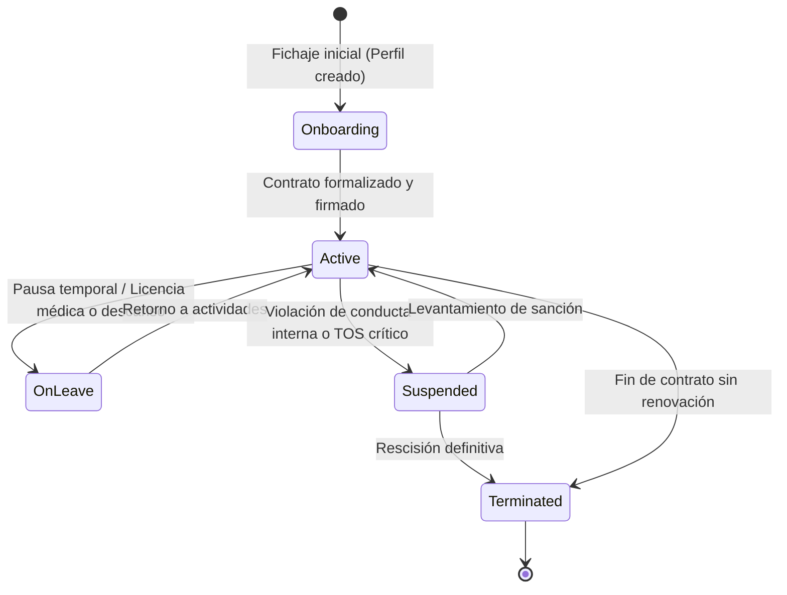
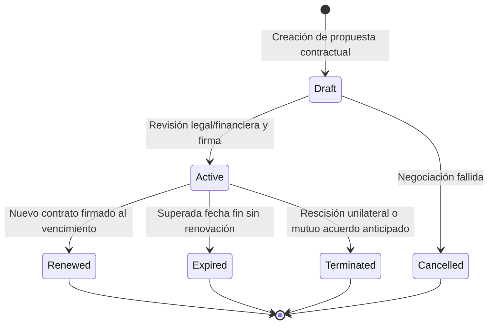

# Módulo 02 — Creadores, Canales, Snapshots y Contratos

## 1. Alcance y Modelos de Datos

Este módulo constituye el núcleo de negocio de la agencia de representación de talento digital. Gestiona el catálogo de creadores (*roster*), su información legal/fiscal protegida (KYC), sus canales en redes sociales con seguimiento de métricas históricas (*snapshots*) y la formalización de acuerdos contractuales con porcentajes de reparto de ingresos (*revenue splits*) y cuotas mensuales de producción.

### Modelos de Base de Datos Involucrados:
- [`Creator`](file:///home/diego/Proyectos/rrss-creators-analyzer/rrss_creatos_analyzer/apps/creators/models.py) (`creators_creator`): Perfil del talento, identificador público (`handle`), nivel (`tier`), plataforma principal, estado operativo y usuario vinculado opcional.
- [`CreatorPersonalInfo`](file:///home/diego/Proyectos/rrss-creators-analyzer/rrss_creatos_analyzer/apps/creators/models.py) (`creators_creatorpersonalinfo`): Información confidencial KYC (nombre legal, número de identificación fiscal/DNI/RFC/RUT, dirección física, datos bancarios para transferencias, contacto de emergencia).
- [`Channel`](file:///home/diego/Proyectos/rrss-creators-analyzer/rrss_creatos_analyzer/apps/creators/models.py) (`creators_channel`): Canales por plataforma (`PlatformType`), identificador de plataforma (`channel_id`), nombre, URL oficial y estado del canal.
- [`ChannelSnapshot`](file:///home/diego/Proyectos/rrss-creators-analyzer/rrss_creatos_analyzer/apps/creators/models.py) (`creators_channel_snapshot`): Registro histórico diario de suscriptores, seguidores, total de vistas y videos subidos.
- [`Contract`](file:///home/diego/Proyectos/rrss-creators-analyzer/rrss_creatos_analyzer/apps/contracts/models.py) (`creators_contract`): Términos legales de representación, vigencia temporal, retribución fija mensual (*monthly_retainer*), *splits* porcentuales para streams, videos y patrocinios, y cuotas de contenido.

---

## 2. Reglas de Negocio del Módulo (RN-CRE)

### RN-CRE-001: Unicidad y Normalización de Identificadores de Creador
- Cada creador debe tener un `handle` único en la plataforma (formato alfanumérico, guiones bajos o puntos, sin `@` al inicio).
- El sistema debe autogenerar un `slug` único normalizado a partir del `handle` mediante `SluggedModelMixin`.

### RN-CRE-002: Tiers de Creadores y Criterios Operativos
- Los creadores se clasifican en los siguientes niveles jerárquicos:
  1. **Rookie**: Creadores en formación (< 25,000 seguidores combinados).
  2. **Standard**: Creadores consolidados (25,000 a 100,000 seguidores combinados).
  3. **Partner**: Creadores destacados con ingresos regulares (> 100,000 seguidores combinados).
  4. **Elite**: Creadores de alto impacto con transmisiones masivas (> 5,000 CCV promedio).
  5. **Ambassador**: Talentos insignia que representan oficialmente la marca de la agencia.
- El cambio de tier debe requerir aprobación de un Talent Manager o Company Admin.

### RN-CRE-003: Protección y Confidencialidad de Datos KYC (CreatorPersonalInfo)
- Los datos de `CreatorPersonalInfo` (cuentas bancarias, DNI/RFC, dirección residencial) son estrictamente confidenciales.
- Solo los usuarios con rol `Company Admin` o `Finance` tienen acceso de lectura y edición a esta entidad. Los usuarios con rol `Manager` o `Analyst` no pueden visualizar datos bancarios ni fiscales bajo ninguna circunstancia.
- Cualquier acceso o modificación a esta tabla genera una traza de auditoría en `AuditEvent`.

### RN-CRE-004: Unicidad de Canales por Plataforma
- Dentro del sistema, no pueden coexistir dos canales con el mismo `platform` y `channel_id` (o `channel_url`), garantizando la no duplicidad de métricas.
- Un creador puede tener múltiples canales en una misma plataforma (ejemplo: Canal Principal de YouTube y Canal Secundario de Shorts), pero cada uno con su propio identificador único.

### RN-CRE-005: Periodicidad de Snapshots de Canal
- Los snapshots de audiencia (`ChannelSnapshot`) se registran con una granularidad mínima de 1 por día (`snapshot_date`).
- Si se intenta insertar un snapshot para la misma fecha y canal, el sistema debe actualizar el registro existente en lugar de crear un duplicado (*upsert*).

### RN-CRE-006: No Superposición de Contratos Activos
- Un creador solo puede tener **un único contrato en estado `active`** en un momento dado.
- No pueden existir dos contratos del mismo creador cuyas fechas de vigencia (`start_date` a `end_date`) se superpongan si ambos están activos.

### RN-CRE-007: Coherencia de Fechas Contractuales
- En todo contrato, `end_date` debe ser estrictamente posterior a `start_date` (`end_date > start_date`).
- Si el contrato es de duración indefinida, `end_date` puede ser nulo (`null=True`), pero debe requerir revisión anual mediante alerta de sistema.

### RN-CRE-008: Validación de Porcentajes de Reparto (Revenue Splits)
- Los porcentajes de reparto de ingresos acordados para la agencia deben encontrarse en el rango de 0.00% a 100.00%:
  - `agency_stream_split_pct`: Comisión de la agencia sobre transmisiones en vivo (subs, bits, ads de stream).
  - `agency_video_split_pct`: Comisión de la agencia sobre publicaciones de video (AdSense, RPM).
  - `agency_sponsor_split_pct`: Comisión de la agencia sobre patrocinios y campañas comerciales.
- La porción correspondiente al creador se calcula matemáticamente como: `creator_split = 100.00 - agency_split`.

### RN-CRE-009: Cuotas Mensuales de Producción
- El contrato define las metas mínimas requeridas para el creador durante cada ciclo mensual:
  - `monthly_stream_hours_quota`: Horas mínimas requeridas de transmisión en vivo.
  - `monthly_videos_quota`: Cantidad mínima de videos largos producidos.
  - `monthly_shorts_quota`: Cantidad mínima de piezas verticales (Shorts, Reels, TikToks).
- El incumplimiento reiterado de cuotas activa automáticamente alertas de sistema de severidad `warning` (`RN-ALT-001`).

### RN-CRE-010: Retainer Mensual y Condiciones de Recoupment
- El `monthly_retainer` representa un anticipo o estipendio fijo mensual garantizado por la agencia.
- Según la cláusula contractual, si los ingresos brutos generados por el creador en un mes no cubren el retainer garantizado, el balance negativo puede acumularse como deducción (*recoupment*) para los ciclos posteriores.

---

## 3. Casos de Uso del Módulo

### CU-CRE-01: Alta de Creador en el Roster (Onboarding)
- **Actor Primario**: Talent Manager (`ACT-MGR`) o Company Admin (`ACT-ADM`).
- **Precondiciones**: El usuario dispone del permiso `creators.add_creator`.
- **Disparador**: Firma o preacuerdo de representación con un nuevo creador de contenido.
- **Flujo Principal**:
  1. El actor accede al formulario de **Nuevo Creador**.
  2. Ingresa los datos básicos: Nombre para mostrar (`display_name`), Handle oficial (`handle`), Plataforma primaria (`primary_platform`), Tier inicial (`CreatorTier`), biografía, avatar URL y correo de contacto.
  3. El sistema valida la unicidad del `handle` y genera automáticamente el `slug`.
  4. El sistema guarda el registro en estado `onboarding`.
  5. El sistema ofrece de forma guiada: (a) Invitar al usuario para que acceda al portal, (b) Cargar información legal/fiscal (KYC), (c) Vincular sus canales de redes sociales.
- **Flujos Alternativos**:
  - *3a. El handle ya existe en el sistema*: El sistema alerta que el handle ya está ocupado y sugiere alternativas.
- **Postcondiciones**: El perfil del creador queda creado en el catálogo de talentos de la agencia.

---

### CU-CRE-02: Registrar y Custodiar Información Confidencial KYC y Bancaria
- **Actor Primario**: Financial Director (`ACT-FIN`) o Company Admin (`ACT-ADM`).
- **Precondiciones**: Existencia previa del Creador y posesión del permiso estricto `creators.change_creatorpersonalinfo`.
- **Disparador**: Necesidad de completar el expediente fiscal previo a la emisión de pagos.
- **Flujo Principal**:
  1. El actor abre la ficha del creador y se dirige a la pestaña **Datos Fiscales y Bancarios (KYC)**.
  2. El sistema comprueba que el actor pertenezca a los grupos autorizados (`Company Admin` o `Finance`).
  3. El actor completa: Nombre legal completo, Número de identificación fiscal (DNI/CIF/RUT/RFC), Dirección postal de facturación, Banco receptor, Código IBAN/SWIFT o CLABE, y contacto de emergencia.
  4. El sistema cifra en tránsito la información y almacena o actualiza la relación 1:1 `CreatorPersonalInfo`.
  5. Se emite un registro de auditoría `AuditEvent` catalogado como `SENSITIVE_DATA_ACCESS`.
- **Postcondiciones**: Los datos de pago quedan asegurados para los procesos de liquidación mensual (`payouts`).

---

### CU-CRE-03: Vincular y Configurar Canales de Redes Sociales
- **Actor Primario**: Talent Manager (`ACT-MGR`) o Business Analyst (`ACT-ANA`).
- **Precondiciones**: Perfil del Creador existente.
- **Disparador**: Creador posee canales en Twitch, YouTube, Kick o TikTok que deben ser monitoreados.
- **Flujo Principal**:
  1. En el perfil del Creador, el usuario pulsa **Añadir Canal**.
  2. Selecciona la plataforma (`PlatformType`), ingresa el nombre del canal, handle en la red, URL pública y el ID interno de la plataforma (`channel_id`).
  3. El sistema comprueba que no exista otro canal registrado con esa misma URL o ID de plataforma (RN-CRE-004).
  4. Se guarda el canal con estado inicial `active`.
  5. El sistema habilita la recepción de métricas de transmisiones, publicaciones y snapshots de audiencia para dicho canal.
- **Postcondiciones**: El canal queda vinculado y listo para la ingesta de estadísticas.

---

### CU-CRE-04: Registrar Snapshot Diario de Audiencia
- **Actor Primario**: Proceso Asíncrono / Business Analyst (`ACT-ANA`).
- **Precondiciones**: Canal existente y activo.
- **Disparador**: Ejecución de tarea programada nocturna de captura de métricas o importación manual de balance diario.
- **Flujo Principal**:
  1. El sistema o analista suministra: `channel_id`, fecha del snapshot (`snapshot_date`), total de seguidores/suscriptores actuales, vistas totales acumuladas y videos subidos.
  2. El sistema busca si ya existe un snapshot para ese canal y fecha.
  3. Si no existe, crea un nuevo `ChannelSnapshot`.
  4. Si ya existe, actualiza los valores existentes (*upsert*).
  5. El sistema calcula la variación neta respecto al snapshot del día anterior (`net_follower_growth`, `net_views_growth`).
- **Postcondiciones**: La serie temporal de crecimiento del canal queda actualizada para alimentar gráficos de tendencia.

---

### CU-CRE-05: Redactar Borrador de Contrato de Representación
- **Actor Primario**: Company Admin (`ACT-ADM`) o Talent Manager (`ACT-MGR`).
- **Precondiciones**: Creador activo o en onboarding.
- **Disparador**: Negociación de términos de fichaje o renovación contractual.
- **Flujo Principal**:
  1. El actor ingresa a **Contratos > Crear Borrador**.
  2. Selecciona el creador y define: Fechas de inicio y fin (`start_date`, `end_date`), Retainer mensual garantizado, Splits porcentuales de agencia (Streams %, Videos %, Sponsors %) y Cuotas de contenido (horas de stream, videos, shorts).
  3. Adjunta notas legales y cláusulas particulares.
  4. El sistema valida las reglas RN-CRE-007 y RN-CRE-008.
  5. El contrato queda guardado con estado `draft`.
- **Postcondiciones**: El borrador queda disponible para revisión por el área financiera y legal antes de su activación.

---

### CU-CRE-06: Formalizar y Activar Contrato
- **Actor Primario**: Financial Director (`ACT-FIN`) o Company Admin (`ACT-ADM`).
- **Precondiciones**: Existencia de un contrato en estado `draft` firmado por ambas partes.
- **Disparador**: Recepción del documento legal firmado.
- **Flujo Principal**:
  1. El actor revisa los términos del borrador contractual.
  2. El sistema valida que el creador no posea otro contrato actualmente `active` que colisione en fechas (RN-CRE-006).
  3. Si existe un contrato activo previo que vence en la fecha de inicio del nuevo contrato, el sistema permite marcar el contrato anterior como `renewed`.
  4. El actor confirma la activación.
  5. El sistema cambia el estado a `active`.
  6. Si el creador estaba en estado `onboarding`, su estado se actualiza automáticamente a `active`.
  7. Se registra un `AuditEvent` con copia del snapshot de condiciones financieras pactadas.
- **Postcondiciones**: El contrato rige oficialmente para el cálculo de cuotas y liquidaciones mensuales.

---

### CU-CRE-07: Rescindir Contrato Anticipadamente
- **Actor Primario**: Company Admin (`ACT-ADM`).
- **Precondiciones**: Contrato en estado `active`.
- **Disparador**: Incumplimiento grave de cláusulas, mutuo acuerdo o abandono del talento.
- **Flujo Principal**:
  1. El administrador selecciona la acción **Rescindir Contrato**.
  2. El sistema solicita la fecha efectiva de rescisión, motivo legal de terminación y si aplican penalizaciones o retenciones de saldo.
  3. El sistema actualiza `Contract`: `status = terminated`, `end_date = fecha_efectiva`.
  4. Si no existen otros contratos vigentes, el estado del creador cambia a `terminated` o `inactive`.
  5. Se emite una alerta a Finance para proceder al cierre contable y liquidación final.
- **Postcondiciones**: El creador deja de generar obligaciones de cuotas y se congela la generación automática de nuevos payouts regulares.

---

### CU-CRE-08: Consultar Ficha Integral 360° del Creador
- **Actor Primario**: Talent Manager (`ACT-MGR`), Analyst (`ACT-ANA`), Admin (`ACT-ADM`).
- **Precondiciones**: Creador asignado o permiso `creators.view_all_creators`.
- **Flujo Principal**:
  1. El actor selecciona un creador del catálogo.
  2. El sistema carga la vista 360° que consolida:
     - Resumen de perfil (tier, canales, estado, equipo asignado).
     - Estado del contrato vigente y medidor de avance de cuotas del mes en curso.
     - Gráficos de evolución de audiencia (snapshots diarios).
     - Rendimiento de últimas transmisiones en vivo y últimos videos publicados.
     - Semáforo de salud y alertas activas del canal.
- **Postcondiciones**: Información estratégica disponible para la toma de decisiones y seguimiento del talento.

---

## 4. Diagramas de Flujo de Trabajo (Workflows)

### 4.1 Ciclo de Vida Operativo del Creador

### 4.2 Máquina de Estados del Contrato de Representación

