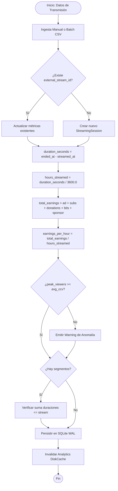

# Módulo 03 — Sesiones de Streaming y Transmisiones en Vivo

## 1. Alcance y Modelos de Datos

Este módulo gestiona la captura, almacenamiento, desglose y análisis de rendimiento de las transmisiones en vivo (*live streams*) realizadas por los creadores en plataformas como Twitch, YouTube Live, Kick y TikTok. Permite rastrear la audiencia en tiempo real (CCV promedio y pico), duración, métricas de interacción en el chat, monetización directa (suscripciones, anuncios, donaciones, bits/regalos y patrocinios de stream) y la segmentación detallada de la emisión por categoría o videojuego transmitido.

### Modelos de Base de Datos Involucrados:
- [`StreamingSession`](file:///home/diego/Proyectos/rrss-creators-analyzer/rrss_creatos_analyzer/apps/streams/models.py) (`streams_streaming_session`): Registro consolidado de la transmisión en vivo, plataforma, horas transmitidas, métricas de audiencia y monetización desglosada.
- [`SessionSegment`](file:///home/diego/Proyectos/rrss-creators-analyzer/rrss_creatos_analyzer/apps/streams/models.py) (`streams_session_segment`): Desglose cronológico de los distintos juegos, dinámicas o categorías desarrollados a lo largo de una misma transmisión continua.

---

## 2. Reglas de Negocio del Módulo (RN-STR)

### RN-STR-001: Unicidad y Prevención de Duplicados de Transmisiones
- Cada sesión de streaming registrada debe identificar de forma unívoca la emisión mediante la combinación de `platform` y `external_stream_id` (o el timestamp exacto de inicio `streamed_at` para un mismo `channel_id`).
- Si se intenta cargar un stream con un `external_stream_id` ya existente para la misma plataforma y canal, el sistema debe realizar una actualización de métricas (*upsert*) en lugar de duplicar el registro.

### RN-STR-002: Cálculo Automático de Horas Transmitidas
- La duración base se almacena en segundos enteros (`duration_seconds`).
- El campo `hours_streamed` se calcula automáticamente como:
  $$\text{hours\_streamed} = \frac{\text{duration\_seconds}}{3600.0}$$
  redondeado a dos decimales.
- Si se proporcionan `streamed_at` y `ended_at`, el sistema calcula automáticamente `duration_seconds = (ended_at - streamed_at).total_seconds()`.

### RN-STR-003: Fórmula de Ingresos Totales de la Sesión
- El valor de `total_earnings` de una sesión de streaming es la suma consolidada de todas sus fuentes de monetización directa:
  $$\text{total\_earnings} = \text{ad\_revenue} + \text{subs\_revenue} + \text{donations\_revenue} + \text{bits\_or\_gifts\_revenue} + \text{sponsorship\_revenue}$$
- Ninguno de los componentes de ingresos puede ser negativo (`>= 0.00`). Si alguno no aplica, se inicializa en `0.00`.

### RN-STR-004: Rendimiento Económico por Hora (Earnings per Hour)
- El campo `earnings_per_hour` mide la rentabilidad del tiempo en pantalla del talento y se calcula automáticamente como:
  $$\text{earnings\_per\_hour} = \begin{cases} \frac{\text{total\_earnings}}{\text{hours\_streamed}} & \text{si hours\_streamed} > 0 \\ 0.00 & \text{si hours\_streamed} = 0 \end{cases}$$

### RN-STR-005: Coherencia y Consistencia de Audiencia
- La métrica de espectadores pico (`peak_viewers`) debe ser estrictamente mayor o igual que el promedio de espectadores concurrentes (`avg_ccv`):
  $$\text{peak\_viewers} \ge \text{avg\_ccv} \ge 0$$
- Si durante la ingesta se detecta un stream donde `avg_ccv > peak_viewers`, el sistema debe rechazar la fila o registrar una alerta de anomalía de datos en el lote.

### RN-STR-006: Segmentación de Contenido y Consistencia Temporal
- Una sesión puede contener múltiples `SessionSegment`.
- La suma de las duraciones en segundos de todos los segmentos de una sesión no debe exceder la duración total del stream:
  $$\sum \text{segment.duration\_seconds} \le \text{session.duration\_seconds}$$
- Los timestamps de inicio y fin de cada segmento deben encontrarse comprendidos dentro del intervalo `[session.streamed_at, session.ended_at]`.

### RN-STR-007: Marcado de Stream Patrocinado
- Si la sesión incluye una activación comercial contratada (`is_sponsored = True`), debe registrarse obligatoriamente el importe pactado en `sponsorship_revenue` y debe existir vinculación opcional con una campaña (`SponsorCampaign` / `CampaignDeliverable`).

### RN-STR-008: Cómputo de Cuotas Mensuales de Horas
- Las horas transmitidas de todas las sesiones de un creador en un mes natural computan directamente contra la meta `monthly_stream_hours_quota` estipulada en su contrato vigente (`Contract`).

---

## 3. Casos de Uso del Módulo

### CU-STR-01: Registrar Manualmente una Sesión de Streaming
- **Actor Primario**: Talent Manager (`ACT-MGR`) o Creador (`ACT-TAL`).
- **Precondiciones**: Existencia del Creador y Canal respectivo.
- **Disparador**: Finalización de una transmisión en vivo que no cuenta con sincronización API automática.
- **Flujo Principal**:
  1. El actor accede a **Streams > Registrar Nueva Sesión**.
  2. Selecciona el creador y canal de emisión.
  3. Ingresa: Título de la sesión, Categoría o juego principal (`game_or_category`), Plataforma, Fecha/hora de inicio (`streamed_at`), Fecha/hora de finalización (`ended_at`) o duración en minutos.
  4. Ingresa las métricas de audiencia: Promedio de CCV (`avg_ccv`) y Espectadores pico (`peak_viewers`).
  5. Ingresa los ingresos obtenidos: Anuncios, Suscripciones, Donaciones, Bits/Regalos y Patrocinios.
  6. Ingresa URLs opcionales (enlace del stream en vivo o VOD grabado).
  7. El sistema valida las reglas de consistencia de audiencia y no negatividad financiera.
  8. El sistema calcula automáticamente `hours_streamed`, `total_earnings` y `earnings_per_hour`.
  9. Se almacena la sesión de streaming.
- **Postcondiciones**: La sesión queda incorporada a las estadísticas del creador y suma al cómputo de cuotas mensuales.

---

### CU-STR-02: Importar Sesiones Masivas desde Exportaciones de Plataforma
- **Actor Primario**: Business Analyst (`ACT-ANA`).
- **Precondiciones**: Archivo CSV/XLSX exportado de Twitch Analytics, YouTube Studio Live o Kick Analytics.
- **Disparador**: Cierre semanal o mensual de métricas de transmisiones.
- **Flujo Principal**:
  1. El analista accede al módulo de **Importaciones > Cargar Lote de Streams**.
  2. Sube el archivo y selecciona la plataforma origen.
  3. El sistema procesa el archivo de forma asíncrona mediante Celery (ver Módulo 09).
  4. Por cada fila, el sistema mapea el canal, extrae las métricas y ejecuta la regla de upsert (RN-STR-001).
  5. Se vinculan los registros creados con el `ImportBatch` correspondiente para trazabilidad.
  6. El analista recibe un reporte con el total de sesiones procesadas, modificadas o rechazadas.
- **Postcondiciones**: El catálogo de streams queda actualizado masivamente sin duplicados.

---

### CU-STR-03: Desglosar Sesión en Segmentos por Categoría/Videojuego
- **Actor Primario**: Talent Manager (`ACT-MGR`) o Analyst (`ACT-ANA`).
- **Precondiciones**: Sesión de streaming existente en el sistema.
- **Disparador**: El streamer realizó un stream variado (ej. 2 horas de "Just Chatting", 3 horas de "Valorant" y 1 hora de "Minecraft").
- **Flujo Principal**:
  1. El actor abre el detalle de la sesión de streaming y se dirige a la sección **Segmentos de Contenido**.
  2. Pulsa en "Añadir Segmento".
  3. Ingresa: Nombre del juego o categoría (`game_or_category`), hora de inicio del segmento, hora de finalización (o duración), CCV promedio y pico específico del tramo.
  4. El sistema valida que los límites de tiempo no excedan los del stream general (RN-STR-006).
  5. Guarda el registro `SessionSegment`.
  6. El sistema actualiza el desglose porcentual de tiempo por categoría para el creador.
- **Postcondiciones**: Permite identificar con precisión quirúrgica cuáles juegos atraen mayor audiencia y rentabilidad.

---

### CU-STR-04: Marcar y Conciliar Stream Patrocinado Comercial
- **Actor Primario**: Talent Manager (`ACT-MGR`) o Financial Director (`ACT-FIN`).
- **Precondiciones**: Sesión de stream registrada y campaña comercial activa.
- **Disparador**: La transmisión formó parte de un patrocinio pagado por una marca.
- **Flujo Principal**:
  1. El actor edita la sesión de streaming y activa la casilla `is_sponsored = True`.
  2. Ingresa el monto acordado por la activación en `sponsorship_revenue`.
  3. Si existe un entregable de campaña asociado (`CampaignDeliverable`), selecciona el entregable en el selector de búsqueda.
  4. El sistema actualiza `total_earnings` y recalcula `earnings_per_hour`.
  5. El entregable de campaña asociado pasa automáticamente al estado `published` o `submitted`.
- **Postcondiciones**: El ingreso por patrocinio queda debidamente clasificado para la liquidación mensual de comisiones.

---

### CU-STR-05: Analizar Rendimiento Comparativo por Categoría
- **Actor Primario**: Business Analyst (`ACT-ANA`), Talent Manager (`ACT-MGR`).
- **Precondiciones**: Existencia de sesiones y segmentos en la base de datos.
- **Flujo Principal**:
  1. El analista accede a la vista analítica **Streams > Rendimiento por Categoría** (alimentada por la vista SQL `v_platform_category_stats`).
  2. Aplica filtros por: Creador, Plataforma y Rango de fechas.
  3. El sistema renderiza la tabla comparativa con: Total de horas transmitidas por juego, CCV promedio por juego, Espectadores pico y Total de ingresos generados.
  4. El sistema destaca la categoría más eficiente (mayor CCV por hora).
- **Postcondiciones**: Información de valor para asesorar al creador sobre qué juegos favorecen su crecimiento de audiencia.

---

### CU-STR-06: Vincular Sesión de Stream con Videos/Clips Derivados
- **Actor Primario**: Video Editor (`ACT-EDT`) o Talent Manager (`ACT-MGR`).
- **Precondiciones**: Sesión de stream registrada con `vod_url` disponible.
- **Disparador**: Un momento destacado del directo se corta para generar un Video largo o un Short vertical.
- **Flujo Principal**:
  1. El actor accede al detalle del stream y hace clic en **Crear Activo Derivado**.
  2. El sistema abre el modal de creación de `Video` precargando el creador y la relación de tipo `derived_from_live`.
  3. El actor especifica el título del clip o proyecto y la marca de tiempo (timestamp) del VOD de origen.
  4. Se crea el `Video` y el vínculo `VideoRelation`.
- **Postcondiciones**: Queda establecida la trazabilidad total entre la transmisión original y las piezas de contenido derivadas.

---

## 4. Diagramas de Flujo de Trabajo (Workflows)

### 4.1 Ingesta, Validación y Cálculo de Métricas de Streaming

