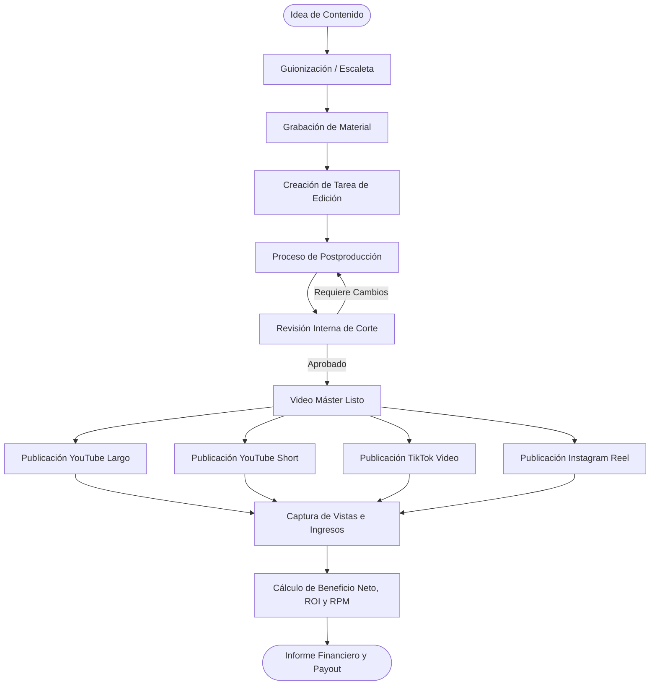
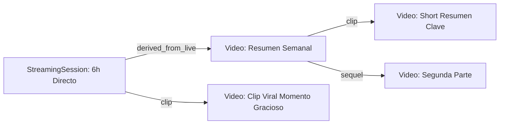

# Módulo 04 — Videos, Publicaciones y Relaciones de Contenido

## 1. Alcance y Modelos de Datos

Este módulo gestiona el ciclo completo de producción audiovisual, distribución multicanal y análisis de rentabilidad (ROI, RPM y Beneficio Neto) del contenido bajo demanda (*VODs*, videos largos, *Shorts*, *Reels* y *TikToks*). 

Implementa una arquitectura de **3 entidades desacopladas**:
1. [`Video`](file:///home/diego/Proyectos/rrss-creators-analyzer/rrss_creatos_analyzer/apps/videos/models.py) (`videos_video`): Representa el activo creativo/máster de producción, sus costos asociados (grabación, edición, miniaturas), estado del pipeline Kanban y asignaciones editoriales.
2. [`VideoPublication`](file:///home/diego/Proyectos/rrss-creators-analyzer/rrss_creatos_analyzer/apps/videos/models.py) (`videos_videopublication`): Representa la publicación concreta del video en una plataforma (YouTube, TikTok, Instagram, etc.), capturando métricas de rendimiento (vistas, retención, interacción, ingresos estimados y RPM).
3. [`VideoRelation`](file:///home/diego/Proyectos/rrss-creators-analyzer/rrss_creatos_analyzer/apps/videos/models.py) (`videos_videorelation`): Traza la genealogía del contenido (relaciones acíclicas entre videos origen y destino, o derivaciones desde transmisiones en vivo).

---

## 2. Reglas de Negocio del Módulo (RN-VID)

### RN-VID-001: Arquitectura de Tres Entidades Desacopladas
- Un proyecto o activo de video (`Video`) puede publicarse cero, una o múltiples veces en distintos canales y formatos (`VideoPublication`).
- Las métricas de consumo (vistas, likes, CTR, ingresos) residen en la publicación (`VideoPublication`), mientras que los costes de postproducción y autoría creativa residen en el activo central (`Video`).

### RN-VID-002: Pipeline de Producción y Estados de Video
- Todo video avanza por los estados del flujo de trabajo:
  $$\text{idea} \longrightarrow \text{scripting} \longrightarrow \text{recording} \longrightarrow \text{editing} \longrightarrow \text{review} \longrightarrow \text{ready} \longrightarrow \text{published}$$
  (con posibilidad de archivo manual `archived`).
- Un video no puede marcarse en estado `published` a menos que exista al menos una publicación vinculada en estado `published` en `VideoPublication`.

### RN-VID-003: Fórmula de Coste Total de Producción
- El coste consolidado de un activo de video se calcula automáticamente como la suma de sus tres componentes de inversión:
  $$\text{total\_production\_cost} = \text{production\_cost} + \text{editing\_cost} + \text{thumbnail\_cost}$$
- Donde:
  - `production_cost`: Gastos de grabación, utilería, actores, alquiler de set o licencias de música.
  - `editing_cost`: Honorarios abonados al editor de video (imputado automáticamente desde `EditingTask`).
  - `thumbnail_cost`: Honorarios abonados al diseñador de la portada / miniatura.

### RN-VID-004: Cálculo de Beneficio Neto (Net Profit)
- El beneficio neto generado por una publicación de video se determina deduciendo el coste de producción total de los ingresos generados:
  $$\text{net\_profit} = \text{estimated\_revenue} - \text{video.total\_production\_cost}$$
- En caso de distribución multicanal de un mismo activo máster, el `net_profit` consolidado del video es la suma de los ingresos de todas sus publicaciones menos el coste de producción único del activo.

### RN-VID-005: Retorno sobre la Inversión (ROI)
- El porcentaje de retorno sobre la inversión se calcula formalmente como:
  $$\text{ROI (\%)} = \begin{cases} \left( \frac{\text{estimated\_revenue} - \text{video.total\_production\_cost}}{\text{video.total\_production\_cost}} \right) \times 100.0 & \text{si total\_production\_cost} > 0 \\ \text{NULL / N/A} & \text{si total\_production\_cost} = 0 \end{cases}$$

### RN-VID-006: Rendimiento por Mil Impresiones (RPM Estimado)
- El RPM efectivo de una publicación se calcula como:
  $$\text{rpm\_estimated} = \begin{cases} \left( \frac{\text{estimated\_revenue}}{\text{views\_count}} \right) \times 1000.0 & \text{si views\_count} > 0 \\ 0.00 & \text{si views\_count} = 0 \end{cases}$$

### RN-VID-007: Tasa de Interacción (Engagement Rate)
- La tasa de engagement se almacena o calcula como el porcentaje de interacción activa sobre el total de visualizaciones:
  $$\text{engagement\_rate} = \begin{cases} \left( \frac{\text{likes\_count} + \text{comments\_count} + \text{shares\_count} + \text{saves\_count}}{\text{views\_count}} \right) \times 100.0 & \text{si views\_count} > 0 \\ 0.00 & \text{si views\_count} = 0 \end{cases}$$

### RN-VID-008: Integridad en Relaciones de Contenido (VideoRelation)
- Un video no puede tener una relación consigo mismo (`source_video != target_video`).
- La relación debe apuntar a un video destino (`target_video`) o a una sesión de streaming de origen (`target_session`), pero no a ambos nulos simultáneamente.
- Se impone un índice único `(source_video, target_video, relation_type)` para evitar relaciones duplicadas.

### RN-VID-009: Computación de Cuotas Mensuales de Videos
- Las publicaciones de videos en estado `published` dentro del mes computan automáticamente contra `monthly_videos_quota` (para videos largos) o contra `monthly_shorts_quota` (para formatos verticales: Short, Reel, TikTok).

---

## 3. Casos de Uso del Módulo

### CU-VID-01: Dar de Alta una Idea o Proyecto de Video
- **Actor Primario**: Talent Manager (`ACT-MGR`), Creator (`ACT-TAL`), Editor (`ACT-EDT`).
- **Precondiciones**: Creador registrado en el sistema.
- **Disparador**: Planificación editorial o sesión de lluvia de ideas de contenido.
- **Flujo Principal**:
  1. El actor accede a **Videos > Nuevo Proyecto de Video**.
  2. Completa: Título de trabajo, Nombre interno (`internal_name`), Código interno (`internal_code`), Categoría temática, Formato previsto (`VideoFormat`: largo, vertical, highlight, etc.), Fecha estimada de publicación (`target_release_date`) y Editor asignado (`assigned_editor`).
  3. El sistema valida los datos y crea el registro `Video` con estado inicial `idea`.
  4. El sistema asigna etiquetas semánticas con `django-taggit`.
- **Postcondiciones**: El proyecto entra al tablero Kanban de producción.

---

### CU-VID-02: Registrar y Controlar Costes de Producción
- **Actor Primario**: Financial Director (`ACT-FIN`), Talent Manager (`ACT-MGR`).
- **Precondiciones**: Existencia del proyecto de video.
- **Disparador**: Adquisición de elementos de producción o facturación de diseñador.
- **Flujo Principal**:
  1. El actor ingresa a la pestaña de **Costes y Finanzas** del video.
  2. Especifica: Coste directo de producción (`production_cost`) y Coste de diseño de miniatura (`thumbnail_cost`).
  3. El sistema suma automáticamente estos conceptos junto con el `editing_cost` procedente de las tareas de edición.
  4. El sistema almacena `total_production_cost`.
  5. Se actualiza el cálculo del umbral de punto de equilibrio (*break-even point* en vistas proyectadas según el RPM promedio del creador).
- **Postcondiciones**: Los gastos quedan imputados para el cálculo posterior de ROI.

---

### CU-VID-03: Avanzar Etapas en el Pipeline de Producción (Kanban)
- **Actor Primario**: Talent Manager (`ACT-MGR`), Creator (`ACT-TAL`), Editor (`ACT-EDT`).
- **Precondiciones**: Permiso sobre el video correspondiente.
- **Disparador**: Avance real en la elaboración del material audiovisual.
- **Flujo Principal**:
  1. El usuario visualiza el tablero de control de videos por columnas de estado.
  2. Arrastra la tarjeta o cambia el estado: `idea` -> `scripting` -> `recording` -> `editing` -> `review` -> `ready`.
  3. Si el video pasa a `editing`, el sistema verifica si ya existe una tarea asignada en el módulo `editors` o sugiere crear una.
  4. Si el video pasa a `ready`, el sistema notifica al Talent Manager que el video máster final está listo para programar o publicar.
- **Postcondiciones**: Visibilidad en tiempo real del progreso de la producción de contenidos de la agencia.

---

### CU-VID-04: Registrar Publicación Multicanal de un Video
- **Actor Primario**: Talent Manager (`ACT-MGR`) o Creador (`ACT-TAL`).
- **Precondiciones**: Video en estado `ready` o `published` y Canal registrado.
- **Disparador**: El video es publicado o programado en una red social.
- **Flujo Principal**:
  1. En la ficha del video, el actor selecciona **Añadir Publicación**.
  2. Selecciona el Canal de destino, Plataforma, Tipo de publicación (`PublicationType`: standard, short, reel, tiktok), Título publicado, URL pública del post (`post_url`), URL de la miniatura (`thumbnail_url`) y Fecha/hora de publicación (`published_at`).
  3. Ingresa el ID externo de la publicación (`platform_post_id`).
  4. Establece el estado de publicación (`PublicationStatus`: scheduled o published).
  5. El sistema guarda el registro `VideoPublication`.
  6. Si el video padre estaba en estado `ready`, se actualiza automáticamente a `published`.
- **Postcondiciones**: La pieza queda lista para la recopilación de estadísticas de audiencia y monetización.

---

### CU-VID-05: Actualizar Métricas de Rendimiento de la Publicación
- **Actor Primario**: Ingesta Masiva Asíncrona (Celery) / Analyst (`ACT-ANA`).
- **Precondiciones**: Publicación en estado `published`.
- **Disparador**: Sincronización diaria o carga de reporte de YouTube Analytics/TikTok Analytics.
- **Flujo Principal**:
  1. El sistema recibe o el analista carga los valores actualizados: `views_count`, `likes_count`, `comments_count`, `shares_count`, `watch_time_hours`, `retention_rate_pct`, `click_through_rate` e `estimated_revenue`.
  2. El sistema aplica las fórmulas de cálculo de negocio:
     - Calcula `rpm_estimated` (RN-VID-006).
     - Calcula `engagement_rate` (RN-VID-007).
  3. El sistema actualiza el registro en `VideoPublication`.
  4. La vista SQL `v_video_publication_details` recalcula inmediatamente el beneficio neto y el ROI respecto al coste de producción del video padre.
- **Postcondiciones**: Métricas actualizadas disponibles en los reportes de rendimiento.

---

### CU-VID-06: Establecer Relaciones Genealógicas de Contenido
- **Actor Primario**: Video Editor (`ACT-EDT`), Talent Manager (`ACT-MGR`).
- **Precondiciones**: Existencia del video origen y del video o stream destino.
- **Disparador**: Creación de un Short a partir de un video largo, o resumen de una transmisión en vivo.
- **Flujo Principal**:
  1. En el video derivado, el actor hace clic en **Vincular Origen de Contenido**.
  2. Selecciona el tipo de relación (`VideoRelationType`: `derived_from_live`, `clip`, `continuation`, `spin_off`).
  3. Selecciona la sesión de stream origen o el video máster origen.
  4. Ingresa notas opcionales (ej. "Minuto 01:23:45 del directo").
  5. El sistema valida que no exista auto-referencia cíclica (RN-VID-008).
  6. Se persiste el vínculo en `VideoRelation`.
- **Postcondiciones**: Queda habilitado el grafo de derivación de contenidos para análisis de reutilización de material.

---

### CU-VID-07: Evaluar ROI y Rentabilidad por Categoría y Formato
- **Actor Primario**: Financial Director (`ACT-FIN`), Business Analyst (`ACT-ANA`).
- **Precondiciones**: Publicaciones con métricas e ingresos registrados.
- **Flujo Principal**:
  1. El analista accede a la vista analítica **Videos > Auditoría de Rentabilidad y ROI**.
  2. Filtra por creador, formato (`VideoFormat`) o rango temporal.
  3. El sistema despliega la comparativa entre coste de producción total vs ingresos estimados generados, categorizando los videos en: Rentables (ROI > 0%), En punto de equilibrio (ROI = 0%) o Deficitarios (ROI < 0%).
  4. Identifica qué formatos generan mayor RPM y menor coste relativo de edición.
- **Postcondiciones**: Información directiva para optimizar el presupuesto editorial del creador.

---

## 4. Diagramas de Flujo de Trabajo (Workflows)

### 4.1 Ciclo de Vida del Video y Distribución Multicanal

### 4.2 Grafo de Trazabilidad y Derivación de Medios

