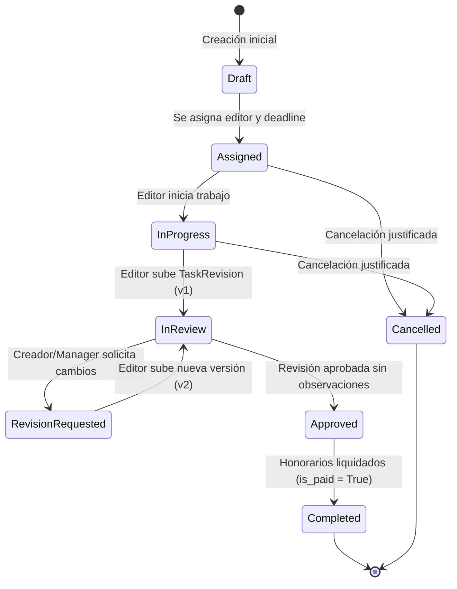
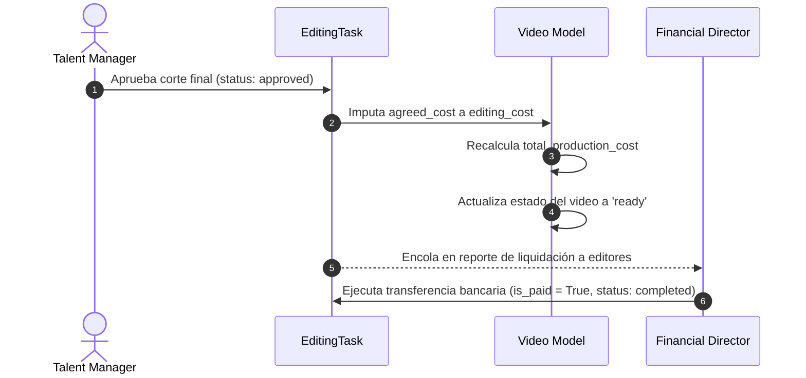

# Módulo 05 — Editores, Asignaciones y Tareas de Postproducción

## 1. Alcance y Modelos de Datos

Este módulo gestiona la fuerza laboral y estudios de postproducción audiovisual (editores de video, diseñadores de miniaturas, animadores de *motion graphics* y coloristas). Centraliza el directorio de editores, acuerdos tarifarios por creador, asignación de tareas de edición con fechas límite (*deadlines*), control iterativo de versiones y revisiones con marcas de tiempo (*timestamps*), e imputación automática de honorarios al coste de producción de los videos.

### Modelos de Base de Datos Involucrados:
- [`Editor`](file:///home/diego/Proyectos/rrss-creators-analyzer/rrss_creatos_analyzer/apps/editors/models.py) (`editors_editor`): Ficha del editor o agencia externa, especialidad, modelo tarifario base, datos de contacto (Discord, WhatsApp) y estado de disponibilidad.
- [`EditorAssignment`](file:///home/diego/Proyectos/rrss-creators-analyzer/rrss_creatos_analyzer/apps/editors/models.py) (`editors_editorassignment`): Vínculo contractual entre un editor y un creador, definiendo el rol específico (`EditorAssignmentRole`), tarifas acordadas (`agreed_video_rate`, `agreed_short_rate`) y si es el editor principal.
- [`EditingTask`](file:///home/diego/Proyectos/rrss-creators-analyzer/rrss_creatos_analyzer/apps/editors/models.py) (`editors_editingtask`): Tarea de edición asociada a un proyecto de video (`Video`), con prioridad, deadline, coste acordado (`agreed_cost`) y estado en el flujo de entrega.
- [`TaskRevision`](file:///home/diego/Proyectos/rrss-creators-analyzer/rrss_creatos_analyzer/apps/editors/models.py) (`editors_taskrevision`): Ciclo de iteración de un corte o entrega, enlaces a archivos en la nube (Frame.io, Google Drive, Dropbox), notas de corrección y veredicto de revisión.

---

## 2. Reglas de Negocio del Módulo (RN-EDT)

### RN-EDT-001: Unicidad y Perfil de Editor
- Cada editor debe contar con un identificador público único (`handle`) y un `slug` generado automáticamente.
- Puede estar vinculado opcionalmente a un usuario del sistema (`User`), lo que le permite iniciar sesión y acceder exclusivamente a su panel de tareas de edición (`RN-SEC-004`).

### RN-EDT-002: Prevalencia de Tarifas Acordadas (EditorAssignment)
- Si existe una asignación activa (`EditorAssignment`) entre el editor y el creador, las tarifas estipuladas en dicha asignación (`agreed_video_rate`, `agreed_short_rate`) prevalecen sobre las tarifas base del catálogo del editor.
- Al crear una nueva `EditingTask`, el sistema debe precargar automáticamente el `agreed_cost` en base al tipo de tarea (`task_type`) y las tarifas pactadas en la asignación vigente.

### RN-EDT-003: Unicidad del Editor Principal
- Para un mismo creador y un mismo rol operativo (`EditorAssignmentRole`: lead editor, shorts editor, thumbnail designer), solo puede existir una única asignación activa con la bandera `is_primary = True`.
- Al marcar una nueva asignación como principal, el sistema desmarca automáticamente cualquier asignación previa que ostentara dicha condición para ese rol.

### RN-EDT-004: Máquina de Estados de la Tarea de Edición
- Toda tarea de edición debe seguir estrictamente la secuencia de estados:
  $$\text{draft} \longrightarrow \text{assigned} \longrightarrow \text{in\_progress} \longrightarrow \text{in\_review} \longrightarrow \text{approved} \longrightarrow \text{completed}$$
  (con posibilidad de transición cíclica a `revision_requested` cuando se solicitan cambios).
- Un editor solo puede avanzar una tarea a `in_review` si adjunta al menos una entrega formal en `TaskRevision` con URL de visualización.

### RN-EDT-005: Control Iterativo de Revisiones (TaskRevision)
- Cada entrega de corte por parte del editor incrementa el número correlativo de versión (`version_number`: v1, v2, v3...).
- Mientras una revisión se encuentre en estado `pending_review`, el editor no puede enviar una nueva versión para la misma tarea hasta recibir el veredicto del creador o manager (`changes_requested` o `approved`).

### RN-EDT-006: Imputación Automática de Costes al Video
- En el momento exacto en que una `EditingTask` pasa al estado `approved`:
  - Se registra el timestamp de aprobación `approved_at = now()`.
  - El sistema actualiza automáticamente el campo `editing_cost` (o `thumbnail_cost` si el `task_type = 'thumbnail'`) en el modelo padre `Video`.
  - El modelo `Video` recalcula inmediatamente su `total_production_cost` (RN-VID-003).

### RN-EDT-007: Liquidación Financiera de Honorarios al Editor
- El campo `is_paid` indica si los honorarios de la tarea ya fueron transferidos al editor.
- Una tarea solo puede marcarse como `is_paid = True` si previamente alcanzó el estado `approved` o `completed`.
- Al marcarse como pagada, se registra `paid_at = now()`.

### RN-EDT-008: Cumplimiento de Deadlines y Alertas de Retraso
- Si la fecha actual supera el `deadline` fijado para la tarea y esta no se encuentra en estado `in_review`, `approved` o `completed`, el sistema debe marcar visualmente la tarea como "Atrasada" y emitir una alerta preventiva al Talent Manager responsable.

---

## 3. Casos de Uso del Módulo

### CU-EDT-01: Alta de Editor o Estudio en el Directorio
- **Actor Primario**: Talent Manager (`ACT-MGR`), Company Admin (`ACT-ADM`).
- **Precondiciones**: Permiso `editors.add_editor`.
- **Disparador**: Contratación o registro de un nuevo colaborador de postproducción.
- **Flujo Principal**:
  1. El actor ingresa a **Editores > Registrar Nuevo Editor**.
  2. Completa: Nombre completo o razón social del estudio, Handle (`@`), Tipo de colaborador (`EditorType`: in-house, freelancer, agencia), Especialidad principal (`EditorSpecialty`), Modelo tarifario base (`RateModel`), Tarifas estándar (por video largo, por short, por hora o retainer mensual), Correo, Teléfono/WhatsApp y usuario de Discord.
  3. Puede asociar una cuenta de usuario existente del sistema para habilitar el portal del editor.
  4. El sistema valida la unicidad del `handle` y genera el `slug`.
  5. Se almacena el registro con estado `active`.
- **Postcondiciones**: El editor queda catalogado y disponible para ser asignado a creadores.

---

### CU-EDT-02: Formalizar Asignación de Editor a Creador
- **Actor Primario**: Talent Manager (`ACT-MGR`).
- **Precondiciones**: Existencia del Editor y del Creador.
- **Disparador**: Se establece una relación de trabajo recurrente entre un editor y un creador.
- **Flujo Principal**:
  1. El actor accede a la pestaña de **Editores Asignados** del Creador.
  2. Selecciona el editor, el rol de asignación (`lead_editor`, `shorts_editor`, `thumbnail_designer`), fecha de inicio y tarifas personalizadas acordadas (`agreed_video_rate`, `agreed_short_rate`).
  3. Marca la casilla `is_primary = True` si será el responsable principal de ese rol.
  4. El sistema valida la regla de unicidad de editor principal (RN-EDT-003).
  5. Se almacena el registro `EditorAssignment`.
- **Postcondiciones**: El editor queda configurado con tarifas preferenciales para los proyectos del creador.

---

### CU-EDT-03: Crear y Asignar Tarea de Edición Vinculada a un Video
- **Actor Primario**: Talent Manager (`ACT-MGR`) o Creator (`ACT-TAL`).
- **Precondiciones**: Activo de video registrado en estado `recording` o `editing`.
- **Disparador**: El material en bruto (brutos de cámara o VOD) está listo para ser editado.
- **Flujo Principal**:
  1. En el proyecto del video, el usuario pulsa **Asignar Tarea de Edición**.
  2. Selecciona el editor (precargando el editor asignado o sugiriendo el editor principal).
  3. Especifica: Título de la tarea, Tipo de tarea (`TaskType`: video largo, short, miniatura), Prioridad (`TaskPriority`: baja, media, alta, urgente) y Fecha límite de entrega (`deadline`).
  4. El sistema autocompleta el coste acordado (`agreed_cost`) según la asignación contractual del editor (RN-EDT-002).
  5. Proporciona enlaces al material bruto (Google Drive, Dropbox, Mega) e instrucciones de edición.
  6. Guarda la tarea con estado inicial `assigned`.
  7. El sistema notifica al editor (correo y alerta de plataforma).
- **Postcondiciones**: La tarea entra en la bandeja de trabajo del editor.

---

### CU-EDT-04: Iniciar Trabajo y Subir Corte de Edición (TaskRevision)
- **Actor Primario**: Video Editor (`ACT-EDT`).
- **Precondiciones**: Tarea en estado `assigned` o `revision_requested`.
- **Disparador**: El editor finaliza el primer corte (o una versión corregida) del video.
- **Flujo Principal**:
  1. El editor abre su panel de **Mis Tareas** y selecciona la tarea correspondiente.
  2. Cambia el estado a `in_progress` al comenzar a trabajar.
  3. Al completar el montaje, selecciona la acción **Entregar Corte para Revisión**.
  4. Ingresa: URL del corte (Frame.io, YouTube Privado, Google Drive), Notas de entrega del editor y versión (`v1`, `v2`).
  5. El sistema crea un nuevo registro `TaskRevision` en estado `pending_review`.
  6. La tarea cambia automáticamente al estado `in_review` y se marca `delivered_at = now()`.
  7. El sistema envía una notificación inmediata al Talent Manager y al Creador informando que el corte está disponible.
- **Postcondiciones**: La entrega queda formalizada a la espera de aprobación o solicitud de ajustes.

---

### CU-EDT-05: Solicitar Cambios en el Corte con Marcas de Tiempo
- **Actor Primario**: Talent Manager (`ACT-MGR`) o Creator (`ACT-TAL`).
- **Precondiciones**: Tarea en estado `in_review` con una revisión en `pending_review`.
- **Disparador**: El video requiere ajustes de ritmo, música, rótulos o efectos.
- **Flujo Principal**:
  1. El revisor visualiza el corte del editor.
  2. En el sistema, selecciona **Solicitar Cambios**.
  3. Redacta el feedback estructurado con marcas de tiempo (ej. "01:15 - Bajar volumen de la música de fondo; 03:40 - Corregir errata en el subtítulo").
  4. La `TaskRevision` actual pasa a estado `changes_requested`.
  5. La tarea pasa al estado `revision_requested`.
  6. El editor recibe la notificación con la lista de correcciones solicitadas.
- **Postcondiciones**: El editor retoma el proyecto con directrices precisas de modificación.

---

### CU-EDT-06: Aprobar Tarea de Edición e Imputar Coste al Video
- **Actor Primario**: Talent Manager (`ACT-MGR`) o Creator (`ACT-TAL`).
- **Precondiciones**: Tarea en estado `in_review`.
- **Disparador**: El corte cumple con todos los estándares editoriales y de calidad.
- **Flujo Principal**:
  1. El revisor selecciona la acción **Aprobar Entrega Final**.
  2. El sistema actualiza la `TaskRevision` a `approved`.
  3. La tarea pasa al estado `approved` y se registra `approved_at = now()`.
  4. El sistema ejecuta la regla RN-EDT-006: imputa el `agreed_cost` al campo `editing_cost` del `Video` padre y recalcula `total_production_cost`.
  5. El activo `Video` avanza automáticamente a estado `ready`.
  6. La tarea queda lista para ser liquidada en el ciclo financiero.
- **Postcondiciones**: El video queda aprobado para publicación y el honorario queda consolidado para pago.

---

### CU-EDT-07: Liquidar y Pagar Honorarios a Editores
- **Actor Primario**: Financial Director (`ACT-FIN`).
- **Precondiciones**: Tareas de edición en estado `approved` no pagadas (`is_paid = False`).
- **Disparador**: Cierre quincenal o mensual de pagos a colaboradores externos.
- **Flujo Principal**:
  1. El director financiero accede a **Editores > Liquidaciones Pendientes**.
  2. El sistema lista las tareas aprobadas agrupadas por editor y creador, con el acumulado monetario a transferir.
  3. Tras realizar la transferencia bancaria o pago por pasarela, el actor marca las tareas seleccionadas como "Liquidadas".
  4. El sistema actualiza cada tarea: `is_paid = True`, `paid_at = now()`, `status = completed`.
  5. Se genera un comprobante de liquidación y se registra la traza contable.
- **Postcondiciones**: Las tareas quedan saldadas contablemente.

---

## 4. Diagramas de Flujo de Trabajo (Workflows)

### 4.1 Ciclo de Vida de Tarea de Edición y Sistema de Revisiones

### 4.2 Integración Financiera entre Edición y Rentabilidad del Video

