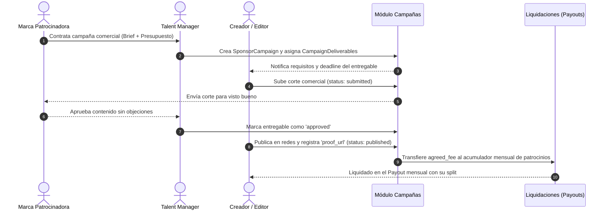

# Módulo 06 — Campañas Publicitarias y Patrocinios Comerciales

## 1. Alcance y Modelos de Datos

Este módulo gestiona los acuerdos comerciales entre marcas patrocinadoras y la agencia de creadores. Coordina la planificación de campañas, la asignación y seguimiento de piezas publicitarias (*deliverables* o entregables: menciones integradas, videos dedicados, streams patrocinados, posts en redes o TikToks), el control presupuestario, la validación de pruebas de emisión (*proof URLs*) y la canalización de los ingresos por patrocinio hacia la liquidación mensual de los creadores.

### Modelos de Base de Datos Involucrados:
- [`SponsorCampaign`](file:///home/diego/Proyectos/rrss-creators-analyzer/rrss_creatos_analyzer/apps/campaigns/models.py) (`campaigns_sponsorcampaign`): Ficha de la campaña comercial con la marca/anunciante, presupuesto total contratado (`total_budget`), fechas de vigencia y estado administrativo (`CampaignStatus`).
- [`CampaignDeliverable`](file:///home/diego/Proyectos/rrss-creators-analyzer/rrss_creatos_analyzer/apps/campaigns/models.py) (`campaigns_campaigndeliverable`): Compromiso publicitario individual asignado a un creador concreto, especificando el tipo de entregable (`DeliverableType`), plataforma, tarifa pactada (`agreed_fee`), fecha límite de entrega (`due_date`), URL de prueba (`proof_url`), métricas alcanzadas y estado de aprobación (`DeliverableStatus`).

---

## 2. Reglas de Negocio del Módulo (RN-CAM)

### RN-CAM-001: Consistencia Temporal de la Campaña y Entregables
- En toda campaña, la fecha de conclusión debe ser igual o posterior a la fecha de inicio (`end_date >= start_date`).
- La fecha límite de entrega (`due_date`) de cualquier `CampaignDeliverable` debe encontrarse comprendida dentro del intervalo temporal de la campaña matriz:
  $$\text{campaign.start\_date} \le \text{deliverable.due\_date} \le \text{campaign.end\_date}$$

### RN-CAM-002: Control Presupuestario y Asignación de Tarifas
- La suma acumulada de las tarifas pactadas para los creadores (`agreed_fee`) en los entregables de una campaña no debe superar el presupuesto total contratado (`total_budget`), salvo autorización explícita del Director Financiero:
  $$\sum \text{deliverable.agreed\_fee} \le \text{campaign.total\_budget}$$
- El margen bruto de la agencia en la campaña se calcula como: `total_budget - sum(agreed_fee)`.

### RN-CAM-003: Tipología Estandarizada de Entregables
- Los entregables comerciales deben categorizarse de forma estricta según `DeliverableType`:
  1. `sponsored_stream`: Transmisión en vivo patrocinada con banner o dinámica de marca.
  2. `dedicated_video`: Video completo centrado en el producto o servicio del sponsor.
  3. `integrated_ad_read`: Mención o segmento publicitario integrado (60 a 90 segundos) dentro de un video largo regular.
  4. `short_or_reel`: Pieza vertical publicitaria exclusiva en TikTok, Shorts o Reels.
  5. `social_post`: Publicación o hilo patrocinado en X o Instagram Feed.

### RN-CAM-004: Máquina de Estados del Entregable Comercial
- Cada entregable debe avanzar a través de la secuencia:
  $$\text{pending} \longrightarrow \text{in\_progress} \longrightarrow \text{submitted} \longrightarrow \text{approved} \longrightarrow \text{published}$$
  (con posibilidad de `rejected` si la marca solicita rehacer la pieza).
- Un entregable no puede avanzar al estado `published` sin haber completado previamente la aprobación de la marca (`approved`) y sin contar con una URL pública verificable (`proof_url`).

### RN-CAM-005: Obligatoriedad de Comprobante de Emisión (Proof URL)
- Para que un entregable se considere completado y apto para cobro:
  - El campo `proof_url` debe contener un enlace válido y accesible a la publicación o VOD.
  - Se debe registrar la fecha de publicación efectiva `published_at`.

### RN-CAM-006: Canalización Hacia Liquidaciones Mensuales (Payouts)
- Al confirmarse el estado `published` de un entregable dentro de un mes contable, el importe `agreed_fee` se incorpora automáticamente al acumulador `gross_sponsorship_revenue` del creador para su liquidación mensual (`CreatorPayout`), aplicando el porcentaje de comisión contractual pactado en su contrato vigente (`agency_sponsor_split_pct`).

---

## 3. Casos de Uso del Módulo

### CU-CAM-01: Registrar Nueva Campaña Publicitaria con una Marca
- **Actor Primario**: Talent Manager (`ACT-MGR`), Financial Director (`ACT-FIN`).
- **Precondiciones**: Permiso `campaigns.add_sponsorcampaign`.
- **Disparador**: Cierre de un acuerdo comercial con un anunciante o marca patrocinadora.
- **Flujo Principal**:
  1. El actor ingresa a **Campañas > Crear Campaña Comercial**.
  2. Ingresa: Nombre de la marca o sponsor, Título de la campaña, Presupuesto total asignado (`total_budget`), Moneda, Fecha de inicio (`start_date`), Fecha de finalización (`end_date`), Descripción y Requisitos clave de la marca (brief publicitario, llamadas a la acción, hashtags obligatorios).
  3. El sistema valida las fechas (RN-CAM-001).
  4. Guarda la campaña con estado inicial `proposal` o `active`.
- **Postcondiciones**: La campaña queda disponible para desglosar sus piezas publicitarias.

---

### CU-CAM-02: Asignar Entregables a Creadores del Roster
- **Actor Primario**: Talent Manager (`ACT-MGR`).
- **Precondiciones**: Campaña comercial activa y Creadores disponibles.
- **Disparador**: Selección de los creadores ideales para el perfil de la marca.
- **Flujo Principal**:
  1. En el detalle de la campaña, el manager pulsa **Añadir Entregable**.
  2. Selecciona el Creador del roster, el Tipo de entregable (`DeliverableType`), la Plataforma de difusión y la Fecha límite (`due_date`).
  3. Define la tarifa acordada para el creador (`agreed_fee`).
  4. El sistema comprueba que la tarifa no desborde el presupuesto total restante de la campaña (RN-CAM-002).
  5. Se almacena el `CampaignDeliverable` en estado `pending`.
  6. El creador y su equipo reciben una notificación con el brief de la marca y la fecha de entrega.
- **Postcondiciones**: El creador tiene formalmente asignada su responsabilidad comercial.

---

### CU-CAM-03: Enviar Avance Publicitario a Revisión de la Marca
- **Actor Primario**: Talent Manager (`ACT-MGR`) o Creator (`ACT-TAL`).
- **Precondiciones**: Entregable en estado `in_progress` y material grabado.
- **Disparador**: El creador completa el borrador de la mención o video patrocinado.
- **Flujo Principal**:
  1. El actor accede al entregable y selecciona **Enviar a Aprobación de Marca**.
  2. Adjunta enlace al corte del video (Google Drive / Frame.io / enlace no listado) y notas específicas.
  3. El sistema cambia el estado del entregable a `submitted`.
  4. Se registra la fecha de envío y se envía el material a la agencia de medios o contacto de la marca.
- **Postcondiciones**: La pieza publicitaria queda a la espera del veredicto del patrocinador.

---

### CU-CAM-04: Registrar Veredicto de la Marca (Aprobación o Rechazo)
- **Actor Primario**: Talent Manager (`ACT-MGR`).
- **Precondiciones**: Entregable en estado `submitted`.
- **Disparador**: Recepción de la respuesta formal del anunciante.
- **Flujo Principal**:
  1. El manager abre el entregable comercial.
  2. Si la marca aprueba sin cambios: Selecciona "Aprobar", cambiando el estado a `approved`.
  3. Si la marca solicita correcciones: Selecciona "Rechazar / Cambios Requeridos", indicando los ajustes requeridos por el anunciante; el estado pasa a `rejected` o `in_progress`.
- **Postcondiciones**: El creador conoce si puede proceder a publicar o si debe corregir el contenido.

---

### CU-CAM-05: Publicar Entregable Comercial y Registrar Enlace de Prueba
- **Actor Primario**: Creator (`ACT-TAL`), Talent Manager (`ACT-MGR`).
- **Precondiciones**: Entregable en estado `approved`.
- **Disparador**: Publicación efectiva del contenido en redes sociales en la fecha programada.
- **Flujo Principal**:
  1. El usuario accede al entregable comercial aprobado.
  2. Ingresa la URL pública y definitiva de la publicación (`proof_url`) y la fecha/hora de publicación (`published_at`).
  3. Si el entregable es un video largo o short del sistema, puede asociar el `VideoPublication` correspondiente.
  4. Si es un directo, asocia la sesión `StreamingSession`.
  5. El sistema valida la accesibilidad de la URL y actualiza el estado a `published`.
  6. Se notifica a Finanzas para la contabilización en la liquidación del creador (RN-CAM-006).
- **Postcondiciones**: La obligación comercial queda formalmente certificada ante la marca.

---

### CU-CAM-06: Auditar Cumplimiento de Métricas y Cerrar Campaña
- **Actor Primario**: Business Analyst (`ACT-ANA`), Financial Director (`ACT-FIN`).
- **Precondiciones**: Todos los entregables de la campaña en estado `published`.
- **Disparador**: Vencimiento del período de medición de la campaña publicitaria.
- **Flujo Principal**:
  1. El analista recopila y registra las métricas alcanzadas en cada entregable: impresiones, visualizaciones, clics en enlaces patrocinados o tasa de engagement.
  2. El sistema genera el **Informe Final de Campaña para el Sponsor** (resumen de alcance e impacto combinado).
  3. El director financiero valida que todas las obligaciones contractuales fueron cumplidas.
  4. La campaña pasa al estado `completed` y posteriormente a `invoiced` al emitirse la factura a la marca.
- **Postcondiciones**: La campaña queda cerrada operativamente y lista para cobro comercial.

---

## 4. Diagramas de Flujo de Trabajo (Workflows)

### 4.1 Ciclo de Vida de Campañas y Aprobación de Entregables

