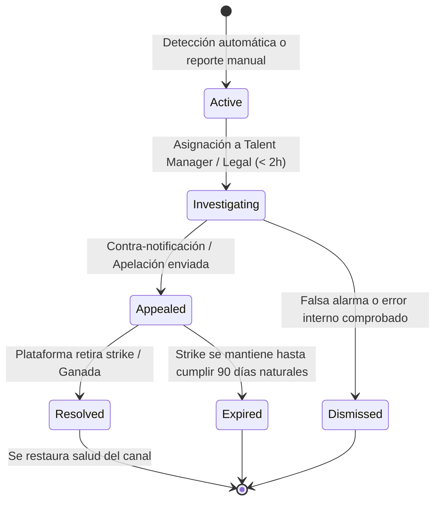

# Módulo 07 — Alertas, Strikes y Salud del Canal

## 1. Alcance y Modelos de Datos

Este módulo actúa como el sistema de defensa, monitoreo de riesgos y control de calidad legal y operativo para los canales de los creadores representados. Gestiona incidentes críticos de propiedad intelectual (strikes de DMCA, reclamos de Content ID/Copyright), infracciones a los términos de servicio (TOS) y directrices de la comunidad, caídas anómalas de audiencia, sospechas de tráfico artificial (bots) e incumplimiento de cuotas mensuales de producción.

### Modelos de Base de Datos Involucrados:
- [`ChannelAlert`](file:///home/diego/Proyectos/rrss-creators-analyzer/rrss_creatos_analyzer/apps/alerts/models.py) (`alerts_channelalert`): Registro formal de la alerta, tipo de infracción o anomalía (`AlertType`), nivel de severidad (`AlertSeverity`), puntos de strike acumulados (`strike_points`), estado de tramitación (`AlertStatus`), notas de resolución y asignación de responsable legal/manager.

---

## 2. Reglas de Negocio del Módulo (RN-ALT)

### RN-ALT-001: Clasificación y Tipología de Alertas
- Toda alerta detectada o ingresada en el sistema debe categorizarse rigurosamente bajo uno de los siguientes tipos:
  1. `dmca_strike`: Notificación formal de infracción de derechos de autor con cese de emisión o retirada de video.
  2. `copyright_claim`: Reclamo de monetización parcial o silenciamiento de pista de audio vía Content ID.
  3. `tos_violation`: Advertencia por incumplimiento de términos de servicio de la plataforma (lenguaje, conducta, contenido explícito).
  4. `community_guideline_strike`: Strike formal por normas de comunidad.
  5. `demonetization`: Desmonetización total o parcial del canal o video.
  6. `temporary_ban`: Suspensión temporal de la cuenta o canal por días/semanas.
  7. `unusual_ccv_drop`: Caída anómala de audiencia en vivo (> 40% respecto a la media habitual del creador sin causa aparente).
  8. `suspicious_bot_traffic`: Picos repentinos de visualizaciones o seguidores no correlacionados con interacción real.
  9. `quota_missed`: Alerta interna de sistema por incumplimiento de las metas contractuales del mes.

### RN-ALT-002: Severidad y Acuerdos de Nivel de Servicio (SLA)
- La severidad se clasifica en tres niveles, cada uno con un tiempo límite de respuesta obligatoria:
  - **`critical`**: Strikes de DMCA, suspensión temporal, baneo o desmonetización total. *SLA de atención: Menor a 2 horas*. Notificación push y correo de emergencia a Company Admin y Talent Manager.
  - **`warning`**: Reclamos de copyright no lesivos, caída abrupta de CCV, sospecha de bots o cuota en riesgo. *SLA de atención: Menor a 24 horas*.
  - **`info`**: Notificaciones operativas, silenciamiento menor de VOD o advertencias leves de plataforma. *SLA de atención: Menor a 72 horas*.

### RN-ALT-003: Acumulación de Strike Points y Umbral de Riesgo Fatal
- Las alertas de tipo DMCA o infracción comunitaria pueden acumular `strike_points` (típicamente 1 punto por strike activo).
- En plataformas como YouTube y Twitch, **3 strikes activos simultáneos implican el cierre definitivo del canal**.
- Si el acumulado de strike points activos de un canal llega a **2 puntos**, el sistema debe disparar una **Alerta de Máximo Riesgo** a toda la plana directiva y congelar inmediatamente la programación de contenidos en ese canal hasta resolver al menos una apelación.

### RN-ALT-004: Máquina de Estados de la Alerta
- El ciclo de gestión de una alerta contempla:
  $$\text{active} \longrightarrow \text{investigating} \longrightarrow \text{appealed} \longrightarrow \text{resolved}$$
  (con opciones de cierre alternativo: `dismissed` si fue una falsa alarma, o `expired` si el strike prescribió de forma natural tras 90 días).
- Para pasar una alerta a estado `resolved` o `dismissed`, es obligatorio registrar notas detalladas en `resolution_notes` justificando la decisión o el resultado del proceso legal.

### RN-ALT-005: Afectación Directa al Estado del Canal
- Si se emite una alerta de tipo `temporary_ban`, el sistema debe actualizar automáticamente el estado del canal afectado a `suspended` en `Channel.status`.
- Si la alerta es de tipo `demonetization`, el canal debe pasar a `demonetized`.
- Al resolverse favorablemente la alerta (`resolved`), el canal regresa a su estado operativo habitual (`active`).

---

## 3. Casos de Uso del Módulo

### CU-ALT-01: Detección y Emisión de Alerta de Canal
- **Actor Primario**: Proceso Automático del Sistema o Talent Manager (`ACT-MGR`).
- **Precondiciones**: Canal registrado y activo en el sistema.
- **Disparador**: Notificación de la plataforma (YouTube Studio, Twitch Dashboard) o detección automática por anomalía en las métricas de transmisión.
- **Flujo Principal**:
  1. El actor o worker registra la alerta indicando: Creador, Canal afectado, Tipo de alerta (`AlertType`), Severidad (`AlertSeverity`), Puntos de strike (`strike_points`), Título explicativo y Descripción de los hechos.
  2. Puede vincular opcionalmente la sesión de stream infractora (`related_session`) o el video infractor (`related_publication`).
  3. El sistema valida las reglas de severidad y genera el registro en `ChannelAlert` con estado `active`.
  4. Si la severidad es `critical`, el sistema ejecuta la regla RN-ALT-005 actualizando el estado del canal.
  5. El sistema despacha notificaciones urgentes a los miembros del equipo asignados al creador.
- **Postcondiciones**: La alerta queda registrada en el semáforo de riesgo del creador y en el panel directivo.

---

### CU-ALT-02: Asignar Responsable e Iniciar Investigación Técnica
- **Actor Primario**: Talent Manager (`ACT-MGR`) o Company Admin (`ACT-ADM`).
- **Precondiciones**: Alerta en estado `active`.
- **Disparador**: Notificación de un nuevo incidente en el canal.
- **Flujo Principal**:
  1. El usuario accede al detalle de la alerta.
  2. Se asigna a sí mismo o a un especialista legal de la agencia en el campo `assigned_to`.
  3. Cambia el estado a `investigating`.
  4. Recopila las evidencias: minuto exacto del reclamo, pista de audio utilizada, titular del reclamo o fragmento del directo en cuestión.
  5. Guarda los hallazgos en las notas de investigación.
- **Postcondiciones**: El incidente se encuentra bajo gestión activa con un responsable asignado.

---

### CU-ALT-03: Presentar Contra-Notificación o Apelación Legal
- **Actor Primario**: Talent Manager (`ACT-MGR`) o Asesor Legal de la Agencia.
- **Precondiciones**: Alerta en estado `investigating`.
- **Disparador**: Se determina que el strike o reclamo es infundado, uso legítimo (*fair use*) o error de identificación automática.
- **Flujo Principal**:
  1. El responsable prepara la documentación de apelación o contra-notificación DMCA ante la plataforma correspondiente.
  2. En el sistema, cambia el estado de la alerta a `appealed`.
  3. Registra el número de caso o ticket legal abierto ante la plataforma y la fecha límite de respuesta de la contraparte (típicamente 10 a 14 días hábiles).
- **Postcondiciones**: La alerta queda a la espera de la resolución formal de la plataforma.

---

### CU-ALT-04: Resolver o Cerrar Incidente
- **Actor Primario**: Talent Manager (`ACT-MGR`) o Company Admin (`ACT-ADM`).
- **Precondiciones**: Alerta en estado `investigating` o `appealed`.
- **Disparador**: La plataforma retira el strike, el titular desiste del reclamo o se llega a un acuerdo.
- **Flujo Principal**:
  1. El responsable ingresa a la alerta y selecciona la acción **Resolver Alerta**.
  2. Ingresa obligatoriamente el resultado en `resolution_notes` (ej. "La contraparte retiró el reclamo tras presentar la licencia de música comprada").
  3. El sistema actualiza el estado a `resolved` y marca el timestamp `resolved_at = now()`.
  4. Si el strike point fue anulado, se descuenta del cómputo de strikes activos del canal.
  5. Si el canal estaba en estado `suspended` o `demonetized` debido a esta alerta, se restaura a `active`.
- **Postcondiciones**: El canal recupera su buena reputación y la alerta queda archivada en el historial histórico de auditoría.

---

### CU-ALT-05: Detección Proactiva de Caída Anómala de Audiencia (CCV Drop)
- **Actor Primario**: Worker Automático de Ingesta / Business Analyst (`ACT-ANA`).
- **Precondiciones**: Existencia de histórico de transmisiones del creador.
- **Disparador**: Ingesta de una nueva sesión de streaming con métricas anormalmente bajas.
- **Flujo Principal**:
  1. Tras registrar un stream, el sistema compara el `avg_ccv` de la sesión contra el promedio móvil de los últimos 30 días del creador en esa misma categoría y franja horaria.
  2. Si la audiencia presenta una caída superior al 45%, el sistema genera automáticamente una alerta de tipo `unusual_ccv_drop` con severidad `warning`.
  3. Se notifica al Talent Manager para verificar si hubo problemas técnicos de bitrate, cortes de fibra óptica o shadowban temporal.
- **Postcondiciones**: Prevención temprana de fallas técnicas o desinterés en nuevos juegos.

---

## 4. Diagramas de Flujo de Trabajo (Workflows)

### 4.1 Protocolo de Gestión, Escalado y Resolución de Incidentes y Strikes

