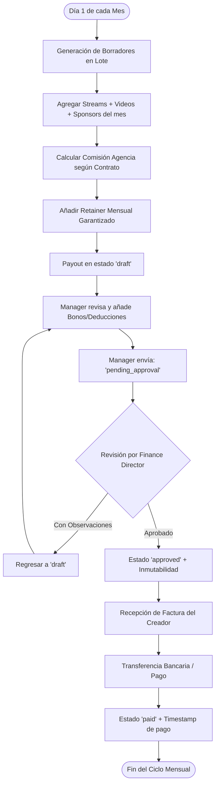

# Módulo 08 — Liquidaciones Financieras y Pagos a Creadores (Payouts)

## 1. Alcance y Modelos de Datos

Este módulo gestiona el ciclo financiero mensual de liquidación, facturación y conciliación de pagos a los creadores de contenido de la agencia. Consolida todos los flujos de ingresos generados durante el mes contable (transmisiones en vivo, monetización de publicaciones de video y patrocinios comerciales de marcas), aplica rigurosamente los porcentajes de comisión pactados en los contratos vigentes (*revenue splits*), adiciona el estipendio o anticipo base (*retainer*) y bonificaciones, resta deducciones o adelantos acumulados (*recoupment*), y somete la liquidación a un flujo de aprobación dual antes de la transferencia bancaria.

### Modelos de Base de Datos Involucrados:
- [`CreatorPayout`](file:///home/diego/Proyectos/rrss-creators-analyzer/rrss_creatos_analyzer/apps/payouts/models.py) (`payouts_creatorpayout`): Registro formal de la liquidación mensual del creador, ingresos brutos desglosados, comisión total retenida por la agencia, importe neto a transferir al talento, número de factura de respaldo y estado en el flujo contable (`PayoutStatus`).
- Entidades orígenes integradas: [`Contract`](file:///home/diego/Proyectos/rrss-creators-analyzer/rrss_creatos_analyzer/apps/contracts/models.py), [`StreamingSession`](file:///home/diego/Proyectos/rrss-creators-analyzer/rrss_creatos_analyzer/apps/streams/models.py), [`VideoPublication`](file:///home/diego/Proyectos/rrss-creators-analyzer/rrss_creatos_analyzer/apps/videos/models.py), [`CampaignDeliverable`](file:///home/diego/Proyectos/rrss-creators-analyzer/rrss_creatos_analyzer/apps/campaigns/models.py).

---

## 2. Reglas de Negocio del Módulo (RN-PAY)

### RN-PAY-001: Periodicidad y Unicidad del Período de Liquidación
- Las liquidaciones se efectúan con periodicidad mensual natural (del primer al último día de cada mes: `period_year`, `period_month`).
- No puede existir más de un registro de `CreatorPayout` para un mismo creador y un mismo período mensual, garantizando la no duplicidad de liquidaciones contables.

### RN-PAY-002: Fórmula Matemática Estricta de Liquidación Mensual
La liquidación neta a transferir al creador (`net_creator_payout`) y la retención de la agencia (`agency_commission_amount`) se rigen por la siguiente formulación matemática obligatoria:

1. **Ingresos Brutos Consolidados por Fuente**:
   - `gross_stream_revenue`: Suma de `total_earnings` de todas las sesiones de streaming finalizadas en el período.
   - `gross_video_revenue`: Suma de `estimated_revenue` de las publicaciones de video del período.
   - `gross_sponsorship_revenue`: Suma de `agreed_fee` de los entregables de patrocinio completados y publicados en el período.

2. **Cálculo de la Comisión de la Agencia**:
   $$\text{agency\_commission} = \left( \text{gross\_stream} \times \frac{\text{split\_stream}_{\text{agencia}}}{100} \right) + \left( \text{gross\_video} \times \frac{\text{split\_video}_{\text{agencia}}}{100} \right) + \left( \text{gross\_sponsor} \times \frac{\text{split\_sponsor}_{\text{agencia}}}{100} \right)$$

3. **Cálculo del Neto para el Creador**:
   $$\text{creator\_gross\_share} = (\text{gross\_stream} + \text{gross\_video} + \text{gross\_sponsor}) - \text{agency\_commission}$$
   $$\text{net\_creator\_payout} = \text{creator\_gross\_share} + \text{base\_retainer} + \text{bonuses} - \text{deductions\_or\_recoupment}$$

### RN-PAY-003: Control de Balances Negativos y Arrastre de Deuda (Recoupment Rollover)
- El valor transferible no puede ser negativo en una orden bancaria (`net_creator_payout >= 0.00`).
- Si en un período mensual el total de deducciones por adelantos o costes de producción supera el haber del creador, el pago del mes se liquida en `0.00` y el remanente deudo se transfiere automáticamente como deducción inicial para el siguiente mes contable.

### RN-PAY-004: Flujo de Aprobación Dual Obligatorio
- Todo payout debe transitar la siguiente máquina de estados:
  $$\text{draft} \longrightarrow \text{pending\_approval} \longrightarrow \text{approved} \longrightarrow \text{paid}$$
  (con opciones de `disputed` en caso de discrepancia o `cancelled` si es anulado).
- **Rol Revisor**: El Talent Manager genera o revisa el borrador y lo eleva a `pending_approval`.
- **Rol Aprobador**: Exclusivamente un usuario con rol `Financial Director` (`ACT-FIN`) o `Company Admin` (`ACT-ADM`) puede cambiar el estado a `approved`. El usuario aprobador se registra en `approved_by`.

### RN-PAY-005: Inmutabilidad de Liquidaciones Aprobadas o Pagadas
- Una vez que un `CreatorPayout` pasa al estado `approved` o `paid`, queda **estrictamente bloqueado contra cualquier edición o eliminación manual**.
- Si se detecta un error posterior, no se edita el registro: se debe generar una partida de ajuste (bono o deducción) en la liquidación del mes subsiguiente.

### RN-PAY-006: Requisitos de Pago (Factura y Soporte Fiscal)
- Antes de que el Director Financiero marque el pago como `paid`:
  - Debe existir obligatoriamente un identificador fiscal o número de factura emitido por el creador en `invoice_reference`.
  - El perfil del creador debe contar con información KYC completa en `CreatorPersonalInfo` (cuenta bancaria validada).
  - Al marcarse como pagado, se fija de forma inmutable el timestamp `paid_at = now()`.

---

## 3. Casos de Uso del Módulo

### CU-PAY-01: Generar Precierre Automatizado Mensual de Liquidaciones
- **Actor Primario**: Financial Director (`ACT-FIN`) o Tarea Celery Programada.
- **Precondiciones**: Ha concluido el mes natural a liquidar.
- **Disparador**: Día 1 de cada mes (ej. precierre del mes vencido).
- **Flujo Principal**:
  1. El sistema ejecuta el proceso de consolidación de ingresos para cada creador activo que cuente con contrato vigente (`Contract.status = 'active'`).
  2. Consulta la base de datos y agrega:
     - Ingresos de streams del mes (`streams_streaming_session`).
     - Ingresos de publicaciones de video del mes (`videos_videopublication`).
     - Ingresos por entregables de patrocinios completados (`campaigns_campaigndeliverable`).
  3. Aplica los porcentajes de split del contrato correspondiente (RN-PAY-002).
  4. Carga el `monthly_retainer` acordado en `base_retainer_amount`.
  5. Crea el registro `CreatorPayout` con estado `draft`.
  6. Emite un informe preliminar consolidado para los Talent Managers.
- **Postcondiciones**: Borradores de liquidación generados listos para revisión y ajustes.

---

### CU-PAY-02: Registrar Ajustes Manuales (Bonificaciones y Deducciones)
- **Actor Primario**: Talent Manager (`ACT-MGR`), Financial Director (`ACT-FIN`).
- **Precondiciones**: Payout en estado `draft`.
- **Disparador**: Existencia de incentivos por metas superadas o deducciones por adelantos y gastos de viaje.
- **Flujo Principal**:
  1. El actor abre el borrador de la liquidación del creador.
  2. Ingresa conceptos extraordinarios:
     - `bonuses_amount`: Bonificaciones por superar metas de horas de stream, premios por visualizaciones o incentivos de agencia.
     - `deductions_or_recoupment`: Anticipos de dinero otorgados al creador, costes de producción extraordinarios asumidos por la agencia o compras de equipamiento.
  3. El sistema recalcula en tiempo real `net_creator_payout` respetando la regla de no negatividad (RN-PAY-003).
  4. Guarda los cambios adjuntando un memorando explicativo del ajuste.
- **Postcondiciones**: El borrador refleja con exactitud la situación económica acordada.

---

### CU-PAY-03: Enviar Liquidación a Aprobación Directiva
- **Actor Primario**: Talent Manager (`ACT-MGR`).
- **Precondiciones**: Borrador revisado y validado con el creador.
- **Flujo Principal**:
  1. El manager comprueba que las transmisiones y videos del mes estén completos.
  2. Selecciona la acción **Elevar a Aprobación Financiera**.
  3. El sistema cambia el estado de `draft` a `pending_approval`.
  4. El área de finanzas recibe una notificación en su panel de aprobaciones pendientes.
- **Postcondiciones**: El payout queda bloqueado para modificaciones del manager a la espera del veredicto financiero.

---

### CU-PAY-04: Aprobar Liquidación y Autorizar Desembolso
- **Actor Primario**: Financial Director (`ACT-FIN`) o Company Admin (`ACT-ADM`).
- **Precondiciones**: Payout en estado `pending_approval` y permiso `payouts.approve_creatorpayout`.
- **Disparador**: Revisión contable final de la agencia.
- **Flujo Principal**:
  1. El director financiero analiza el desglose de ingresos brutos, comisión de agencia y deducciones.
  2. Verifica que los datos bancarios del creador estén vigentes en su ficha KYC.
  3. Selecciona **Aprobar Liquidación**.
  4. El sistema registra `approved_by = request.user`, actualiza el estado a `approved` y bloquea la entidad contra modificaciones (RN-PAY-005).
  5. Se emite automáticamente la pre-factura o desglose oficial para que el creador emita su factura fiscal.
- **Postcondiciones**: Liquidación formalmente autorizada para ejecución bancaria.

---

### CU-PAY-05: Consultar Estado de Cuenta por el Creador
- **Actor Primario**: Creator (`ACT-TAL`).
- **Precondiciones**: Creador autenticado con su usuario vinculado.
- **Disparador**: El creador desea consultar sus ingresos del mes.
- **Flujo Principal**:
  1. El creador ingresa a su sección privada **Mis Ingresos y Liquidaciones**.
  2. El sistema aplica el selector de aislamiento (RN-SEC-004), mostrando únicamente sus registros.
  3. Visualiza la tabla con el desglose de sus ingresos brutos por plataforma, la comisión de la agencia, sus bonos y el neto final aprobado.
  4. Puede descargar el extracto en formato PDF imprimible.
  5. Si detecta alguna anomalía, puede pulsar el botón **Reportar Discrepancia**, pasando el payout a estado `disputed` y abriendo un canal de comunicación con su manager.
- **Postcondiciones**: Transparencia absoluta en la relación agencia-talento.

---

### CU-PAY-06: Ejecutar Pago y Adjuntar Comprobante Bancario
- **Actor Primario**: Financial Director (`ACT-FIN`).
- **Precondiciones**: Payout en estado `approved`.
- **Disparador**: Ejecución exitosa de la transferencia internacional o pago bancario.
- **Flujo Principal**:
  1. El actor ingresa el número o folio de la factura recibida del creador en `invoice_reference`.
  2. Selecciona **Confirmar Pago Realizado**.
  3. El sistema actualiza el estado a `paid` y estampa `paid_at = now()`.
  4. Se envía una notificación al creador confirmando la transferencia de fondos con el comprobante adjunto.
  5. El payout queda archivado en el histórico contable inalterable.
- **Postcondiciones**: El ciclo mensual queda cerrado y conciliado.

---

## 4. Diagramas de Flujo de Trabajo (Workflows)

### 4.1 Flujo Integral de Liquidación Mensual y Doble Aprobación

