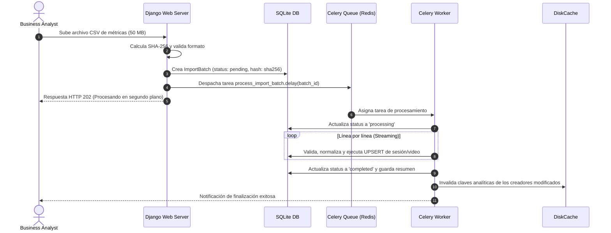

# Módulo 09 — Importaciones, Exportaciones y Motor Analítico

## 1. Alcance y Modelos de Datos

Este módulo proporciona la infraestructura de procesamiento de datos para la ingesta masiva de métricas desde archivos externos, la generación desacoplada de reportes descargables en múltiples formatos y el motor analítico de alto rendimiento que alimenta los tableros de control directivos, ránkings de creadores y comparativas de mercado mediante vistas SQL optimizadas y almacenamiento intermedio en **DiskCache**.

### Modelos de Base de Datos y Componentes Involucrados:
- [`ImportBatch`](file:///home/diego/Proyectos/rrss-creators-analyzer/rrss_creatos_analyzer/apps/imports/models.py) (`imports_importbatch`): Control de lotes de importación masiva de archivos (CSV, XLSX, JSON), hash de seguridad SHA-256 para evitar duplicaciones accidentales, contador de filas procesadas/fallidas y registro de errores detallado.
- [`ExportJob`](file:///home/diego/Proyectos/rrss-creators-analyzer/rrss_creatos_analyzer/apps/exports/models.py) (`exports_exportjob`): Solicitud asíncrona de extracción de datos, formato de salida (`csv`, `xlsx`, `json`, `pdf`), ruta de almacenamiento seguro y vigencia de descarga.
- [`AnalyticsSnapshot`](file:///home/diego/Proyectos/rrss-creators-analyzer/rrss_creatos_analyzer/apps/analytics/models.py) (`analytics_analyticssnapshot`): Agregaciones temporales precomputadas por creador y plataforma.
- **Vistas SQL Analíticas Nativas** (definidas en [`docs/schema.sql`](file:///home/diego/Proyectos/rrss-creators-analyzer/docs/schema.sql)):
  - `v_creator_performance_summary`: Consolidado global de horas transmitidas, CCV, vistas de video e ingresos combinados por creador.
  - `v_creator_overall_rankings`: Leaderboard con funciones de ventana (`DENSE_RANK()`) para clasificar el roster por ingresos, CCV y horas.
  - `v_platform_category_stats`: Agrupación cruzada de rendimiento por plataforma y juego/categoría.
  - `v_monthly_revenue_summary`: Resumen financiero temporal mensual de toda la agencia.
  - `v_video_publication_details`: Detalle granular de videos con cálculo de beneficio neto, ROI y RPM.
  - `v_recent_channel_activity`: Timeline cronológico unificado de directos, videos publicados y alertas.

---

## 2. Reglas de Negocio del Módulo (RN-DAT)

### RN-DAT-001: Verificación de Integridad y Hash SHA-256 en Importaciones
- Todo archivo subido para importación debe ser procesado inmediatamente mediante un cálculo de su resumen criptográfico SHA-256 (`file_hash_sha256`).
- Si ya existe un `ImportBatch` en estado `completed` con el mismo hash SHA-256, el sistema debe alertar al usuario y rechazar la ingesta para evitar la duplicación masiva accidental de sesiones o publicaciones.

### RN-DAT-002: Procesamiento Asíncrono Desacoplado con Celery
- Las operaciones de importación masiva y exportación de reportes nunca deben ejecutarse en el ciclo de vida síncrono de la petición HTTP.
- Deben despacharse como tareas asíncronas encoladas en Celery (`compose/celery`), garantizando que la interfaz permanezca reactiva e informando el progreso en tiempo real mediante sondeo liviano o WebSockets.

### RN-DAT-003: Transaccionalidad Atómica y Recuperación de Fallos
- Cada lote de importación debe procesarse bajo transacciones atómicas de base de datos (`transaction.atomic()`):
  - Si una fila presenta inconsistencias de formato, se registra el error específico en `error_log` del lote y se incrementa `error_rows_count`, continuando con el resto de filas (*partial processing*).
  - Si ocurre un fallo catastrófico de base de datos o corrupción de archivo, la transacción completa se revierte y el lote pasa a estado `failed`.

### RN-DAT-004: TTL y Purga de Archivos Exportados
- Los reportes generados por un `ExportJob` tienen un tiempo de vida útil limitado de 72 horas (`TTL = 72h`).
- Cumplido el plazo, una rutina programada de Celery Beat elimina físicamente el archivo del disco de exportaciones y marca el estado del trabajo como `expired` para proteger la privacidad de los datos y evitar el agotamiento de almacenamiento.

### RN-DAT-005: Estrategia de Caché Multinivel con DiskCache
- Las consultas analíticas de alto coste computacional (cálculo de percentiles, funciones analíticas `DENSE_RANK()`, agregaciones temporales de millones de segundos de stream) deben cachearse mediante la librería **DiskCache** (`rrss-cache`).
- Las entradas de caché se almacenan con claves versionadas por creador y período (ej. `analytics:summary:creator:12:2026-10`).
- El TTL por defecto de las claves analíticas es de 6 horas, con refresco programado nocturno.

### RN-DAT-006: Invalidación de Caché Dirigida por Eventos
- El caché analítico de un creador debe invalidarse de forma explícita e inmediata desde la capa de servicio ante cualquiera de los siguientes eventos:
  1. Finalización exitosa de un `ImportBatch` que incluya registros del creador.
  2. Aprobación formal de una liquidación mensual (`CreatorPayout.status = 'approved'`).
  3. Modificación o eliminación de una sesión de streaming o publicación de video.

---

## 3. Casos de Uso del Módulo

### CU-DAT-01: Cargar Lote Masivo de Métricas (CSV / XLSX / JSON)
- **Actor Primario**: Business Analyst (`ACT-ANA`).
- **Precondiciones**: Archivo estructurado con formato oficial de la plataforma (Twitch, YouTube Studio, TikTok).
- **Disparador**: Recepción periódica de exportaciones de analítica de redes sociales.
- **Flujo Principal**:
  1. El analista accede a **Importaciones > Cargar Nuevo Archivo**.
  2. Selecciona el tipo de lote (`ImportBatchType`: streams, videos, publications, snapshots), la plataforma origen y arrastra el archivo.
  3. El sistema valida el formato de archivo, comprueba el tamaño máximo permitido (50 MB) y calcula el hash SHA-256.
  4. Comprueba la regla de no duplicidad de hash (RN-DAT-001).
  5. Guarda el registro `ImportBatch` en estado `pending` y encola la tarea en Celery.
  6. Devuelve una respuesta inmediata al analista con el enlace para monitorear el progreso del lote.
- **Postcondiciones**: El lote entra en la cola asíncrona de procesamiento.

---

### CU-DAT-02: Procesamiento y Mapeo Asíncrono del Lote
- **Actor Primario**: Worker de Celery (`System Worker`).
- **Precondiciones**: Registro `ImportBatch` encolado.
- **Flujo Principal**:
  1. El worker toma la tarea y actualiza el lote a estado `processing`.
  2. Lee el archivo línea por línea mediante streaming (evitando sobrecarga de memoria RAM).
  3. Mapea cada fila al creador y canal correspondiente utilizando el handle o ID de plataforma.
  4. Ejecuta las validaciones de negocio de cada entidad y aplica la lógica de *upsert* para evitar duplicados.
  5. Contabiliza filas exitosas y filas con error.
  6. Al concluir el archivo:
     - Si todas las filas fueron exitosas: actualiza estado a `completed`.
     - Si hubo fallos parciales: actualiza estado a `partial` y almacena el JSON de errores.
  7. Ejecuta la invalidación de caché analítica para los creadores afectados (RN-DAT-006).
- **Postcondiciones**: La base de datos queda enriquecida con los nuevos registros y el caché actualizado.

---

### CU-DAT-03: Revertir un Lote de Importación Erróneo (Rollback)
- **Actor Primario**: Company Admin (`ACT-ADM`) o Business Analyst (`ACT-ANA`).
- **Precondiciones**: Lote en estado `completed` o `partial`.
- **Disparador**: Se detecta que el archivo suministrado por el cliente contenía datos corruptos o correspondientes a un período equivocado.
- **Flujo Principal**:
  1. El actor abre el detalle del `ImportBatch` y selecciona **Revertir Lote (Rollback)**.
  2. El sistema solicita confirmación mediante advertencia destructiva.
  3. Se lanza una tarea atómica de reversión que elimina todas las sesiones o publicaciones cuyo `import_batch_id` coincida con el lote seleccionado.
  4. El estado del lote pasa a `rolled_back`.
  5. Se dispara la invalidación global del caché analítico.
  6. Se registra el evento en `AuditEvent`.
- **Postcondiciones**: La base de datos queda restaurada al estado previo a la importación del archivo.

---

### CU-DAT-04: Solicitar Exportación Personalizada de Datos
- **Actor Primario**: Business Analyst (`ACT-ANA`), Financial Director (`ACT-FIN`), Talent Manager (`ACT-MGR`).
- **Precondiciones**: Permiso de exportación respectivo (`streams.export_sessions`, etc.).
- **Disparador**: Necesidad de entregar un reporte a un sponsor, realizar un análisis estadístico en Excel o presentar balances contables.
- **Flujo Principal**:
  1. El actor ingresa a **Reportes y Exportaciones > Nueva Exportación**.
  2. Selecciona: Tipo de reporte (Rendimiento de Creadores, Detalle de Streams, Rentabilidad de Videos, Liquidaciones Contables), Formato deseado (`csv`, `xlsx`, `json`, `pdf`) y Criterios de filtrado (creador, rango de fechas, plataforma).
  3. El sistema valida las cuotas y permisos del usuario y crea el registro `ExportJob` en estado `pending`.
  4. Encola la generación del archivo en Celery.
  5. El usuario puede continuar navegando mientras el archivo se compila en segundo plano.
- **Postcondiciones**: La solicitud de exportación queda encolada para su procesamiento.

---

### CU-DAT-05: Descarga Segura de Archivos Exportados
- **Actor Primario**: Usuario Solicitante.
- **Precondiciones**: Tarea de exportación en estado `completed`.
- **Disparador**: El usuario recibe una notificación informando que su reporte está listo para descarga.
- **Flujo Principal**:
  1. El usuario accede a su historial de descargas en **Mis Exportaciones**.
  2. Hace clic en el botón **Descargar Archivo**.
  3. El sistema verifica que el usuario autenticado sea el mismo que solicitó el trabajo (`requested_by = request.user`) o que posea rol de Company Admin.
  4. Comprueba que el archivo no haya superado su TTL de 72 horas (RN-DAT-004).
  5. Sirve el archivo mediante streaming seguro (`FileResponse` con cabeceras `Content-Disposition: attachment`).
  6. Registra la descarga en la bitácora de auditoría.
- **Postcondiciones**: Archivo recibido de forma confidencial por el usuario autorizado.

---

### CU-DAT-06: Visualizar Dashboard Ejecutivo y Ranking de la Compañía
- **Actor Primario**: Company Admin (`ACT-ADM`), Talent Manager (`ACT-MGR`).
- **Precondiciones**: Permiso `analytics.view_company_dashboard`.
- **Flujo Principal**:
  1. El usuario ingresa a la vista principal de **Analítica Global**.
  2. El sistema consulta las vistas SQL `v_creator_overall_rankings` y `v_monthly_revenue_summary` (obteniendo los resultados desde DiskCache si están vigentes).
  3. Despliega los KPI globales:
     - Facturación combinada total (Streams + Videos + Patrocinios).
     - Horas totales transmitidas y promedio de CCV de la compañía.
     - Leaderboard interactivo de creadores ordenado por `revenue_rank`, `ccv_rank` u `hours_rank`.
     - Comparativa de volumen e ingresos por plataforma (Twitch vs YouTube vs Kick vs TikTok).
- **Postcondiciones**: Visión estratégica consolidada del rendimiento de la agencia.

---

### CU-DAT-07: Forzar Recálculo e Invalidación de Caché Analítico
- **Actor Primario**: Company Admin (`ACT-ADM`).
- **Precondiciones**: Permiso `analytics.refresh_analytics_cache`.
- **Disparador**: Sospecha de desfase temporal de estadísticas o tras una migración de datos.
- **Flujo Principal**:
  1. El administrador accede a **Configuración > Estado del Caché Analítico**.
  2. Pulsa en **Limpiar y Recalcular Caché**.
  3. El sistema vacía las claves de agregación en `DiskCache`.
  4. Dispara una tarea asíncrona de precalentamiento (*cache warming*) que vuelve a ejecutar las consultas de las vistas SQL y llena la caché fresca.
- **Postcondiciones**: Todos los tableros analíticos quedan sincronizados con los datos transaccionales más recientes.

---

## 4. Diagramas de Flujo de Trabajo (Workflows)

### 4.1 Canal de Ingesta Masiva Asíncrona con Celery

