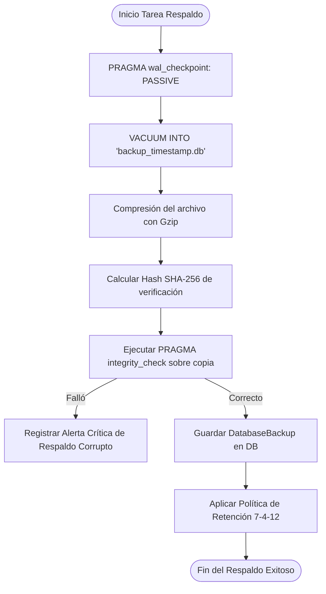
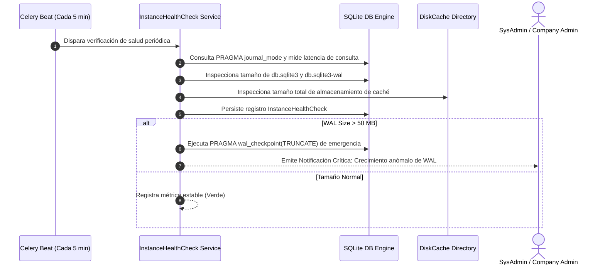

# Módulo 10 — Auditoría, Logs, Monitor de Salud y Respaldos del Sistema

## 1. Alcance y Modelos de Datos

Este módulo abarca la infraestructura de gobierno, observabilidad, seguridad informática y continuidad operativa de la plataforma. Proporciona la configuración singleton corporativa de la agencia, una bitácora inmutable de auditoría forense (`AuditEvent`), trazabilidad estructurada de logs de aplicación (`ApplicationLogEntry`), diagnóstico continuo de la salud del motor SQLite y del caché en disco (`InstanceHealthCheck`), y la ejecución automatizada y segura de copias de respaldo de base de datos sin detención del servicio (`DatabaseBackup`).

### Modelos de Base de Datos Involucrados:
- [`CompanySettings`](file:///home/diego/Proyectos/rrss-creators-analyzer/rrss_creatos_analyzer/apps/core/models.py) (`core_company_settings`): Configuración global única (patrón Singleton), nombre legal de la agencia, moneda base oficial, splits predeterminados y preferencias de interfaz.
- [`AuditEvent`](file:///home/diego/Proyectos/rrss-creators-analyzer/rrss_creatos_analyzer/apps/audit/models.py) (`auditlog_logentry` / `audit_auditevent`): Registro inmutable de eventos sensibles, cambios de contratos, accesos a datos KYC, aprobación de liquidaciones y modificaciones de permisos.
- [`ApplicationLogEntry`](file:///home/diego/Proyectos/rrss-creators-analyzer/rrss_creatos_analyzer/apps/logs/models.py) (`logs_applicationlogentry`): Eventos de sistema capturados por el subsistema de logging de Python, códigos de evento, trazas de excepción y métricas de desempeño.
- [`InstanceHealthCheck`](file:///home/diego/Proyectos/rrss-creators-analyzer/rrss_creatos_analyzer/apps/monitor/models.py) (`monitor_instancehealthcheck`): Diagnóstico periódico de infraestructura: modo de diario de SQLite (`WAL`), tamaño del archivo `.db`, tamaño del archivo `.db-wal`, tamaño del directorio de DiskCache y tiempo de respuesta en milisegundos (`response_time_ms`).
- [`DatabaseBackup`](file:///home/diego/Proyectos/rrss-creators-analyzer/rrss_creatos_analyzer/apps/backups/models.py) (`backups_databasebackup`): Catálogo histórico de copias de seguridad de la base de datos SQLite, tipo de respaldo (manual o programado), tamaño en megabytes, suma de verificación SHA-256 y estado de integridad.

---

## 2. Reglas de Negocio del Módulo (RN-SYS)

### RN-SYS-001: Patrón Singleton Estricto en CompanySettings
- En la base de datos solo puede existir un único registro de `CompanySettings` (`id = 1`).
- Cualquier intento de invocar `CompanySettings.objects.create()` cuando ya existe una instancia debe fallar o actualizar la instancia existente.
- Los cambios en la moneda base o splits predeterminados no alteran retroactivamente los contratos o payouts previamente aprobados.

### RN-SYS-002: Inmutabilidad Absoluta de Registros de Auditoría
- La tabla de `AuditEvent` es de **solo adición (*append-only*)**.
- El sistema no provee ninguna vista, formulario o método de ORM para actualizar (`UPDATE`) o eliminar (`DELETE`) filas de auditoría.
- Cualquier intento de manipulación manual a nivel de base de datos es catalogado como una brecha de integridad.

### RN-SYS-003: Monitoreo de Parámetros Críticos de SQLite y WAL
- La base de datos SQLite debe operar obligatoriamente en modo **WAL (Write-Ahead Logging)**:
  $$\text{PRAGMA journal\_mode = WAL;}$$
- Umbrales de alerta preventiva sobre el archivo de transacciones WAL (`sqlite_wal_size_mb`):
  - **Estado Normal**: `< 20 MB`.
  - **Advertencia (Warning)**: `20 MB a 50 MB` (indica transacciones lentas no consolidadas).
  - **Crítico (Critical)**: `> 50 MB` (el sistema dispara automáticamente un `PRAGMA wal_checkpoint(TRUNCATE)` y emite una alerta a los administradores).

### RN-SYS-004: Control del Almacenamiento de DiskCache
- El directorio de caché en disco (`diskcache_size_mb`) debe monitorearse periódicamente.
- Umbral de advertencia: Si supera los **500 MB**, Celery Beat debe ejecutar una rutina de compactación y desalojo de claves menos recientemente usadas (LRU - *Least Recently Used*).

### RN-SYS-005: Respaldo en Caliente sin Bloqueos de Concurrencia
- Las copias de seguridad de SQLite nunca deben realizarse mediante una copia plana de archivo a nivel de sistema operativo mientras la base de datos está abierta, para evitar corrupción de páginas en memoria.
- Deben ejecutarse obligatoriamente mediante el comando nativo de SQLite:
  $$\text{VACUUM INTO '/ruta/backup/rrss\_backup\_timestamp.db'}$$
  o a través de la API `sqlite3_backup`, garantizando un respaldo consistente y atómico sin detener la lectura ni la escritura de la aplicación web.

### RN-SYS-006: Política de Retención y Rotación de Backups (Directiva 7-4-12)
- El sistema gestiona automáticamente la retención de respaldos programados:
  - Conservar los últimos **7 respaldos diarios**.
  - Conservar los últimos **4 respaldos semanales** (uno por semana).
  - Conservar los últimos **12 respaldos mensuales** (uno por mes).
- Las copias que excedan estas cuotas son purgadas de forma segura para optimizar el almacenamiento.

### RN-SYS-007: Privilegio Exclusivo de Acceso
- El acceso a los módulos de Respaldos, Auditoría y Monitor de Salud queda estrictamente reservado a los roles `Company Admin` (`ACT-ADM`) y `System Auditor` (`ACT-AUD`).
- Ningún Talent Manager, Analista o Creador puede acceder a estas vistas ni descargar archivos de volcado de base de datos.

---

## 3. Casos de Uso del Módulo

### CU-SYS-01: Configurar Parámetros Corporativos de la Agencia
- **Actor Primario**: Company Admin (`ACT-ADM`).
- **Precondiciones**: Permiso `core.change_companysettings`.
- **Disparador**: Inicio de operaciones de la plataforma o cambio de políticas de agencia.
- **Flujo Principal**:
  1. El administrador accede a **Configuración del Sistema > Ajustes Corporativos**.
  2. Modifica: Nombre legal de la compañía, Moneda predeterminada (USD, EUR, MXN, ARS), Porcentajes de comisión base predeterminados para nuevos contratos (Splits por defecto), y Logotipo institucional.
  3. El sistema valida los rangos porcentuales (0 a 100%).
  4. Guarda los cambios en la única instancia de `CompanySettings`.
  5. Se registra el cambio en la bitácora de auditoría.
- **Postcondiciones**: La plataforma utiliza la nueva configuración para la inicialización de futuros registros.

---

### CU-SYS-02: Consultar Bitácora de Auditoría Forense de Cambios
- **Actor Primario**: System Auditor (`ACT-AUD`), Company Admin (`ACT-ADM`).
- **Precondiciones**: Permiso `audit.view_auditevent`.
- **Disparador**: Investigación interna sobre modificación sospechosa de contrato, alteración de datos bancarios o cancelación de una alerta crítica.
- **Flujo Principal**:
  1. El auditor accede a **Seguridad > Bitácora de Auditoría Forense**.
  2. Filtra por: Usuario ejecutor, Modelo afectado (`Contract`, `CreatorPersonalInfo`, `CreatorPayout`), Rango temporal o Tipo de acción (Creación, Modificación, Eliminación).
  3. El sistema despliega la lista inmutable detallando: Timestamp exacto, Usuario, Dirección IP, User-Agent, y el diff o comparativa de valores anteriores vs valores nuevos (`changes_dict`).
  4. El auditor puede exportar el informe firmado digitalmente.
- **Postcondiciones**: Trazabilidad legal y forense certificada.

---

### CU-SYS-03: Monitorear Registros de Error de la Aplicación
- **Actor Primario**: Company Admin (`ACT-ADM`), Administrador de Sistemas.
- **Precondiciones**: Permiso `logs.view_applicationlogentry`.
- **Flujo Principal**:
  1. El usuario ingresa a **Monitoreo > Bitácora de Eventos y Logs**.
  2. Filtra por nivel de severidad (`ERROR`, `CRITICAL`) y módulo de origen.
  3. El sistema despliega la traza completa de la excepción (*stacktrace*), el código de evento y los parámetros del contexto de ejecución.
  4. Permite marcar eventos como "Revisados" para descartar falsos positivos de depuración.
- **Postcondiciones**: Diagnóstico rápido de incidentes técnicos en producción.

---

### CU-SYS-04: Ejecutar Diagnóstico de Salud de Infraestructura y Base de Datos
- **Actor Primario**: Tarea Periódica Celery Beat / Company Admin (`ACT-ADM`).
- **Disparador**: Ejecución programada cada 5 minutos o solicitud manual desde la UI.
- **Flujo Principal**:
  1. El sistema ejecuta una comprobación de bajo nivel sobre la infraestructura:
     - Ejecuta `PRAGMA journal_mode;` comprobando que devuelva `wal`.
     - Inspecciona el tamaño en disco de `db.sqlite3` y `db.sqlite3-wal`.
     - Mide el tamaño total del directorio de `DiskCache`.
     - Ejecuta una consulta testigo (`SELECT 1`) midiendo la latencia de respuesta en milisegundos (`response_time_ms`).
  2. Registra los valores obtenidos en un nuevo registro de `InstanceHealthCheck`.
  3. Si algún valor excede los umbrales críticos de RN-SYS-003, dispara de inmediato una notificación de alarma preventiva al equipo de infraestructura.
- **Postcondiciones**: Registro continuo del estado operativo del servidor y base de datos.

---

### CU-SYS-05: Ejecutar Respaldo Manual o Programado de la Base de Datos
- **Actor Primario**: Company Admin (`ACT-ADM`) o Tarea Nocturna Celery.
- **Precondiciones**: Permiso `backups.add_databasebackup` y espacio suficiente en disco.
- **Disparador**: Rutina programada de madrugada (03:00 AM) o previo a una actualización mayor del sistema.
- **Flujo Principal**:
  1. El sistema ejecuta `PRAGMA wal_checkpoint(PASSIVE);` para asegurar la consolidación de páginas de memoria al archivo de log.
  2. Ejecuta `VACUUM INTO '/backups/rrss_backup_YYYYMMDD_HHMMSS.db'` (RN-SYS-005).
  3. Comprime el archivo resultante con compresión `gzip`/`zstandard`.
  4. Calcula el hash criptográfico SHA-256 del archivo generado.
  5. Crea el registro `DatabaseBackup` con: Nombre de archivo, Tamaño en MB, Hash SHA-256, Tipo (manual/programado) y estado `completed`.
  6. Aplica la política de rotación y purga de backups antiguos (RN-SYS-006).
- **Postcondiciones**: Copia de seguridad íntegra y verificada, disponible para recuperación ante desastres.

---

### CU-SYS-06: Descarga y Verificación de Integridad de Copia de Seguridad
- **Actor Primario**: Company Admin (`ACT-ADM`).
- **Precondiciones**: Respaldo existente en estado `completed`.
- **Disparador**: Auditoría periódica de recuperación de desastres o almacenamiento fuera de línea (*off-site backup*).
- **Flujo Principal**:
  1. El administrador accede al catálogo de **Copias de Seguridad**.
  2. Selecciona la copia de respaldo y pulsa **Verificar Integridad**.
  3. El sistema recalcula el hash SHA-256 del archivo en disco y ejecuta una prueba de consistencia `PRAGMA integrity_check;` sobre una conexión temporal de lectura.
  4. Si la comprobación es exitosa, el sistema certifica el estado del respaldo como íntegro.
  5. El administrador pulsa **Descargar Respaldo Seguro**.
  6. El sistema sirve el archivo cifrado y genera un `AuditEvent` de alta severidad registrando la descarga.
- **Postcondiciones**: Copia física transferida de forma controlada a un almacenamiento externo seguro.

---

## 4. Diagramas de Flujo de Trabajo (Workflows)

### 4.1 Rutina de Respaldo en Caliente de SQLite con WAL Checkpoint

### 4.2 Arquitectura de Monitoreo Preventivo de Infraestructura SQLite

