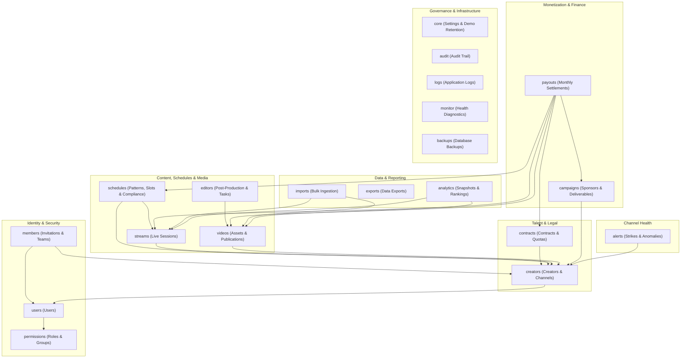

# System Requirements Catalog — Index & Architecture

## 1. Purpose

**RRSS Creators Analyzer** is a talent management, multi-platform analytics, audiovisual post-production, and financial settlement platform for digital creator agencies (`Twitch`, `YouTube`, `Kick`, `TikTok`, `Instagram`, `X`). It centralizes creator contracts, streaming compliance, video ROI, sponsorship deliverables, channel health alerts, and monthly payouts.

---

## 2. Module Map & Domain Architecture

The system consists of 20 modular Django applications backed by PostgreSQL + Redis in production (SQLite WAL + DiskCache locally) and Celery for asynchronous tasks:

---

## 3. System Actors

| Actor | Code | Scope |
|---|---|---|
| **Company Administrator** | `ACT-ADM` | Unrestricted access to agency settings, contracts, audit logs, assignments, and backups. |
| **Talent Manager** | `ACT-MGR` | Manages creator rosters, channels, quotas, streams, video workflows, and assigned teams. |
| **Financial Director** | `ACT-FIN` | Validates contracts, sponsor budgets, editing costs, and approves monthly creator payouts. |
| **Business Analyst** | `ACT-ANA` | Runs bulk metric imports, exports reports, and evaluates rankings and RPMs. |
| **Creator / Talent** | `ACT-TAL` | Scoped strictly to personal dashboard, channel metrics, quotas, and payout statements. |
| **Video Editor / Studio** | `ACT-EDT` | Scoped to assigned editing tasks, cut uploads, and revision feedback. |
| **System Auditor** | `ACT-AUD` | Reviews audit logs (`auditlog`), permission changes, and data export records. |

---

## 4. Specification Index

1. [`01_USERS_ROLES_AND_PERMISSIONS.md`](file:///home/diego/Proyectos/rrss-creators-analyzer/docs/requirements/01_USERS_ROLES_AND_PERMISSIONS.md) — `users`, `permissions`, `members`
2. [`02_CREATORS_CHANNELS_AND_CONTRACTS.md`](file:///home/diego/Proyectos/rrss-creators-analyzer/docs/requirements/02_CREATORS_CHANNELS_AND_CONTRACTS.md) — `creators`, `contracts`
3. [`03_STREAMS_AND_BROADCASTS.md`](file:///home/diego/Proyectos/rrss-creators-analyzer/docs/requirements/03_STREAMS_AND_BROADCASTS.md) — `streams`
4. [`04_VIDEOS_PUBLICATIONS_AND_RELATIONS.md`](file:///home/diego/Proyectos/rrss-creators-analyzer/docs/requirements/04_VIDEOS_PUBLICATIONS_AND_RELATIONS.md) — `videos`
5. [`05_EDITORS_AND_TASK_MANAGEMENT.md`](file:///home/diego/Proyectos/rrss-creators-analyzer/docs/requirements/05_EDITORS_AND_TASK_MANAGEMENT.md) — `editors`
6. [`06_CAMPAIGNS_AND_SPONSORSHIPS.md`](file:///home/diego/Proyectos/rrss-creators-analyzer/docs/requirements/06_CAMPAIGNS_AND_SPONSORSHIPS.md) — `campaigns`
7. [`07_ALERTS_AND_CHANNEL_HEALTH.md`](file:///home/diego/Proyectos/rrss-creators-analyzer/docs/requirements/07_ALERTS_AND_CHANNEL_HEALTH.md) — `alerts`
8. [`08_FINANCIAL_SETTLEMENTS_AND_PAYOUTS.md`](file:///home/diego/Proyectos/rrss-creators-analyzer/docs/requirements/08_FINANCIAL_SETTLEMENTS_AND_PAYOUTS.md) — `payouts`
9. [`09_IMPORTS_EXPORTS_AND_ANALYTICS.md`](file:///home/diego/Proyectos/rrss-creators-analyzer/docs/requirements/09_IMPORTS_EXPORTS_AND_ANALYTICS.md) — `imports`, `exports`, `analytics`
10. [`10_AUDIT_LOGS_MONITORING_AND_BACKUPS.md`](file:///home/diego/Proyectos/rrss-creators-analyzer/docs/requirements/10_AUDIT_LOGS_MONITORING_AND_BACKUPS.md) — `core`, `audit`, `logs`, `monitor`, `backups`
11. [`11_TRACEABILITY_MATRIX_AND_GLOBAL_RULES.md`](file:///home/diego/Proyectos/rrss-creators-analyzer/docs/requirements/11_TRACEABILITY_MATRIX_AND_GLOBAL_RULES.md) — Cross-module traceability & global rules
12. [`12_SCHEDULES_AND_COMPLIANCE.md`](file:///home/diego/Proyectos/rrss-creators-analyzer/docs/requirements/12_SCHEDULES_AND_COMPLIANCE.md) — `schedules`

---

## 5. Naming Conventions

- **Use Cases**: `CU-<MODULE>-<NN>` (e.g., `CU-CRE-01`, `CU-PAY-03`, `CU-SCH-01`).
- **Business Rules**: `RN-<DOMAIN>-<NNN>` (e.g., `RN-SEC-002`, `RN-PAY-003`, `RN-SCH-001`).
- **Models**: `PascalCase` Django models (`StreamingSession`, `CreatorScheduleSlot`).
- **Statuses**: `TextChoices` lowercase identifiers (`active`, `scheduled`, `completed`, `late`, `missed`).
