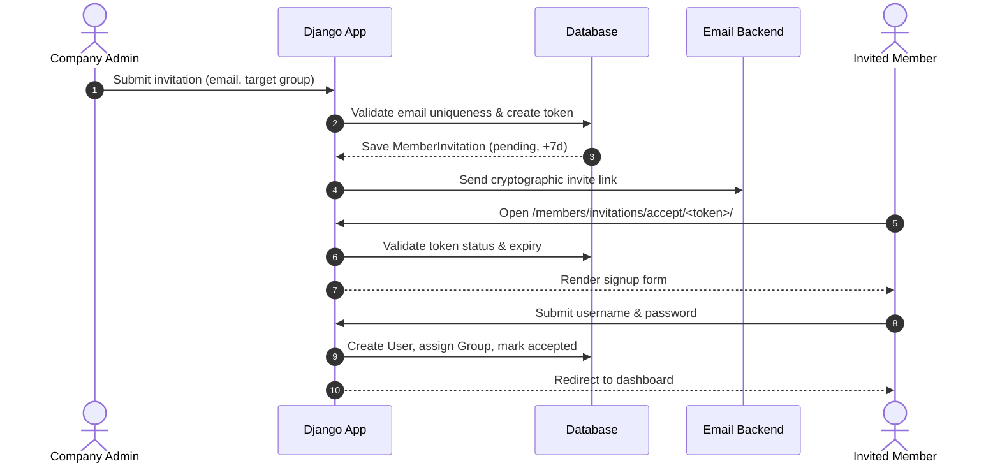

# Module 01 — Users, Roles, Permissions & Teams

## 1. Scope & Data Models

Manages user identity, native Django RBAC, selector-level row scoping, corporate member invitations, and creator team assignments.

- [`User`](file:///home/diego/Proyectos/rrss-creators-analyzer/rrss_creatos_analyzer/apps/users/models.py) (`users_user`): Custom `AbstractUser` with `name`, `username`, `email`, and M2M `groups`/`user_permissions`.
- [`RoleGroupProfile`](file:///home/diego/Proyectos/rrss-creators-analyzer/rrss_creatos_analyzer/apps/permissions/models.py) (`permissions_rolegroupprofile`): Extends `auth_group` with UI badge color, description, and `is_system_role` flag.
- [`MemberInvitation`](file:///home/diego/Proyectos/rrss-creators-analyzer/rrss_creatos_analyzer/apps/members/models.py) (`members_memberinvitation`): Cryptographic email invitation tokens, expiration timestamp, and target group.
- [`CreatorTeamAssignment`](file:///home/diego/Proyectos/rrss-creators-analyzer/rrss_creatos_analyzer/apps/members/models.py) (`members_creatorteamassignment`): Operational assignment linking staff (`Manager`, `Editor`, `Analyst`) to a `Creator`.

---

## 2. Business Rules (`RN-SEC`)

- **RN-SEC-001 (Unique Email)**: Active accounts must use unique, valid email addresses.
- **RN-SEC-002 (Invitation Lifecycle)**: Invitations use `secrets.token_urlsafe(48)` tokens valid for 7 days (`expires_at`), transition to `expired` if unclaimed, and are single-use (`accepted`).
- **RN-SEC-003 (Least Privilege)**: Permissions are enforced via `auth_group` profiles (`Company Admin`, `Manager`, `Finance`, `Analyst`, `Creator`, `Video Editor`).
- **RN-SEC-004 (Selector-Level Row Isolation)**: Users lacking `view_all_*` permissions can only query rows where `creator__user = request.user` (or `user = request.user`).
- **RN-SEC-005 (Primary Team Assignment)**: Only one `is_primary = True` assignment may exist per `(creator, responsibility)` pair.
- **RN-SEC-006 (Last Admin Protection)**: The final active member of `Company Admin` cannot be deleted, deactivated, or stripped of the group.
- **RN-SEC-007 (Privilege Audit)**: Group and permission changes are logged via `django-auditlog` / `AuditEvent`.

---

## 3. Use Cases

- **CU-USR-01 — Invite Member (`ACT-ADM`)**: Validates no active account or pending invite exists, creates `MemberInvitation` (+7d expiry), sends invite link, and logs audit event.
- **CU-USR-02 — Accept Invitation (`ACT-MGR`, `ACT-ANA`, `ACT-FIN`, `ACT-TAL`, `ACT-EDT`)**: Validates pending non-expired token at `/members/invitations/accept/<token>/`, creates `User` with Argon2 hash, assigns target `Group` (and `Creator`/`Editor` profile if applicable), marks invitation `accepted`.
- **CU-USR-03 — Assign/Revoke Roles (`ACT-ADM`)**: Updates `users_user_groups` while enforcing `RN-SEC-006` and recording an audit trail.
- **CU-USR-04 — Manage Creator Team (`ACT-ADM`, `ACT-MGR`)**: Assigns team members to a `Creator`; setting `is_primary = True` demotes any previous primary for that responsibility (`RN-SEC-005`).
- **CU-USR-05 — Update Profile (`Authenticated User`)**: Updates display name and profile preferences.
- **CU-USR-06 — Deactivate User (`ACT-ADM`)**: Sets `user.is_active = False`, revokes active sessions, warns about orphaned `is_primary` creator assignments, and logs a high-severity audit record.

---

## 4. Workflows

