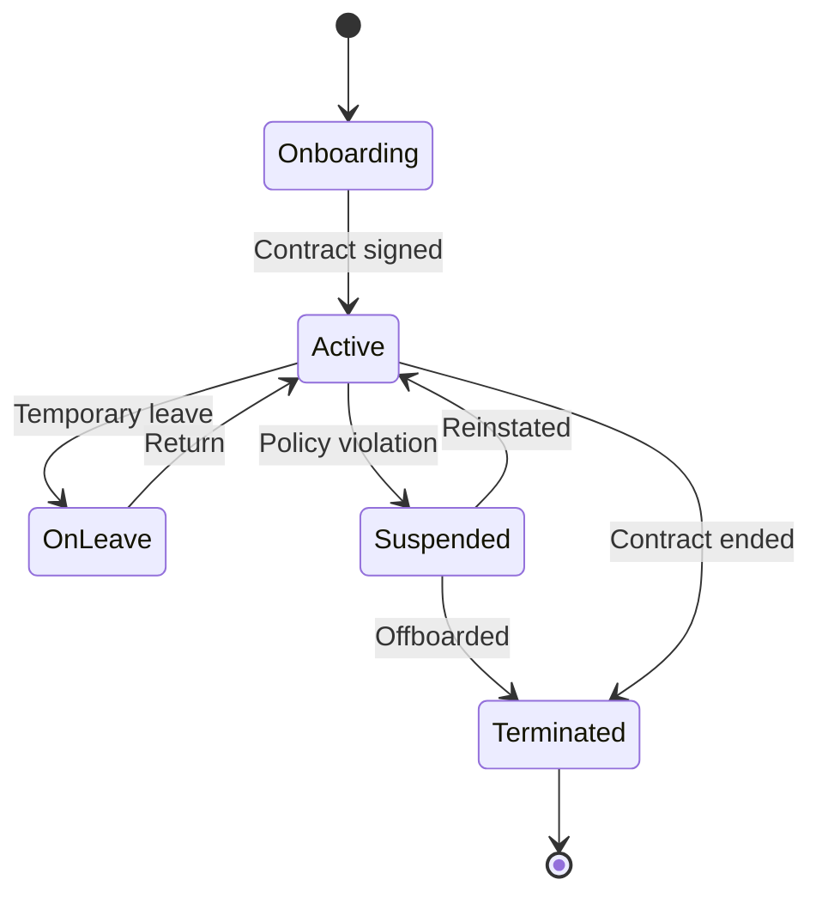

# Module 02 — Creators, Channels, Snapshots & Contracts

## 1. Scope & Data Models

Manages the digital talent roster, confidential KYC/banking details, multi-platform channels, daily audience snapshots, and representation contracts.

- [`Creator`](file:///home/diego/Proyectos/rrss-creators-analyzer/rrss_creatos_analyzer/apps/creators/models.py) (`creators_creator`): Public profile, unique `handle`, `slug`, `tier`, `primary_platform`, `status`, and optional linked `User`.
- [`CreatorPersonalInfo`](file:///home/diego/Proyectos/rrss-creators-analyzer/rrss_creatos_analyzer/apps/creators/models.py) (`creators_creatorpersonalinfo`): Restricted 1:1 KYC record (legal name, tax ID, address, payout banking info, emergency contact).
- [`Channel`](file:///home/diego/Proyectos/rrss-creators-analyzer/rrss_creatos_analyzer/apps/creators/models.py) (`creators_channel`): Platform channels (`Twitch`, `YouTube`, `Kick`, `TikTok`, `Instagram`, `X`) with `channel_id`, URL, and status.
- [`ChannelSnapshot`](file:///home/diego/Proyectos/rrss-creators-analyzer/rrss_creatos_analyzer/apps/creators/models.py) (`creators_channel_snapshot`): Daily time-series of followers/subscribers, cumulative views, and video counts.
- [`Contract`](file:///home/diego/Proyectos/rrss-creators-analyzer/rrss_creatos_analyzer/apps/contracts/models.py) (`creators_contract`): Representation term, `monthly_retainer`, agency/creator revenue splits (streams, videos, sponsors), and monthly quotas.

---

## 2. Business Rules (`RN-CRE`)

- **RN-CRE-001 (Unique Handle & Slug)**: `handle` is unique (without leading `@`); `SluggedModelMixin` generates a normalized `slug`.
- **RN-CRE-002 (Creator Tiers)**: `rookie` (<25k followers), `standard` (25k–100k), `partner` (>100k), `elite` (>5k avg CCV), `ambassador` (flagship talent).
- **RN-CRE-003 (KYC Confidentiality)**: Only `Company Admin` and `Finance` may view/edit `CreatorPersonalInfo`; all accesses are audited.
- **RN-CRE-004 (Unique Channel Identity)**: `(platform, channel_id)` cannot be duplicated. Multiple channels per platform are allowed with distinct IDs.
- **RN-CRE-005 (Daily Snapshot Upsert)**: Maximum one `ChannelSnapshot` per `(channel, snapshot_date)`; subsequent runs update the existing row and compute daily net growth.
- **RN-CRE-006 (Single Active Contract)**: A creator may have at most one `active` contract with non-overlapping date ranges.
- **RN-CRE-007 (Date Consistency)**: `end_date > start_date` unless open-ended (`end_date = None`).
- **RN-CRE-008 (Revenue Splits)**: Agency splits (`agency_stream_split_pct`, `agency_video_split_pct`, `agency_sponsor_split_pct`) range from `0.00` to `100.00`; creator share equals `100.00 - agency_split`.
- **RN-CRE-009 (Monthly Quotas)**: Contracts specify `monthly_stream_hours_quota`, `monthly_videos_quota`, and `monthly_shorts_quota`.
- **RN-CRE-010 (Monthly Retainer & Recoupment)**: Guaranteed `monthly_retainer` advances may recoup against gross earnings in subsequent periods when specified.

---

## 3. Use Cases

- **CU-CRE-01 — Onboard Creator (`ACT-MGR`, `ACT-ADM`)**: Registers creator profile (`onboarding`), optionally links `User`, captures KYC, and links channels (supported via `SessionWizardView`).
- **CU-CRE-02 — Manage KYC & Banking Info (`ACT-FIN`, `ACT-ADM`)**: Verifies `Company Admin`/`Finance` permission, saves `CreatorPersonalInfo`, logs `SENSITIVE_DATA_ACCESS`.
- **CU-CRE-03 — Link Social Channels (`ACT-MGR`, `ACT-ANA`)**: Validates uniqueness (`RN-CRE-004`) and activates channel tracking.
- **CU-CRE-04 — Record Daily Channel Snapshot (`Celery` / `ACT-ANA`)**: Upserts `(channel, snapshot_date)` metrics and computes net delta.
- **CU-CRE-05 — Draft Contract (`ACT-ADM`, `ACT-MGR`)**: Creates `draft` contract validating `RN-CRE-007` and `RN-CRE-008`.
- **CU-CRE-06 — Activate Contract (`ACT-FIN`, `ACT-ADM`)**: Ensures no overlapping `active` contract (`RN-CRE-006`), marks prior expiring contract `renewed` if applicable, sets `active`, and moves `onboarding` creator to `active`.
- **CU-CRE-07 — Terminate Contract Early (`ACT-ADM`)**: Sets `status = terminated`, updates `end_date`, transitions creator if no active contracts remain, and notifies Finance.
- **CU-CRE-08 — 360° Creator Profile View (`ACT-MGR`, `ACT-ANA`, `ACT-ADM`)**: Consolidates roster profile, active contract quota progress, audience trend charts, recent streams/videos, and channel alerts.

---

## 4. State Machines

