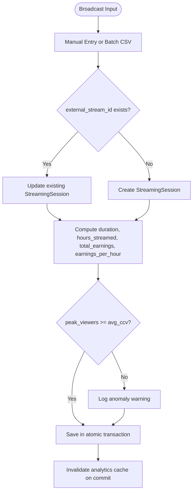

# Module 03 — Live Streaming Sessions & Broadcasts

## 1. Scope & Data Models

Captures, validates, and analyzes live broadcasts (`Twitch`, `YouTube Live`, `Kick`, `TikTok`), including audience metrics, category segmentation, and direct monetization.

- [`StreamingSession`](file:///home/diego/Proyectos/rrss-creators-analyzer/rrss_creatos_analyzer/apps/streams/models.py) (`streams_streaming_session`): Broadcast record with duration, `hours_streamed`, `avg_ccv`, `peak_viewers`, chat activity, new followers, and itemized revenue.
- [`SessionSegment`](file:///home/diego/Proyectos/rrss-creators-analyzer/rrss_creatos_analyzer/apps/streams/models.py) (`streams_session_segment`): Chronological game/category breakdown within a broadcast.

---

## 2. Business Rules (`RN-STR`)

- **RN-STR-001 (Broadcast Deduplication)**: Sessions are uniquely identified by `(platform, external_stream_id)` (or `(channel, streamed_at)`); re-ingestion performs an upsert.
- **RN-STR-002 (Hours Streamed)**: Stored in integer `duration_seconds` and derived via `GeneratedField`:

  $$\text{hours\_streamed} = \frac{\text{duration\_seconds}}{3600.0}$$

- **RN-STR-003 (Total Earnings)**: Non-negative sum of all stream revenue lines:

  $$\text{total\_earnings} = \text{ad\_revenue} + \text{subs\_revenue} + \text{donations\_revenue} + \text{bits\_or\_gifts\_revenue} + \text{sponsorship\_revenue}$$

- **RN-STR-004 (Earnings per Hour)**:

  $$\text{earnings\_per\_hour} = \begin{cases} \frac{\text{total\_earnings}}{\text{hours\_streamed}} & \text{if } \text{hours\_streamed} > 0 \\ 0.00 & \text{if } \text{hours\_streamed} = 0 \end{cases}$$

- **RN-STR-005 (Audience Consistency)**: $\text{peak\_viewers} \ge \text{avg\_ccv} \ge 0$.
- **RN-STR-006 (Segment Time Bounds)**: $\sum \text{segment.duration\_seconds} \le \text{session.duration\_seconds}$, within `[streamed_at, ended_at]`.
- **RN-STR-007 (Sponsored Streams)**: `is_sponsored = True` requires `sponsorship_revenue` and optional linkage to `CampaignDeliverable`.
- **RN-STR-008 (Monthly Hour Quotas)**: Monthly `hours_streamed` counts toward `Contract.monthly_stream_hours_quota`.

---

## 3. Use Cases

- **CU-STR-01 — Log Session Manually (`ACT-MGR`, `ACT-TAL`)**: Records session metadata, audience, and revenue; validates non-negativity and computes derived fields.
- **CU-STR-02 — Bulk Import Sessions (`ACT-ANA`)**: Queues CSV/XLSX import batch via Celery, performs idempotent upserts (`RN-STR-001`), and links `ImportBatch`.
- **CU-STR-03 — Add Category Segments (`ACT-MGR`, `ACT-ANA`)**: Splits a broadcast into category/game segments validating `RN-STR-006`.
- **CU-STR-04 — Reconcile Sponsored Stream (`ACT-MGR`, `ACT-FIN`)**: Marks `is_sponsored = True`, sets `sponsorship_revenue`, and links `CampaignDeliverable`.
- **CU-STR-05 — Compare Category Performance (`ACT-ANA`, `ACT-MGR`)**: Aggregates hours, avg CCV, peak viewers, and revenue by game/category and platform.
- **CU-STR-06 — Derive Video/Clip from Stream (`ACT-EDT`, `ACT-MGR`)**: Creates a `Video` linked via `VideoRelation` (`derived_from_live` / `clip`).

---

## 4. Workflow

