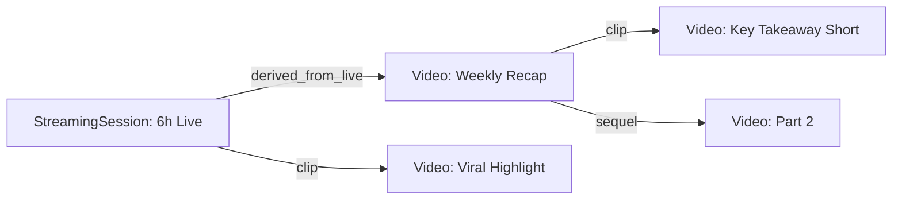

# Module 04 — Videos, Publications & Content Relations

## 1. Scope & Data Models

Manages on-demand video production (`VOD`, long-form, `Shorts`, `Reels`, `TikToks`), multi-platform distribution, and profitability (`Net Profit`, `ROI`, `RPM`).

- [`Video`](file:///home/diego/Proyectos/rrss-creators-analyzer/rrss_creatos_analyzer/apps/videos/models.py) (`videos_video`): Master creative asset, editorial status, tags (`django-taggit`), and production/editing/thumbnail costs.
- [`VideoPublication`](file:///home/diego/Proyectos/rrss-creators-analyzer/rrss_creatos_analyzer/apps/videos/models.py) (`videos_videopublication`): Channel-specific release capturing views, impressions, CTR, retention, engagement, and estimated revenue.
- [`VideoRelation`](file:///home/diego/Proyectos/rrss-creators-analyzer/rrss_creatos_analyzer/apps/videos/models.py) (`videos_videorelation`): Acyclic lineage linking videos to parent videos or origin `StreamingSession`s.

---

## 2. Business Rules (`RN-VID`)

- **RN-VID-001 (Three-Entity Separation)**: Production costs live on `Video`; distribution metrics and revenue live on `VideoPublication`.
- **RN-VID-002 (Editorial Pipeline)**: `idea -> scripting -> recording -> editing -> review -> ready -> published` (plus `archived`). Transition to `published` requires at least one published `VideoPublication`.
- **RN-VID-003 (Total Production Cost)**:

  $$\text{total\_production\_cost} = \text{production\_cost} + \text{editing\_cost} + \text{thumbnail\_cost}$$

- **RN-VID-004 (Net Profit)**: $\text{net\_profit} = \text{estimated\_revenue} - \text{video.total\_production\_cost}$.
- **RN-VID-005 (ROI %)**:

  $$\text{ROI (\%)} = \begin{cases} \left(\frac{\text{estimated\_revenue} - \text{total\_production\_cost}}{\text{total\_production\_cost}}\right) \times 100.0 & \text{if } \text{total\_production\_cost} > 0 \\ \text{N/A} & \text{if } \text{total\_production\_cost} = 0 \end{cases}$$

- **RN-VID-006 (Estimated RPM)**:

  $$\text{rpm\_estimated} = \begin{cases} \left(\frac{\text{estimated\_revenue}}{\text{views\_count}}\right) \times 1000.0 & \text{if } \text{views\_count} > 0 \\ 0.00 & \text{if } \text{views\_count} = 0 \end{cases}$$

- **RN-VID-007 (Engagement Rate %)**: $\frac{\text{likes} + \text{comments} + \text{shares} + \text{saves}}{\text{views\_count}} \times 100.0$ (when `views_count > 0`).
- **RN-VID-008 (Relation Integrity)**: `source_video != target_video`, must reference either `target_video` or `target_session`, unique `(source_video, target_video, relation_type)`.
- **RN-VID-009 (Monthly Quotas)**: Published releases count toward `monthly_videos_quota` (long-form) or `monthly_shorts_quota` (vertical formats).

---

## 3. Use Cases

- **CU-VID-01 — Create Video Project (`ACT-MGR`, `ACT-TAL`, `ACT-EDT`)**: Initializes `Video` in `idea` with format, target release date, and tags.
- **CU-VID-02 — Track Production Costs (`ACT-FIN`, `ACT-MGR`)**: Updates `production_cost` and `thumbnail_cost`, recalculates `total_production_cost` and break-even view threshold.
- **CU-VID-03 — Advance Production Stage (`ACT-MGR`, `ACT-TAL`, `ACT-EDT`)**: Transitions status across editorial stages.
- **CU-VID-04 — Register Channel Publication (`ACT-MGR`, `ACT-TAL`)**: Creates `VideoPublication` (`scheduled`/`published`) and transitions parent `Video` from `ready` to `published`.
- **CU-VID-05 — Update Publication Metrics (`Celery` / `ACT-ANA`)**: Updates views, retention, and revenue; recomputes `rpm_estimated`, `engagement_rate`, net profit, and ROI.
- **CU-VID-06 — Link Content Lineage (`ACT-EDT`, `ACT-MGR`)**: Creates `VideoRelation` (`derived_from_live`, `clip`, `continuation`, `spin_off`) enforcing `RN-VID-008`.
- **CU-VID-07 — Audit Profitability & ROI (`ACT-FIN`, `ACT-ANA`)**: Filters videos by creator/format/period into profitable, break-even, and deficit buckets.

---

## 4. Workflow

