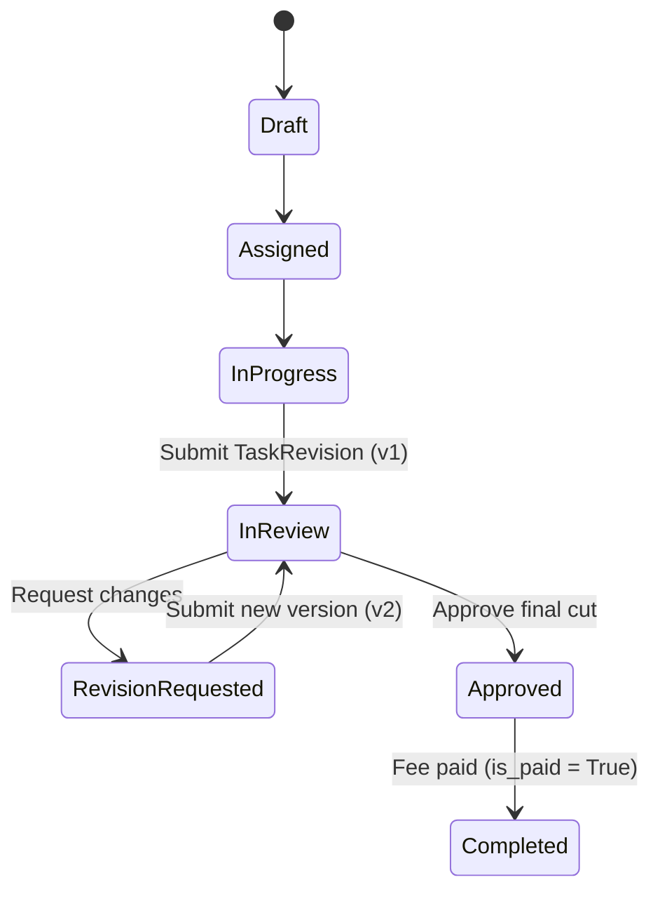

# Module 05 — Editors, Assignments & Post-Production Tasks

## 1. Scope & Data Models

Manages post-production staff and agencies (video editors, thumbnail designers, colorists), creator rate agreements, task deadlines, iterative cut revisions, and cost allocation into `Video`.

- [`Editor`](file:///home/diego/Proyectos/rrss-creators-analyzer/rrss_creatos_analyzer/apps/editors/models.py) (`editors_editor`): Editor/studio profile, unique `handle`, `slug`, specialty, base rate model, contact handles, and optional linked `User`.
- [`EditorAssignment`](file:///home/diego/Proyectos/rrss-creators-analyzer/rrss_creatos_analyzer/apps/editors/models.py) (`editors_editorassignment`): Creator-editor engagement with role (`lead_editor`, `shorts_editor`, `thumbnail_designer`), negotiated rates, and `is_primary` flag.
- [`EditingTask`](file:///home/diego/Proyectos/rrss-creators-analyzer/rrss_creatos_analyzer/apps/editors/models.py) (`editors_editingtask`): Task linked to a `Video` with priority, `deadline`, `agreed_cost`, payment flag (`is_paid`), and workflow status.
- [`TaskRevision`](file:///home/diego/Proyectos/rrss-creators-analyzer/rrss_creatos_analyzer/apps/editors/models.py) (`editors_taskrevision`): Sequential cut versions (`v1`, `v2`, ...) with cloud preview URLs, time-coded notes, and review verdict.

---

## 2. Business Rules (`RN-EDT`)

- **RN-EDT-001 (Editor Identity)**: Unique `handle` and auto-generated `slug`; optional `User` link restricts portal access to assigned tasks (`RN-SEC-004`).
- **RN-EDT-002 (Agreed Rate Precedence)**: Active `EditorAssignment` rates (`agreed_video_rate`, `agreed_short_rate`) override catalog defaults when initializing `EditingTask.agreed_cost`.
- **RN-EDT-003 (Single Primary per Role)**: Only one active `is_primary = True` assignment may exist per `(creator, role)`; marking a new primary clears the previous one.
- **RN-EDT-004 (Task State Machine)**: `draft -> assigned -> in_progress -> in_review -> approved -> completed` (with `revision_requested` loop and `cancelled`). Moving to `in_review` requires at least one `TaskRevision` with a preview URL.
- **RN-EDT-005 (Sequential Revisions)**: Each submission increments `version_number`. A new revision cannot be uploaded while an earlier revision is `pending_review`.
- **RN-EDT-006 (Automatic Video Cost Allocation)**: Approving an `EditingTask` sets `approved_at = now()`, allocates `agreed_cost` to `Video.editing_cost` (or `thumbnail_cost`), and recomputes `Video.total_production_cost`.
- **RN-EDT-007 (Editor Settlement)**: `is_paid = True` (with `paid_at = now()`) is allowed only on `approved` or `completed` tasks.
- **RN-EDT-008 (Overdue Detection)**: Tasks past `deadline` not in `in_review`, `approved`, or `completed` are flagged overdue.

---

## 3. Use Cases

- **CU-EDT-01 — Register Editor (`ACT-MGR`, `ACT-ADM`)**: Creates editor/studio record with specialty, base rates, and optional `User`.
- **CU-EDT-02 — Assign Editor to Creator (`ACT-MGR`)**: Creates `EditorAssignment` with negotiated rates and `is_primary` check (`RN-EDT-003`).
- **CU-EDT-03 — Create Editing Task (`ACT-MGR`, `ACT-TAL`)**: Links task to `Video`, preloads `agreed_cost` (`RN-EDT-002`), sets `deadline`, and assigns editor.
- **CU-EDT-04 — Submit Cut Revision (`ACT-EDT`)**: Moves task to `in_progress` -> `in_review` and creates `TaskRevision` (`pending_review`).
- **CU-EDT-05 — Request Timestamped Changes (`ACT-MGR`, `ACT-TAL`)**: Marks revision `changes_requested` and task `revision_requested` with structured time-coded notes.
- **CU-EDT-06 — Approve Task & Allocate Cost (`ACT-MGR`, `ACT-TAL`)**: Approves revision and task, updates `Video.editing_cost`/`total_production_cost` (`RN-EDT-006`), and moves `Video` to `ready`.
- **CU-EDT-07 — Settle Editor Fees (`ACT-FIN`)**: Marks approved tasks `is_paid = True`, `paid_at = now()`, and `status = completed`.

---

## 4. Workflow

