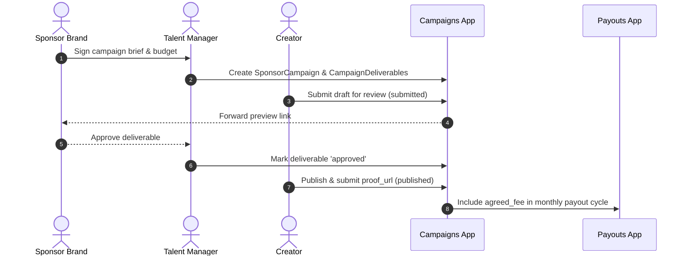

# Module 06 — Sponsor Campaigns & Deliverables

## 1. Scope & Data Models

Manages commercial brand partnerships, campaign budgets, creator deliverables, proof-of-publication verification, and sponsorship revenue routing to monthly payouts.

- [`SponsorCampaign`](file:///home/diego/Proyectos/rrss-creators-analyzer/rrss_creatos_analyzer/apps/campaigns/models.py) (`campaigns_sponsorcampaign`): Brand/advertiser record, `total_budget`, currency, campaign dates, brief, and `CampaignStatus`.
- [`CampaignDeliverable`](file:///home/diego/Proyectos/rrss-creators-analyzer/rrss_creatos_analyzer/apps/campaigns/models.py) (`campaigns_campaigndeliverable`): Creator-specific deliverable (`DeliverableType`), `agreed_fee`, `due_date`, `proof_url`, reach metrics, and `DeliverableStatus`.

---

## 2. Business Rules (`RN-CAM`)

- **RN-CAM-001 (Date Bounds)**: `campaign.end_date >= campaign.start_date`, and every deliverable's `due_date` must fall within `[campaign.start_date, campaign.end_date]`.
- **RN-CAM-002 (Budget Cap)**: $\sum \text{deliverable.agreed\_fee} \le \text{campaign.total\_budget}$ unless explicitly overridden by Finance. Agency gross margin equals `total_budget - sum(agreed_fee)`.
- **RN-CAM-003 (Deliverable Types)**: `sponsored_stream`, `dedicated_video`, `integrated_ad_read`, `short_or_reel`, `social_post`.
- **RN-CAM-004 (Deliverable State Machine)**: `pending -> in_progress -> submitted -> approved -> published` (or `rejected`). Advancing to `published` requires prior `approved` status and a valid `proof_url`.
- **RN-CAM-005 (Proof of Publication)**: Completion requires an accessible `proof_url` and `published_at` timestamp.
- **RN-CAM-006 (Payout Routing)**: Published deliverables feed `agreed_fee` into the creator's monthly `CreatorPayout` (`gross_sponsorship_revenue`), applying `Contract.agency_sponsor_split_pct`.

---

## 3. Use Cases

- **CU-CAM-01 — Create Campaign (`ACT-MGR`, `ACT-FIN`)**: Records sponsor, budget, dates (`RN-CAM-001`), and creative brief (supported via `SessionWizardView`).
- **CU-CAM-02 — Assign Deliverables (`ACT-MGR`)**: Selects creators, deliverable types, due dates, and fees within remaining budget (`RN-CAM-002`).
- **CU-CAM-03 — Submit Draft for Brand Review (`ACT-MGR`, `ACT-TAL`)**: Attaches unlisted review link and moves deliverable to `submitted`.
- **CU-CAM-04 — Record Brand Verdict (`ACT-MGR`)**: Marks deliverable `approved` or `rejected`/`in_progress` with sponsor feedback.
- **CU-CAM-05 — Publish & Attach Proof URL (`ACT-TAL`, `ACT-MGR`)**: Saves `proof_url`, `published_at`, optional `VideoPublication`/`StreamingSession` link, and moves status to `published`.
- **CU-CAM-06 — Audit & Close Campaign (`ACT-ANA`, `ACT-FIN`)**: Compiles impressions/views/clicks report and moves campaign to `completed` / `invoiced`.

---

## 4. Workflow

