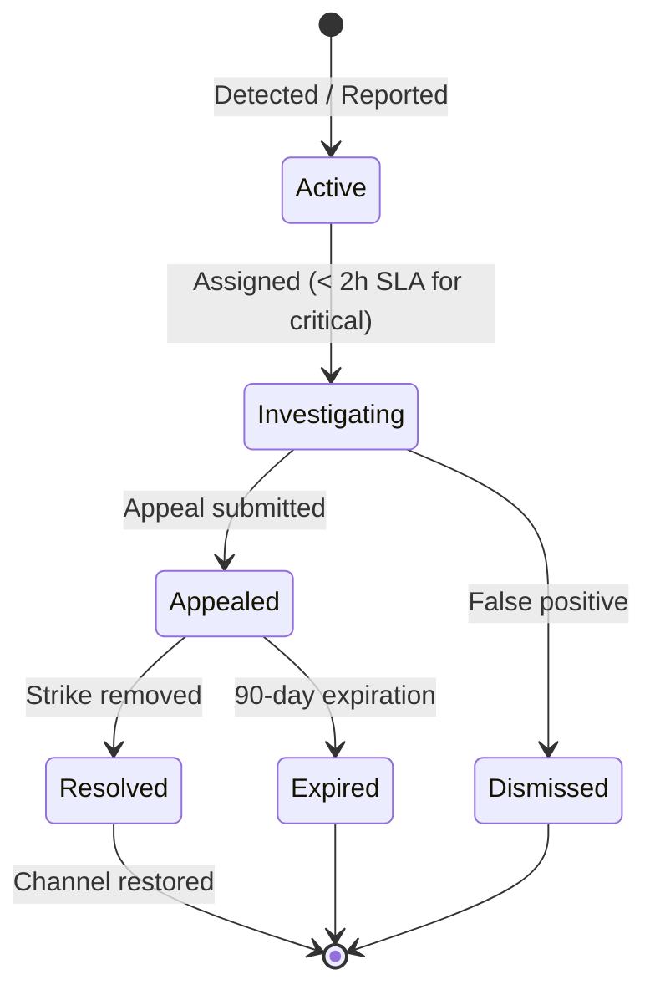

# Module 07 — Alerts, Strikes & Channel Health

## 1. Scope & Data Models

Monitors legal, platform-policy, and operational anomalies across creator channels (DMCA strikes, Content ID claims, ToS warnings, sudden CCV drops, suspected bot traffic, and missed quotas).

- [`ChannelAlert`](file:///home/diego/Proyectos/rrss-creators-analyzer/rrss_creatos_analyzer/apps/alerts/models.py) (`alerts_channelalert`): Alert record with `AlertType`, `AlertSeverity`, `strike_points`, `AlertStatus`, `resolution_notes`, `assigned_to`, and optional links to `StreamingSession` / `VideoPublication`.

---

## 2. Business Rules (`RN-ALT`)

- **RN-ALT-001 (Alert Classification)**: `dmca_strike`, `copyright_claim`, `tos_violation`, `community_guideline_strike`, `demonetization`, `temporary_ban`, `unusual_ccv_drop`, `suspicious_bot_traffic`, `quota_missed`.
- **RN-ALT-002 (Severity & SLAs)**:
  - `critical` (< 2h SLA): DMCA strikes, temporary bans, full demonetization.
  - `warning` (< 24h SLA): Copyright claims, CCV drops, bot anomalies, missed quotas.
  - `info` (< 72h SLA): Minor VOD mutes or informational notices.
- **RN-ALT-003 (Strike Accumulation)**: Active DMCA/community strikes accumulate `strike_points`. Reaching **2 active points** triggers a high-risk escalation warning before platform termination at 3 strikes.
- **RN-ALT-004 (Alert Lifecycle)**: `active -> investigating -> appealed -> resolved` (or `dismissed` / `expired` after 90 days). Moving to `resolved` or `dismissed` requires `resolution_notes`.
- **RN-ALT-005 (Channel Status Sync)**: `temporary_ban` sets `Channel.status = suspended`; `demonetization` sets `Channel.status = demonetized`; favorable resolution restores `Channel.status = active`.

---

## 3. Use Cases

- **CU-ALT-01 — Emit Channel Alert (`System` / `ACT-MGR`)**: Creates `ChannelAlert`, updates `Channel.status` on critical incidents (`RN-ALT-005`), and notifies assigned team members.
- **CU-ALT-02 — Assign & Investigate (`ACT-MGR`, `ACT-ADM`)**: Assigns owner, transitions to `investigating`, and logs incident evidence.
- **CU-ALT-03 — Submit Appeal / Counter-Notice (`ACT-MGR`, `Legal`)**: Moves alert to `appealed` with platform ticket ID and response deadline.
- **CU-ALT-04 — Resolve or Dismiss Alert (`ACT-MGR`, `ACT-ADM`)**: Records mandatory `resolution_notes`, sets `resolved_at = now()`, deducts annulled strike points, and restores channel status (`RN-ALT-005`).
- **CU-ALT-05 — Detect CCV Drop (`Celery` / `ACT-ANA`)**: Compares session `avg_ccv` against 30-day rolling category average and emits `unusual_ccv_drop` when drop exceeds threshold.

---

## 4. State Machine

