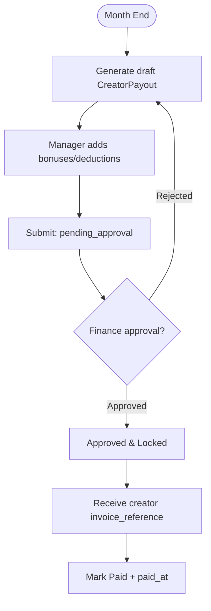

# Module 08 — Financial Settlements & Creator Payouts

## 1. Scope & Data Models

Manages monthly creator financial reconciliation: consolidating stream, video, and sponsorship revenue, applying contractual agency splits, adding retainers/bonuses, subtracting recoupment/deductions, and enforcing dual approval prior to payment.

- [`CreatorPayout`](file:///home/diego/Proyectos/rrss-creators-analyzer/rrss_creatos_analyzer/apps/payouts/models.py) (`payouts_creatorpayout`): Monthly settlement record per creator (`period_year`, `period_month`), itemized gross revenues, `agency_commission_amount`, `net_creator_payout`, `invoice_reference`, and `PayoutStatus`.
- Integrated sources: [`Contract`](file:///home/diego/Proyectos/rrss-creators-analyzer/rrss_creatos_analyzer/apps/contracts/models.py), [`StreamingSession`](file:///home/diego/Proyectos/rrss-creators-analyzer/rrss_creatos_analyzer/apps/streams/models.py), [`VideoPublication`](file:///home/diego/Proyectos/rrss-creators-analyzer/rrss_creatos_analyzer/apps/videos/models.py), [`CampaignDeliverable`](file:///home/diego/Proyectos/rrss-creators-analyzer/rrss_creatos_analyzer/apps/campaigns/models.py).

---

## 2. Business Rules (`RN-PAY`)

- **RN-PAY-001 (Monthly Period Uniqueness)**: At most one `CreatorPayout` per `(creator, period_year, period_month)`.
- **RN-PAY-002 (Settlement Formula)**:
  1. Aggregate `gross_stream_revenue`, `gross_video_revenue`, and `gross_sponsorship_revenue` for the period.
  2. Agency commission:

     $$\text{agency\_commission} = \left(\text{gross\_stream} \times \frac{\text{split\_stream}}{100}\right) + \left(\text{gross\_video} \times \frac{\text{split\_video}}{100}\right) + \left(\text{gross\_sponsor} \times \frac{\text{split\_sponsor}}{100}\right)$$

  3. Net creator payout:

     $$\text{net\_creator\_payout} = (\text{gross\_total} - \text{agency\_commission}) + \text{base\_retainer} + \text{bonuses} - \text{deductions\_or\_recoupment}$$

- **RN-PAY-003 (Non-Negative Payout & Recoupment Rollover)**: `net_creator_payout >= 0.00`. If deductions exceed earnings, payout settles at `0.00` and remaining debt rolls over to the next cycle.
- **RN-PAY-004 (Dual Approval Workflow)**: `draft -> pending_approval -> approved -> paid` (plus `disputed`, `cancelled`). Only `Finance` (`ACT-FIN`) or `Company Admin` (`ACT-ADM`) can transition to `approved`.
- **RN-PAY-005 (Post-Approval Immutability)**: `approved` and `paid` payouts are locked against edits/deletions; later adjustments must be issued in a subsequent period.
- **RN-PAY-006 (Payment Prerequisites)**: Transitioning to `paid` requires `invoice_reference`, complete `CreatorPersonalInfo` banking KYC, and stamps `paid_at = now()`.

---

## 3. Use Cases

- **CU-PAY-01 — Generate Monthly Drafts (`ACT-FIN` / `Celery`)**: Aggregates monthly streams, videos, and published sponsor deliverables for active contracts and creates `draft` payouts.
- **CU-PAY-02 — Apply Adjustments (`ACT-MGR`, `ACT-FIN`)**: Adds bonuses or deductions/recoupment on `draft` payouts enforcing `RN-PAY-003`.
- **CU-PAY-03 — Submit for Financial Approval (`ACT-MGR`)**: Transitions payout to `pending_approval`.
- **CU-PAY-04 — Approve Payout (`ACT-FIN`, `ACT-ADM`)**: Validates KYC, records `approved_by`, locks record (`RN-PAY-005`).
- **CU-PAY-05 — View Creator Statement (`ACT-TAL`)**: Scoped read-only breakdown (`RN-SEC-004`) with option to mark `disputed`.
- **CU-PAY-06 — Execute Payment (`ACT-FIN`)**: Records `invoice_reference`, sets `status = paid` and `paid_at = now()`.

---

## 4. Workflow

