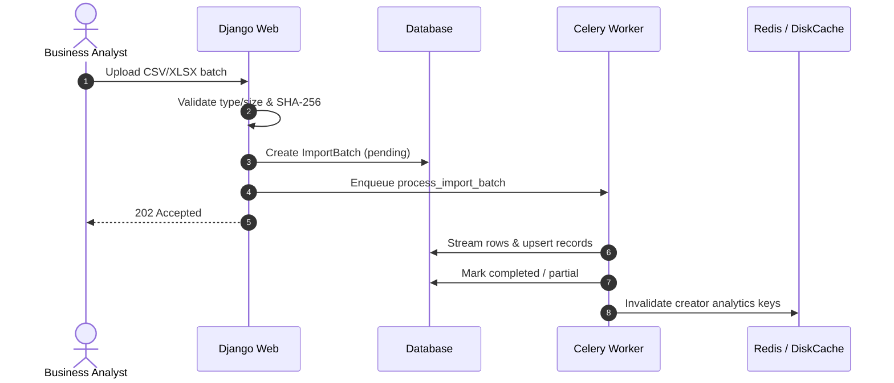

# Module 09 — Bulk Imports, Exports & Analytics Engine

## 1. Scope & Data Models

Handles asynchronous bulk data ingestion (`CSV`, `XLSX`, `JSON`), downloadable report generation, and cached analytical aggregations.

- [`ImportBatch`](file:///home/diego/Proyectos/rrss-creators-analyzer/rrss_creatos_analyzer/apps/imports/models.py) (`imports_importbatch`): Batch tracking with SHA-256 deduplication hash, row counters (`processed`/`error`), and error log.
- [`ExportJob`](file:///home/diego/Proyectos/rrss-creators-analyzer/rrss_creatos_analyzer/apps/exports/models.py) (`exports_exportjob`): Asynchronous report job (`csv`, `xlsx`, `json`, `pdf`), secure storage path, and download TTL.
- [`AnalyticsSnapshot`](file:///home/diego/Proyectos/rrss-creators-analyzer/rrss_creatos_analyzer/apps/analytics/models.py) (`analytics_analyticssnapshot`): Precomputed creator/platform aggregations and rankings.

---

## 2. Business Rules (`RN-DAT`)

- **RN-DAT-001 (SHA-256 Import Deduplication)**: Computes SHA-256 on upload; rejects duplicate uploads matching an existing `completed` `ImportBatch`.
- **RN-DAT-002 (Async Celery Processing)**: Heavy import parsing and export compilation execute in Celery workers rather than the HTTP request thread.
- **RN-DAT-003 (Atomic Batch & Partial Error Logging)**: Invalid rows are captured in `error_log` (`partial` status) without crashing valid rows; fatal errors mark the batch `failed`.
- **RN-DAT-004 (Export File TTL)**: Generated `ExportJob` files expire after 72 hours and are purged from disk.
- **RN-DAT-005 (Cached Analytics)**: Rankings (`Window(DenseRank())`), monthly summaries, and category comparisons use `cache.get_or_set(...)` (Redis in production, DiskCache locally) with versioned keys.
- **RN-DAT-006 (Event-Driven Cache Invalidation)**: Services explicitly invalidate analytics keys via `transaction.on_commit(...)` after batch imports, payout approvals, or stream/video edits.

---

## 3. Use Cases

- **CU-DAT-01 — Upload Metric Batch (`ACT-ANA`)**: Validates file extension/size, computes SHA-256 (`RN-DAT-001`), creates `ImportBatch` (`pending`), and queues Celery task (or uses the multi-step `SessionWizardView` mapper).
- **CU-DAT-02 — Process Batch Async (`Celery`)**: Streams rows, maps channels, upserts records (`RN-STR-001`), sets `completed`/`partial`, and invalidates cache.
- **CU-DAT-03 — Rollback Import Batch (`ACT-ADM`, `ACT-ANA`)**: Deletes records linked to `import_batch_id`, marks `rolled_back`, invalidates cache, and logs audit event.
- **CU-DAT-04 — Request Custom Export (`ACT-ANA`, `ACT-FIN`, `ACT-MGR`)**: Creates `ExportJob` (`pending`) and queues file generation with CSV formula-injection sanitization.
- **CU-DAT-05 — Download Export (`Requester` / `ACT-ADM`)**: Verifies ownership, checks 72h TTL (`RN-DAT-004`), serves file via `FileResponse`, and logs audit trail.
- **CU-DAT-06 — Executive Dashboard & Rankings (`ACT-ADM`, `ACT-MGR`)**: Renders cached KPIs, revenue/CCV/hours rankings, and platform comparisons.
- **CU-DAT-07 — Manual Cache Refresh (`ACT-ADM`)**: Clears analytics cache keys and triggers recalculation.

---

## 4. Workflow

