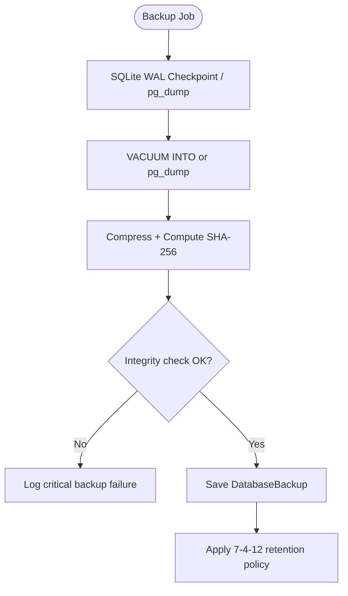

# Module 10 — Audit, Logs, Health Monitor & Backups

## 1. Scope & Data Models

Provides agency-wide configuration, forensic audit logging, application log inspection, database/cache health diagnostics, and backup management.

- [`CompanySettings`](file:///home/diego/Proyectos/rrss-creators-analyzer/rrss_creatos_analyzer/apps/core/models.py) (`core_company_settings`): Singleton agency settings (legal name, base currency, default splits, alert webhook).
- [`AuditEvent`](file:///home/diego/Proyectos/rrss-creators-analyzer/rrss_creatos_analyzer/apps/audit/models.py) / `django-auditlog`: Append-only trail of sensitive mutations (contracts, KYC, payouts, permissions).
- [`ApplicationLogEntry`](file:///home/diego/Proyectos/rrss-creators-analyzer/rrss_creatos_analyzer/apps/logs/models.py) (`logs_applicationlogentry`): Structured application log entries and exception inspection.
- [`InstanceHealthCheck`](file:///home/diego/Proyectos/rrss-creators-analyzer/rrss_creatos_analyzer/apps/monitor/models.py) (`monitor_instancehealthcheck`): Periodic DB/cache health checks (`WAL` mode/size when on SQLite, cache footprint, query latency).
- [`DatabaseBackup`](file:///home/diego/Proyectos/rrss-creators-analyzer/rrss_creatos_analyzer/apps/backups/models.py) (`backups_databasebackup`): Backup catalog with type, size, SHA-256 checksum, and integrity status.

---

## 2. Business Rules (`RN-SYS`)

- **RN-SYS-001 (Singleton CompanySettings)**: Only one `CompanySettings` configuration is active at a time; split changes do not retroactively alter approved contracts or payouts.
- **RN-SYS-002 (Append-Only Audit Trail)**: Audit records cannot be edited or deleted via UI or standard services (aside from automated demo retention purges).
- **RN-SYS-003 (SQLite WAL Thresholds — Local/SQLite Mode)**: When running on SQLite, monitor `journal_mode=WAL` and trigger `PRAGMA wal_checkpoint(TRUNCATE)` if WAL exceeds 50 MB.
- **RN-SYS-004 (Cache Footprint)**: Monitor cache storage usage and evict stale entries when thresholds are exceeded.
- **RN-SYS-005 (Online Backups)**: SQLite backups must use `VACUUM INTO` / `sqlite3_backup` (never raw `cp` while active); PostgreSQL backups use `pg_dump`.
- **RN-SYS-006 (Backup Retention 7-4-12)**: Retain 7 daily, 4 weekly, and 12 monthly scheduled backups.
- **RN-SYS-007 (Restricted Access)**: Audit, logs, monitor, and backup views are restricted to `Company Admin` (`ACT-ADM`) and `System Auditor` (`ACT-AUD`), and disabled/read-only in public demo mode.

---

## 3. Use Cases

- **CU-SYS-01 — Configure Company Settings (`ACT-ADM`)**: Updates agency name, currency, and default splits (`CompanySettings`).
- **CU-SYS-02 — Inspect Forensic Audit Log (`ACT-AUD`, `ACT-ADM`)**: Filters immutable audit events by actor, model, action, and date range.
- **CU-SYS-03 — Review Application Errors (`ACT-ADM`)**: Filters `ERROR`/`CRITICAL` log entries and marks reviewed.
- **CU-SYS-04 — Run Health Diagnostics (`Celery Beat` / `ACT-ADM`)**: Checks DB latency (`SELECT 1`), SQLite WAL / cache size, and stores `InstanceHealthCheck`.
- **CU-SYS-05 — Execute Database Backup (`ACT-ADM` / `Celery`)**: Creates compressed backup, computes SHA-256, verifies integrity, and enforces retention (`RN-SYS-006`).
- **CU-SYS-06 — Verify & Download Backup (`ACT-ADM`)**: Re-verifies SHA-256 and logs high-severity audit event on download.

---

## 4. Workflow

